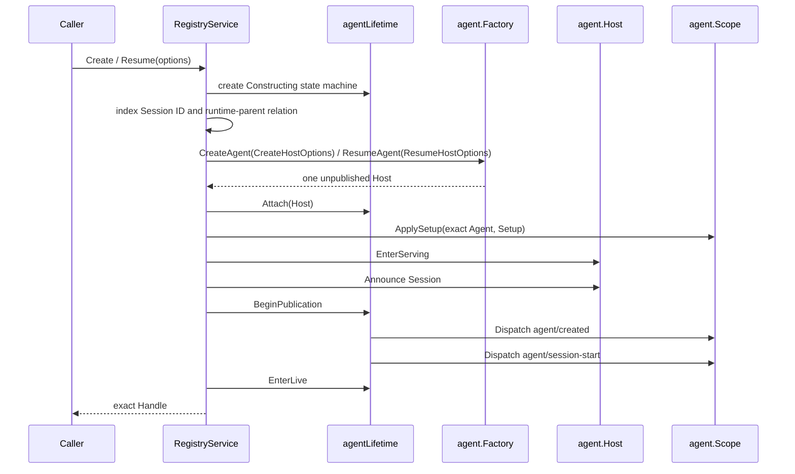

# Agent 领域

`agent/` 拥有 live Agent 的公共能力、Registry、多 Agent 运行期父子关系、Agent Scope 组合契约和组件通信事件。权威边界见[14 Agent Registry、Inbox 与实时事件模块设计](../zh-CN/14-agent-registry-inbox-and-events.md)，单 Agent 执行见[15 Agent Loop 与请求驱动模块设计](../zh-CN/15-agent-loop-and-request-driver.md)，实施证据见[08 实施进度](../zh-CN/08-implementation-progress.md)。

## 职责

| 文件前缀 | 职责 |
| --- | --- |
| `agent` | live Agent 能力与状态 |
| `factory` | Consumer-owned `Factory`、单 Agent `Host` 与创建/恢复参数 |
| `registry` | Registry 查询、Session ID 索引与模块激活；同一对象的方法文件统一使用该前缀 |
| `agent_lifetime` | 一个 exact Agent 的私有生命周期状态机、Host ownership、迁移与稳定关闭结果 |
| `registry_lifecycle` | Create/Resume 事务、Session ID 父子关系和跨 Agent child-first 关闭编排 |
| `registry_module_state` | Registry 模块的 inactive/accepting/draining 准入状态与完成信号 |
| `registry_integration_test` | RegistryPlugin、Factory provider、替换重激活与关闭排空的模块集成测试 |
| `scope`、`setup` | Plugin-neutral Agent Scope、Setup、资源与 middleware 注册边界 |
| `handle` | 绑定 exact `agentLifetime` 的关闭能力 |
| `events` | Agent 组件通信事件、Waterfall 请求和值 |
| `inbox` | 从 append-only Session log 重建并修改 durable Inbox |
| `model_selection` | 同一步 prompt/request 使用的模型选择快照 |
| `initiator`、`cancellation` | 调用链归因与 typed cancellation cause |
| `plugin` | 唯一 Agent 模块 Plugin；绑定 Factory 并发布 Registry 的窄能力 |

本包不构造 concrete Agent，不执行 Turn/Step，不持有 Plugin Runtime Scope，也不管理 Plugin child topology。`agentloop` 实现 `Factory`，但 `agent` 不反向依赖 `agentloop`。

## 创建事务

`Factory` 每次只构造一个 `Host`。`Host` 拥有一个 Agent、一个 Agent Scope 和单实例关闭；它不保存 Registry、runtime parent 或 children。

`Setup.Apply` 通过 `ScopeEditor` 安装 Tool、Prompt、Policy、Agent-local Event/Waterfall 和普通资源。具体 `scopeDraft` 由 `agentloop` 的私有 Agent Scope 实现：注册在未发布 Scope 上立即取得可撤销 Handle，commit 前执行 `ScopeCheck`；失败时逆序撤销，成功后返回只负责幂等关闭的 `ScopeResources`。Setup 和资源都不能包含 Plugin。

## Identity、map 与 ownership

Session ID 是 Agent 的唯一业务 ID。Registry 的主要索引含义是：

- `byID`：key 是 Session ID，value 是该 ID 当前未结束的私有 `agentLifetime`；
- `parentByChild`：key 是 child Session ID，value 是 runtime parent Session ID；
- `childrenByParent`：key 是 parent Session ID，value 是其当前 runtime child Session ID 集合。

这些 map 只保存 ID relation，不形成 parent/child 对象互指。`Handle` 直接绑定创建时的 `agentLifetime`，因此旧 Handle 不会按 Session ID 找到并关闭后来恢复的新 Agent。

`agentLifetime` 是独立状态机，只包含一个 `agentLifetimeState`：`Constructing → Attached → Publishing → Starting → Live`，关闭分支为 `ClosingUnpublished`、`ClosingPublishing`、`ClosingPublished → Retired → Closed`。这些 closing 状态显式表达 `agent/created` 是否正在派发、是否必须配对 `agent/disposed`，不再用 `phase + publicationPhase + descendantAdmission` 拼接出隐式组合。全部状态和 close admission 常量的语义见 `agent_lifetime.go` 注释。

状态、互斥、事件派发计数、迁移准入、完成信号和稳定关闭结果只由 `agentLifetime` 解释。Registry 不读取其私有字段，只调用 `Attach`、`BeginPublication`、`CompleteCreatedEvent`、`EnterLive`、`BeginClose`、`BeginRetirement`、`EnterClosed` 和派发行为。Registry 只拥有 `map[SessionID]*agentLifetime`、Session ID 父子索引与跨生命周期 child-first 编排。`Closed` 后 lifetime 立即从索引删除；同一 Session ID 可再次 Create 或 Resume，旧 Handle 只 join 旧 lifetime 的稳定结果。

## 事件边界

`AgentEvent` 是进程内组件通信事实，不是 Session event，也不写入 Session log。普通事件只在 exact Agent live 时派发；Agent 进入 closing 后，仅实现 `AgentClosingEvent` 的终止通知可以继续派发，直到 Scope 真正关闭。当前 `subagent.Ended` 使用该边界，使 child 关闭期间仍能向正在关闭的 parent 发布配对结束事实。

Agent-local observer 先执行，随后由 AgentLoop 的全局 Plugin gateway 接入 Plugin Runtime Event。Waterfall 顺序相反：全局 middleware 包裹 local middleware，再调用 RLA terminal action。

## 关闭

`Handle.Dispose` 先调用 exact lifetime 的 `BeginClose`，再由 Registry 等待已接纳构造、按 Session ID relation child-first 关闭后代；lifetime 决定是否发布 `agent/disposed` 并关闭自己拥有的 Host。Host 是 Scope 的唯一 owner，按 RLA、Session membership、Scope 的顺序完成清理；Registry 不重复关闭 Scope。任一 child 关闭失败不会跳过其他 child 或 parent；重复关闭返回同一稳定结果。事件回调发起同树关闭时只登记关闭请求，由独立关闭事务在同步派发返回后继续，避免 callback 与 child-first join 互等。

Agent 核心只有一个 `RegistryPlugin`。它依赖 AgentLoop 提供的 `Factory`；每次 `Apply` 激活 Registry 并建立新的排空信号，每次 `Dispose` 关闭构造准入、child-first join 全部活动生命周期后回到 inactive。依赖替换可以再次激活同一 Registry Service，但不会恢复旧 Agent。Plugin Runtime 本身不拥有单个 Agent 的生命周期。
