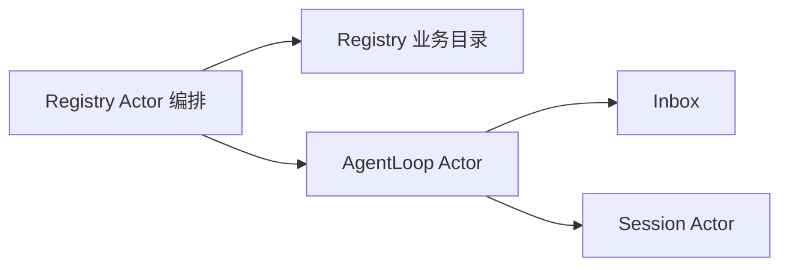

# Agent 业务模块

Agent 负责身份、父子关系、Inbox 与业务契约，设计见 [Agent 模块](../zh-CN/actor-design/32-agent-module.md)及 [Inbox](../zh-CN/actor-design/27-agent-inbox-module.md)。先完成本包，再迁移 AgentLoop 编排。

| 对象 / 文件 | 职责 |
| --- | --- |
| Registry / registry.go | Agent 身份和不可变父子关系，不持有运行对象 |
| Inbox / inbox.go | 持久化待处理消息的 Prepare / Apply 与恢复 |
| ConsumedWork / consumed_work.go | 从日志归纳已消费的输入 |
| initiator.go | 调用链中的 Agent ID 归因与显式清除 |
| cancellation.go | 取消原因和保留 Inbox 的业务意图 |
| ResolveModelSelection / model_selection.go | 从显式选择、日志和默认值确定模型，不持有回调或运行状态 |
| notices.go / decisions.go | 身份与事实通知，以及有返回结果的决策输入输出 |
| agent.go | 状态与只读 Inbox 契约；不返回可执行的 Agent 对象 |
| Options / options.go | Agent 配置值、校验及独立复制，不负责厂商参数规则 |

旧 RegistryPlugin、Factory、Host、Handle、Scope、Setup 和 Registry 并发关闭实现已删除。当前 Registry 管理身份、生命周期、组件就绪依赖和资源责任，返回分离数据，没有锁或工作队列。[Registry Grain](./registry/README.zh-CN.md) 已实现创建、身份授权与关闭编排，纯业务目录仍不承担框架职责。

Registry.StopAdmission 永久停止本次目录实例的新注册和普通准入，保留现有成员供递归关闭及失败重试。它不运行取消、框架停止或存储 flush，也不通过清空成员表伪装关闭完成。

登记失败不修改目录；父 Agent 存在已登记子项时不能移除。BeginClose 停止自身及后代的新接纳，CheckAdmission 沿祖先关系检查；现有子项保留，无关树不受影响。关闭失败不会重新开放接纳，Remove 成功才释放业务标记。配置继承在创建子 Agent 时复制并覆盖，不由父 Agent 动态管理。Inbox 只有成功提交后才 Apply；取消和恢复均依据持久化消息事实。目录没有外部资源，无需 Close。

纯业务测试与 Registry 生命周期集成测试分别验证业务规则和实际 Actor 链路。生产 API 装配仍按实施计划推进。

`agent.Agent` 定义身份、只读 Inbox、状态及 Followup、Steer、Inject、Cancel 业务操作，由 ReactLoopAgent 直接实现。输入方法返回准入提案，完整 Session 提交确认后才改变 Inbox 与执行预约。异步提交、取消投递和 WhenIdle 属于 actor.Client；客户端不实现业务 Agent。Grain 直接持有 ReactLoopAgent，删除了仅重复其方法清单的 execution 接口。依赖方向为 actor → agentloop → agent，业务对象不导入框架。完整执行调度仍须继续接线。

Agent 只公开业务操作。执行流程钩子的输入与决策见 decisions.go，around/串行规则由 [middleware](./middleware/README.zh-CN.md) 实现，框架请求与回复由其 actor 适配层负责。Agent 不嵌入钩子执行接口，单个中间件只参与自己需要的扩展点。

`agent.Hooks` 是独立的异步发起窄接口，Agent 不嵌入它。方法返回值只报告能否发起；最终业务结果使用 agent 包的四类具名完成消息。Actor 执行器直接使用这些结果，不维护重复 DTO。注册、路由、Continue 与取消投递留在执行适配层；Hooks 发起适配器已实现，主驱动接线尚未完成。
