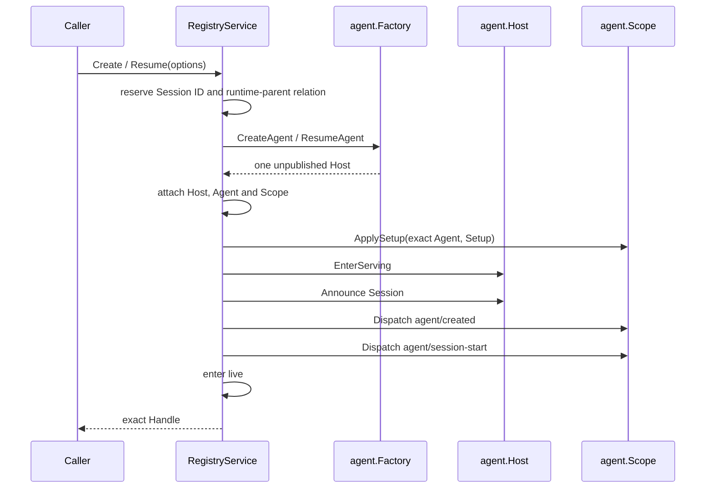

# Agent 领域

`agent/` 拥有 live Agent 的公共能力、Registry、多 Agent 运行期父子关系、Agent Scope 组合契约和组件通信事件。权威边界见[14 Agent Registry、Inbox 与实时事件模块设计](../zh-CN/14-agent-registry-inbox-and-events.md)，单 Agent 执行见[15 Agent Loop 与请求驱动模块设计](../zh-CN/15-agent-loop-and-request-driver.md)，实施证据见[08 实施进度](../zh-CN/08-implementation-progress.md)。

## 职责

| 文件前缀 | 职责 |
| --- | --- |
| `agent` | live Agent 能力与状态 |
| `factory` | Consumer-owned `Factory`、单 Agent `Host` 与创建/恢复参数 |
| `registry` | Session ID 准入、私有 `agentRecord`、运行期父子关系、发布和 child-first 关闭 |
| `scope`、`setup` | Plugin-neutral Agent Scope、Setup、资源与 middleware 注册边界 |
| `handle` | 绑定 exact `agentRecord` 的关闭能力 |
| `events` | Agent 组件通信事件、Waterfall 请求和值 |
| `inbox` | 从 append-only Session log 重建并修改 durable Inbox |
| `model_selection` | 同一步 prompt/request 使用的模型选择快照 |
| `initiator`、`cancellation` | 调用链归因与 typed cancellation cause |
| `plugin` | 唯一 Agent 模块 Plugin；绑定 Factory 并发布 Registry 的窄能力 |

本包不构造 concrete Agent，不执行 Turn/Step，不持有 Plugin Runtime Scope，也不管理 Plugin child topology。`agentloop` 实现 `Factory`，但 `agent` 不反向依赖 `agentloop`。

## 创建事务

`Factory` 每次只构造一个 `Host`。`Host` 拥有一个 Agent、一个 Agent Scope 和单实例关闭；它不保存 Registry、runtime parent 或 children。

`Setup.Apply` 通过 `ScopeEditor` 安装 Tool、Prompt、Policy、Agent-local Event/Waterfall 和普通资源。具体 `scopeDraft` 由 `agentloop` 的私有 Agent Scope 实现：注册在未发布 Scope 上立即取得可撤销 Handle，commit 前执行 `ScopeCheck`；失败时逆序撤销，成功后返回只负责幂等关闭的 `ScopeResources`。Setup 和资源都不能包含 Plugin。

## Identity、map 与 ownership

Session ID 是 Agent 的唯一业务 ID。Registry 的主要索引含义是：

- `byID`：key 是 Session ID，value 是该 ID 当前 exact 生命周期的私有 `agentRecord`；
- `parentByChild`：key 是 child Session ID，value 是 runtime parent Session ID；
- `childrenByParent`：key 是 parent Session ID，value 是其当前 runtime child Session ID 集合。

这些 map 只保存 ID relation，不形成 parent/child 对象互指。`Handle` 直接绑定创建时的 `agentRecord`，因此旧 Handle 不会按 Session ID 找到并关闭后来恢复的新 Agent。

`agentRecord` 只使用 `constructing → attached → live → closing → closed`。`publicationPhase` 单独记录 `agent/created` 是否已经开始，以保证开始发布后必有配对 `agent/disposed`。所有状态和常量的语义见 `registry_state.go` 注释。

## 事件边界

`AgentEvent` 是进程内组件通信事实，不是 Session event，也不写入 Session log。普通事件只在 exact Agent live 时派发；Agent 进入 closing 后，仅实现 `AgentClosingEvent` 的终止通知可以继续派发，直到 Scope 真正关闭。当前 `subagent.Ended` 使用该边界，使 child 关闭期间仍能向正在关闭的 parent 发布配对结束事实。

Agent-local observer 先执行，随后由 AgentLoop 的全局 Plugin gateway 接入 Plugin Runtime Event。Waterfall 顺序相反：全局 middleware 包裹 local middleware，再调用 RLA terminal action。

## 关闭

`Handle.Dispose` 进入一个幂等 close transaction：停止 descendant 准入，等待已接纳构造，按 Session ID relation child-first 关闭后代，发布 `agent/disposed`，关闭 Host，再逆序关闭 Agent Scope。任一 child 关闭失败不会跳过其他 child 或 parent；重复关闭返回同一稳定结果。

Agent 核心只有一个 `RegistryPlugin`。它依赖 AgentLoop 提供的 `Factory`；`Dispose` 先撤销 Factory 绑定，再关闭剩余 Registry records。Plugin Runtime 本身不拥有单个 Agent 的生命周期。
