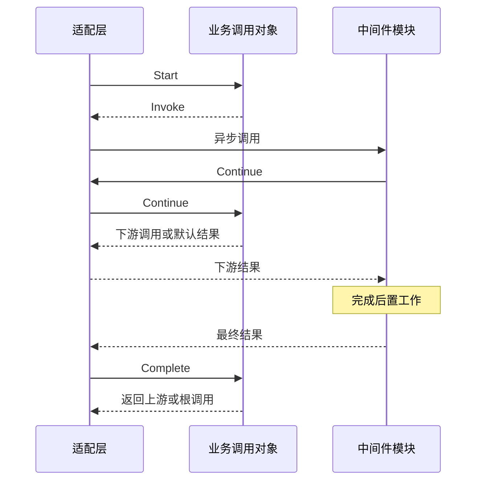

# Agent 中间件调用

本包实现 pre-step、request、request-error 的 around 调用，以及 turn-stopping 串行钩子。业务对象不依赖 GoAkt、context 或 I/O。异步适配见 [actor](./actor/README.zh-CN.md)。本次没有接入真实消费者、动态注册生命周期或 AgentLoop 主链。

需求及上下游契约由 [AgentLoop 方案](../../zh-CN/actor-design/30-agentloop-business.md) 维护；仓库实施记录入口为 [实施进度](../../zh-CN/08-implementation-progress.md)。当前包构建检查不能替代完整 AgentLoop 行为验证。

## 模块内职责

- `PreStep` 分离领取输入和默认进入结果，返回 enter/messages 或 reject。
- `Request` 传递请求配置结果，每次返回都复制可变配置数据。
- `RequestError` 保留失败事实和 RetryPolicy 副本，默认不重试；不实现退避或压缩策略。
- `chain` 仅管理固定定义顺序、单次 Continue 和下游返回关系。`positions` 的 key 是注册身份，value 是本次顺序的位置。
- `TurnStopping` 逐个等待钩子完成，遇错停止，不提供 Continue。

四个扩展点的业务输入均由 `agent` 定义，包含 `agent.TurnStoppingInput`；调用对象消费这些契约，不拥有另一份公共输入类型。

`RegistrationID` 是定义身份；CallID 和 actor 地址留在适配层。业务对象只保存注册身份，不保存模块活对象，不形成父子调用对象循环引用。共有顺序规则是包内实现，公开契约均为具名输入、结果和封闭操作接口。

## around 流程

构造时捕获输入、默认结果和顺序。`Start` 返回首个 Invoke；中间件可直接 Complete，或 Continue 一次，收到下游结果后再 Complete。没有中间件时直接返回默认结果。Return 的 To 为空表示根调用，否则表示等待下游的中间件。

## 错误、取消与生命周期

错误以 error 类型沿返回路径传递，允许上游处理。重复 Continue、未开始调用、未知注册、下游尚未完成时的上游完成，都明确报错。无效的业务决策作为该中间件失败返回上游，不统一转为模型重试。

Cancel 返回并保留第一次非空取消原因，适配层用该值通知模块，重复取消不改写原因；阻止继续启动下游，但不丢弃在途返回路径。已开始的中间件仍必须完成；取消后的最终回复携带取消原因。调用方负责把取消传给模块并等待原调用结束，不能仅取消等待就释放资源。

主业务对象的调用方必须串行执行这些方法。本包没有锁、goroutine、队列或框架回复句柄。

## 与 Agent 业务接口的关系

Agent 对外提供 Followup、Steer、Inject 等业务操作，不嵌入中间件执行接口。四个钩子是 AgentLoop 必须经过的独立执行边界，单个模块仅参与需要的钩子。空集合也有确定结果：PreStep、Request 返回默认值，RequestError 不重试，TurnStopping 正常完成。业务流程负责调用位置及结果决策，Actor 仅异步调度。当前实现不要求模块提供无用的空方法或可空 callback。

`agent.Hooks` 是独立的异步发起窄接口，Agent 不嵌入它。方法返回值只报告能否发起；最终业务结果使用 agent 包的四类具名完成消息。Actor 执行器直接使用这些结果，不维护重复 DTO。注册、路由、Continue 与取消投递留在执行适配层；Hooks 发起适配器已实现，主驱动接线尚未完成。

运行适配的 Handlers 按 PreStep、RequestError、TurnStopping 保存一个 Agent 的已选有序 Route。生命周期接纳时校验并克隆集合，通过 Initialize 传到 AgentLoop 能力适配；业务流程决定调用时机，通信适配只传递相应集合。空集合沿用对应默认行为，不代表自动发现了其他模块。
