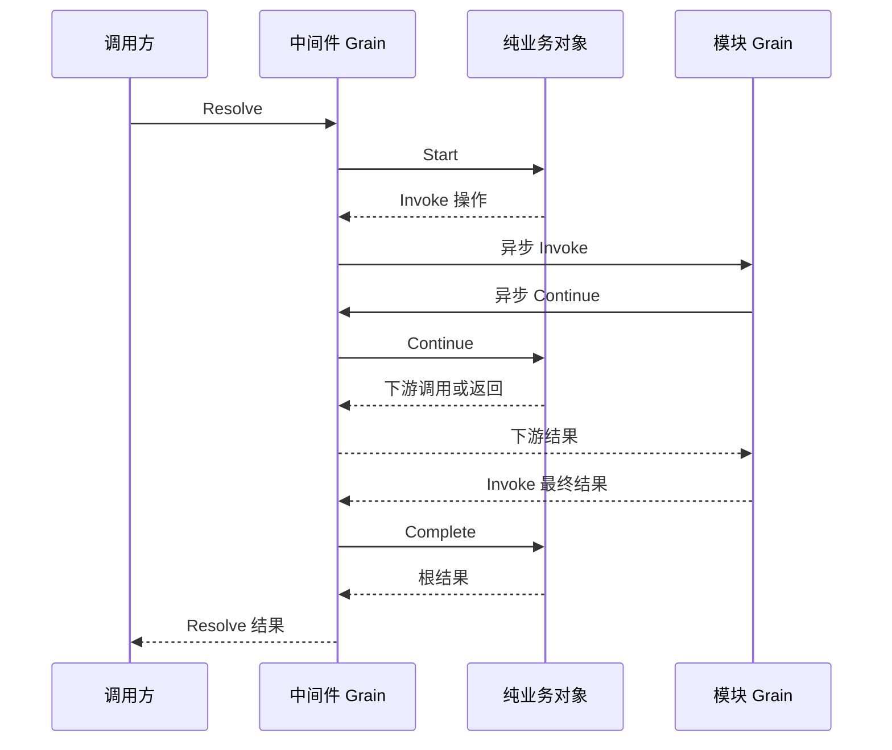

# Agent 中间件 actor 适配

本包将 [纯业务调用对象](../README.zh-CN.md) 映射为 GoAkt Grain 异步请求。设计归 [AgentLoop 方案](../../../zh-CN/actor-design/30-agentloop-business.md)，仓库进度见 [实施进度](../../../zh-CN/08-implementation-progress.md)。已实现调用适配，不代表真实消费者和 AgentLoop 主链已经接入。

## 对象职责与依赖

`Grain` 接收 Resolve/Continue/Cancel 和请求完成消息。每个调用适配对象组合对应的业务对象和 `exchange`，业务决定调用及返回目标，适配层只转换消息。

`exchange` 保存根回复、Continue 回复、固定路由和未回复的模块调用。downstream 的 key 是等待下游的注册身份，value 是该 Continue 请求的回复句柄；active 的 key 是尚未回复 Invoke 的注册身份。这些是技术关联，不是业务调用顺序的第二份状态机。

依赖方向为 actor → middleware → Agent 决策契约。纯业务包不反向依赖本包。没有 AgentLoop 或消费者对象反向引用。

## 接入契约

调用方为每次 Resolve 分配全新 CallID，提供有序 Route 集合和该扩展点输入。CallID 不持久化，不复用为 Agent/Creation/Instance 身份。注册 owner 必须保留本次选中的定义和模块资源，直到原 Resolve 完成；本包不负责动态注册发布或删除模块。

Grain 必须启用 GoAkt reentrancy。Invoke 使用异步 RequestGrain、AllowAll 和无超时等待，Continue 因而能在原 Invoke 等待期间进入。模块收到 Invoke 后，使用 Invocation 中的 Coordinator、CallID 和 Handler 请求相应 Continue；保存原请求的延迟回复，完成自己的工作后回复对应具名 Resolved。不能在模块邮箱中阻塞等待 Continue，也不能保留池化 GrainContext。

三个 around 扩展点分别为 PreStep、Request、RequestError。RunTurnStopping 只串行 InvokeTurnStopping，接收 TurnStoppingCompleted，不存在 ContinueTurnStopping。

## 取消和异常收尾

CancelCall 要求非空 CallID 和 Cause。原调用已释放时，迟到或重复取消直接确认，无须重建调用；该确认不替代调用方对原请求结果的等待。仍有活动记录时，CancelCall 先记录业务取消，再使用业务对象返回的首个取消原因向尚未回复的模块发送 CancelInvocation。重复取消仍可重试通知，但不会把新原因转发给模块。此消息是取消信号；模块必须结束自己的工作并回复原 Invoke。取消命令成功仅说明当前活跃处理者已确认取消命令，原 Resolve 仍等待在途调用收尾。取消投递错误明确返回给调用方，不能据此宣布工作退出。

遇到调用协议错误，适配层通知仍在运行的模块取消，并释放悬挂的 Continue 回复使其能退出；根回复等剩余 Invoke 返回后才完成。框架停用时所有本地请求失败，但不声称外部模块已清理。

Request 回调只将数据放入完成通道，通过 PipeToSelf 回到邮箱后推进业务。不捕获 GrainContext，不让异步任务修改业务对象。完成消息同时校验 CallID 与原调用对象，迟到的完成不能推进新的调用。

`agent.Hooks` 是独立的异步发起窄接口，Agent 不嵌入它。方法返回值只报告能否发起；最终业务结果使用 agent 包的四类具名完成消息。Actor 执行器直接使用这些结果，不维护重复 DTO。注册、路由、Continue 与取消投递留在执行适配层；Hooks 发起适配器已实现，主驱动接线尚未完成。

## Hooks 发起端

Hooks 实现 agent.Hooks，绑定当前 Receive 帧、coordinator、全新 CallID 及本次钩子的固定路由。每个实例只发起一次，不存入 ReactLoopAgent。发起时清除 GrainContext 引用，异步回调只转换具名结果并交给 PipeToSelf。HookCompleted 带技术 CallID 与 agent.HookResult；调用方先检查身份再推进业务。重复发起报错，错误类型回复转换为对应钩子的错误结果。取消继续使用 CancelCall 并等待原完成。当前发起适配器已实现，AgentLoop 主驱动尚未接入。

取消传输由 grain_cancel.go 以 RequestGrain 发起。框架任务收集本次活跃处理者的 Completion，具名结果返回邮箱再回复原 CancelCall；不使用会等待独立确认通道的 TellGrain。取消确认失败不会把业务调用设为协议失败，调用方可以重试，原 Invoke 仍须正常返回。强制停用使未完成的取消请求返回错误。

[AgentLoop 交错测试](../../../agentloop/actor/grain_turn_test.go) 使用本协调器验证停止钩子的取消确认、原调用完成、失败重试及首个取消原因保留；[多层 around 测试](./grain_cancel_test.go) 另行覆盖正常、取消和协议错误的等待链收尾。
