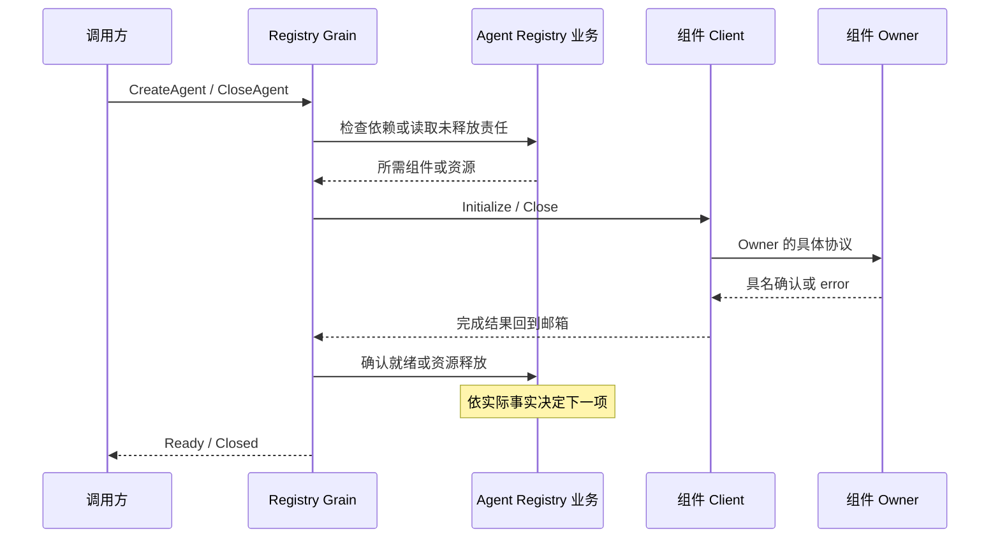

# Agent Registry

本包按 SessionID 管理 Agent 的框架身份并调度生命周期请求。业务依赖、可用状态和资源责任由独立的 `agent.Registry` 管理。设计见 [Agent 生命周期](../../zh-CN/actor-design/39-agent-activation.md)，集成问题见 [验证记录](../../zh-CN/actor-design/40-integration-findings.md)。

## 模块内职责

| 文件 | 职责 |
| --- | --- |
| grain.go | 消息入口、身份授权、父子身份关联和准入请求适配 |
| grain_create.go | 合并重复创建请求，调度未就绪组件，交回初始化结果 |
| grain_close.go | 调度尚未释放的责任，关联关闭回复，确认身份释放 |
| grain_find.go | 返回地址前验证原 AgentLoop 激活仍然有效 |
| grain_tools.go | 单工具实例授权、创建、移除与失败重试 |
| components.go | Client 装配，以及 Session、Tools Runtime、Prompt、LLM、AgentLoop、Commands、附加组件、子 Agent 和工具的具体协议 |
| client.go | 异步请求、回复类型检查、使用当前邮箱上下文续接协议及框架停用 |
| creation.go | 创建请求及校验、复制、重复请求比较，以及就绪结果 |
| messages.go | 身份登记、准入和关闭消息契约 |

不按单个对象拆文件。组件 Client 集中放在同一文件，各自封装对应 owner 的协议；通用调度入口不包含按组件展开的 switch，也不维护 startupStep、shutdownStep 或 StartupAction。

## 主要对象与依赖

业务 Registry 保存四种生命周期状态、组件依赖、已就绪事实及待释放资源。`reservation` 保存本次 CreationID、已授权 InstanceID、Client 和未完成请求。`activation` 仅保存固定创建输入、当前请求关联和共享回复；`closure` 仅保存当前资源请求及共享回复。

`installation` 装配 Client，不启动 Actor。AgentLoop Client 依赖 Session 和 Prompt Client 的已初始化地址；附加组件 Client 依赖 Session 和 AgentLoop 地址。Client 不回指 Registry Grain，不持有业务 Agent 对象。框架地址、回复句柄和取消函数不进入业务 Registry。

`creations` 的 key 是 SessionID。单工具表的 key 是 canonical tool name，例如 `creations["session-1"].tools["ask_user_question"]`；不同 Agent 的同名工具分别登记。工具配置与实现切换仍归 Tools Registry、Tool Runtime 和 Tool 业务对象。

## 交互流程

创建前记录资源责任；无效或丢失回复不能当作没有取得资源。初始化失败自动进入 Closing 并启动清理，创建回复保留原错误。关闭失败保留身份和未释放责任，CloseAgent 重试不会重复已确认的释放。

关闭先冻结准入，等待在途初始化和实际执行结束，再关闭子 Agent、Commands、附加组件、执行资源、Tools、Prompt、Session，最后停用 AgentLoop。取消确认不等于执行结束。显式取消并保留 Inbox 后，输入可以随 Session flush 保留，并在下次恢复；尚有执行或维护时仍等待完成。

Session 登记和启动由 Session Client 封装。LLM Client 只请求配置初始化，LLM owner 自行读取 Session 并恢复配置。业务关闭后还需框架停用的 Client 保留停用确认边界，以便框架停用失败后只重试停用。

## 验证与未完成范围

[纯业务测试](../registry_lifecycle_test.go) 覆盖依赖、非法就绪、未确认资源、关闭顺序和失败保留。[创建集成测试](./grain_creation_test.go) 使用 GoAkt 与 SQLite，覆盖重复创建、自动清理、关闭重试、关闭与维护交错，以及保留 Inbox 后恢复消息身份与顺序。[登记测试](./grain_registration_test.go) 验证损坏注册回复仍保留 Session 清理责任。

创建夹具已改用真实 Tools Registry 并显式初始化默认配置，Tools Runtime 首次应用和发布完成后才初始化 Prompt。internal/server 的真实配置 owner 验收覆盖空集合、工具资源打开与关闭、失败清理后重建。动态更新与执行链仍未完成。强制停用也不能证明业务资源已经释放。
