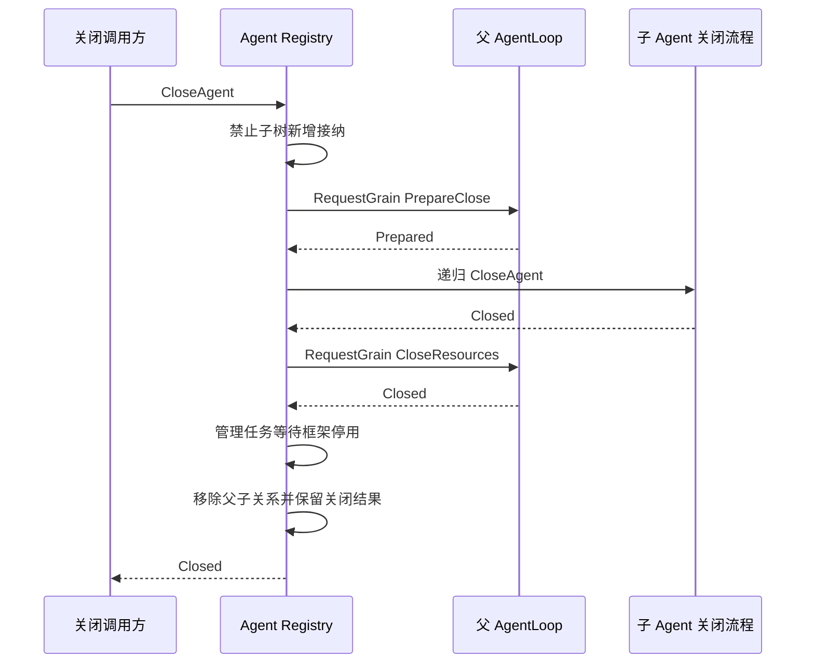

# Agent Registry Grain

本包承载共享 Agent Registry 的身份、父子接纳和关闭协调，设计见 [Agent 模块](../../zh-CN/actor-design/32-agent-module.md)。完整生产创建事务仍未接通。

Grain 持有纯业务 Registry、每个 Agent 最近创建的登记及关闭进度。业务目录决定父子关系和祖先接纳限制；Grain 校验创建与激活身份，并编排跨 Agent 关闭。Executor 是 Claim 提供的框架地址，没有 AgentLoop 对象引用，也不导入 agentloop 包。没有业务消息队列或 mutex。

- `messages.go` 定义 Registry 请求。Reserve 校验父创建并登记关系；同一有效创建重试幂等。Claim/Claimed 与执行方关闭契约属于 agent/actor。
- `grain.go` 维护身份和接纳约束。Claim 固定非空激活标识与匹配逻辑身份的 Executor；不同激活或地址不可接管同一创建。BeginClose 关闭接纳并返回剩余直接子创建，包括初始化中的子项。
- `grain_close.go` 处理 CloseAgent。每个创建只有一个关闭操作，相同创建的并发请求共享结果；失败保留阶段，后续重试继续。框架回复句柄仅保存尚待完成的关闭请求。

Registry 使用 AllowAll 继续接收子关闭、其他身份和重复请求。各阶段用异步 RequestGrain，PipeToSelf 将结果送回本 Grain；不保留池化上下文。框架停用在受管理任务中等待，成功后才释放 Agent 身份。子项失败时父资源保留；已独立关闭并被新创建替换的子项不会被旧父关闭误伤。

CloseAgent 成功表示该创建的已接入资源和框架实例均已关闭；BeginClose 只表示停止接纳，ReleaseReservation 只是创建清理的内部原语，不执行资源关闭，且不能绕过正在进行的关闭协调。完成记录保留到新创建替换，不能重用同一 CreationID。旧请求不影响新创建。

尚未 Claim 的创建不能假定无资源：CloseAgent 停止接纳并返回清理所需的明确错误。初始化失败回滚、执行中工作排空和意外失效后的资源清理仍待完整创建事务接通。Grain 自身停用取消待回复操作并返回错误，丢弃本地目录；这不代表各 Agent 或 Session 已关闭，生产恢复策略仍未完成。

当前真实 GoAkt 与 SQLite 验证位于 [父子关闭测试](../../agentloop/actor/grain_close_test.go)，覆盖三代关系、子项未完成时父资源保留、取消后重试、子项独立关闭后同 ID 替换隔离，以及 Session 身份实际释放。该验证不代表完整模型循环或生产创建链已经完成。
