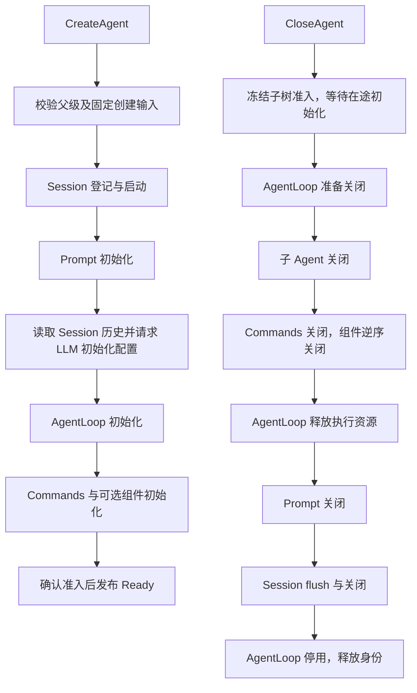

# Agent Registry Grain

本包以 SessionID 索引 Agent 生命周期，统一创建、恢复、就绪发布与关闭编排。设计见 [Agent 生命周期](../../zh-CN/actor-design/39-agent-activation.md)，进度见 [实施计划](../../zh-CN/actor-design/12-implementation-plan.md)。

## 对象与模块职责

| 对象 / 文件 | 职责 |
| --- | --- |
| Grain / grain.go | 持有纯业务 agent.Registry，校验 CreationID、InstanceID 与父级准入 |
| creation.go / messages.go | 创建、查询和关闭契约；返回分离注册信息与框架地址 |
| activation / grain_create.go | 固定创建输入，保存已接收的启动责任和异步初始化进度 |
| grain_resolve.go | 发布地址前校验原 AgentLoop 激活仍有效；旧回复不影响替代实例 |
| closure / grain_close.go | 保存关闭阶段、逆序组件位置和等待回复；失败从原步骤重试 |

creations 的 key 是 SessionID，value 是最近一次创建身份、当前执行地址和创建/关闭进度。关闭成功保留结果到下一次创建，不保留业务 AgentLoop 对象。父子关系仅在纯业务目录中维护，模型、Inbox、工具和压缩业务不进入 Registry。

Registry 用 GrainOf 启动核心组件，使用共享 StartComponent/StopComponent 协议请求能力 Registry。没有 GrainFactory、Plugin、业务队列或 mutex。Compaction 的策略和具体 Grain 启动归它自己的 Registry。

身份只能在 CloseAgent 确认资源关闭后释放，没有直接删除预留的消息入口。关闭不丢弃待处理输入、不把取消确认当作工作结束。失败保留资源与身份，后续重试继续；初始化失败但尚未 Claim 的创建也会清理已获得的 Session/Prompt。旧 CreationID 无权释放替代创建；Verify 检测意外重新激活后停止发布地址，不能据此假称原执行资源已清理。

通过普通调用方 AskGrain 发起首次创建时，须以 WithGrainReentrancy 激活 Registry；Actor 调用方使用 RequestGrain。等待期间 Registry 使用 AllowAll 处理 Claim、重复请求和其他 Agent。框架停用等待在 PipeToSelf 任务中完成。

寻址为 `<sessionID>.<service>`，通过各服务消息文件的 RuntimeName 生成；业务身份在消息中显式传递。Registry 自身使用固定 Name。Resolve 的 WaitReady 可等待已有创建的最终结果，默认仍在初始化未完成时拒绝解析；等待者复用创建回复集合，不增加 API 生命周期 map。Resolve 不创建新的业务生命周期，但框架可能重新激活已失效地址，因此需核对 InstanceID。

## 验证与限制

[创建集成测试](./grain_creation_test.go) 覆盖并发创建、输入冲突、关闭与初始化交错、失败清理、组件逆序关闭重试、SQLite 恢复、Compaction 注册撤销及旧身份隔离；[父子关闭测试](../../agentloop/actor/grain_close_test.go) 覆盖三代关系与父资源保留；[执行关闭测试](../../agentloop/actor/grain_test.go) 覆盖待处理输入取消和 Session flush 失败重试。测试使用真实 GoAkt 和 SQLite，配置及特定故障通过窄契约夹具提供。

本包不代表旧 API Session/Scope 已迁移，也不保证进程崩溃后恢复仍在内存中的创建事务。强制停用导致无法确认资源清理时返回错误并保留身份，不能把框架地址存在视为业务可用。
