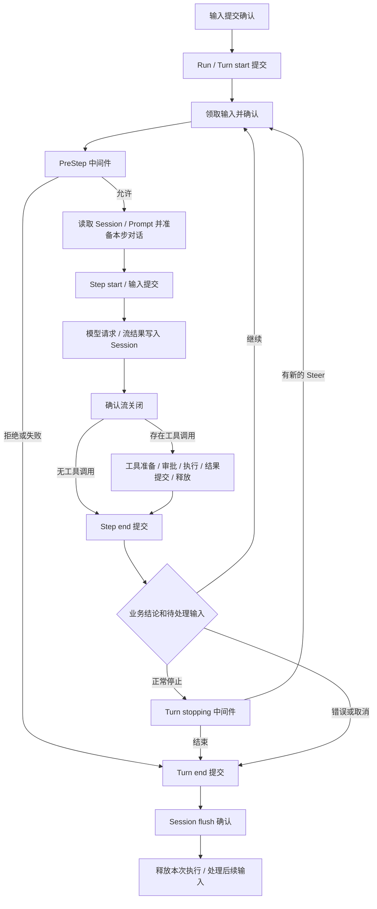

# ReactLoopAgent

ReactLoopAgent 是单 Agent 执行的业务所有者。它拥有 Inbox 投影、执行与维护准入、Turn/Step 状态、模型请求和持久化确认；完整执行流程直接调用消费方定义的异步能力接口。GoAkt 通信位于 [actor](./actor/README.zh-CN.md)，业务包不依赖框架。

## 对象与模块职责

| 文件或对象 | 职责 |
| --- | --- |
| agent_admission.go / agent_state.go | 输入准入、取消意图、执行与维护互斥；维护完成后恢复待执行输入 |
| agent_execution.go | Run 入口、Turn 开始、Step 后续、停止钩子、结束提交与 flush；保存失败边界用于重试 |
| agent_preparation.go | 领取输入、PreStep 决策、读取 Session 与 Prompt、Step 开始和输入提交 |
| agent_request.go | 驱动当前模型请求、流片段处理与 Session 提交、请求恢复及流关闭 |
| agent_tools.go | 工具批次、审批结果分支、执行结果与附加上下文入库、实例释放 |
| services.go | Conversation、Prompts、Middleware、Models、ToolCalls 等窄能力接口和结果接收接口 |
| agent_turn.go / agent_step.go / agent_settlement.go | Turn/Step 状态、提交内容和持久化屏障的合法性校验 |
| agent_commit.go | 提交校验及只持有不可变事实的 Session 写入计划 |
| internal/turn、internal/step、internal/modelrequest、internal/toolbatch | 各自业务状态与不变量；不依赖 Actor，不反向拥有 ReactLoopAgent |

方法按所属对象共享文件名前缀；没有另一套 Actor Turn/Step 驱动。当前工具流程尚有审批接线、取消和资源失败恢复缺口，不能把接口存在视为完整工具能力已经验收。

## 依赖与接口

依赖方向是 Actor 适配 → AgentLoop 业务 → Agent、Session、LLM、Prompt、Tools 契约。生命周期 Registry 创建组件并提供运行地址，业务对象不启动 Actor、不保存地址、框架回复、锁或运行上下文。

`agent.Agent` 定义 Followup、Steer、Inject、Cancel 等外部业务操作，由 ReactLoopAgent 实现。输入先形成提案，Session 确认真实提交后才调用 ConfirmAdmission/ConfirmEdit 更新 Inbox；准入确认不等于执行完成。异步提交、取消投递与 WhenIdle 属于 Actor Client。

`Run(Services)` 推进已接纳执行。业务调用能力时指定窄结果接收者；能力发起失败直接返回 error，成功发起后通过接收者交付最终结果。接收者只知道本次业务事实，调用方不需要选择下一个 Prepare/Confirm 方法。业务对象不保存 Services；每次串行交付提供当前可用的能力接口，因此没有业务对象反向引用 Actor 或 Client 的所有权环。

## 执行流程

PreStep 在对话上下文派生前运行。Prompt 仅组装提示词和工具定义，AgentLoop 从 Session 派生对话并冻结本步输入；模型调用必须等待输入提交确认。模型配置由 LLM 管理，不恢复 AgentLoop 的配置副本。

## 失败、取消与生命周期

TurnStart、EndStep、TurnEnd 是不可变业务事实。提交回复丢失时保留同一事实，通过 Session.IdempotentWrite 重试，Session 返回原 WriteResult；已经确认 Turn end 后，flush 失败只重试 flush，不重新生成或写入结束事件。`ReactLoopAgent.retry` 不保存 Actor 或接收者，只保留待重试边界；当前由再次调用 Run 恢复，生产失败后的自动重试策略尚未接通。

输入领取与 Step start 回复不确定时，按各自恢复契约读取原请求结束后的 Session 并核对，不把普通追加一概视为幂等。恢复读取失败仍保留未确认责任；完整后续恢复尚待补齐。

Cancel 只记录具名业务原因及是否保留 Inbox，Actor 将意图传给当前组件。取消接收确认不代表组件已经完成。Turn 开始前取消可以直接释放活动并保留输入；已发出的写入仍须确认，已打开的模型和工具仍须完成关闭，再结束 Step/Turn 和 flush。

维护独占执行活动；期间输入可以接纳，但 Run 不启动 Turn。MaintenanceCompleted 在收到真实完成后释放维护，并由业务对象决定是否恢复待执行输入。关闭先冻结准入；未完成业务或未确认资源责任禁止 Release。Registry 负责组件关闭和最终 Session 生命周期。

## 验证范围

`agent_execution_test.go` 使用可控异步能力和真实 Session.Log，通过 Run 驱动文本回复、PreStep 拒绝、模型发起失败、Turn/Step 边界回复丢失重试、flush 单独重试、开始前取消和维护后恢复。测试不手动选择内部执行步骤。

`internal/server/server_conversation_test.go` 从真实 HTTP prompt 到本地 SSE 模型服务、WebSocket Session 事件及 SQLite 完整 Turn，验证文本路径已接入当前业务流程。工具、更多取消交错及完整故障恢复仍待验收；这些证据不代表整个 AgentLoop 已完成。

目标契约见 [AgentLoop 设计](../zh-CN/actor-design/30-agentloop-business.md)，当前问题与验证见 [集成问题记录](../zh-CN/actor-design/40-integration-findings.md)。历史实现记录见 [实现进度](../zh-CN/08-implementation-progress.md)，不作为本轮未完成路径的通过证据。

关闭接线验证：`PrepareClose` 在业务对象中冻结准入并记录执行取消，Actor 复用取消通道通知正在执行的能力；收到取消确认后仍等待业务收尾。`internal/server/server_conversation_test.go` 的 `TestHTTPCloseCancelsStreamingModelAndFlushesTurn` 通过真实 HTTP 提交消息、保持模型流打开、再关闭服务，验证提供方收到取消、Step/Turn 结束写入 SQLite，以及后续排队输入仍能从日志恢复。

工具取消：当前调用等待真实结果和释放；后续调用不进入 Runtime，按模型顺序记录执行前取消的调用/结果配对，再结束 Step 与 Turn。`TestBusinessToolCancellationDoesNotDispatchRemainingCalls` 从 Run 覆盖这一流程。所有工具写入回复均校验 Session、序列范围及草稿内容。工具附加上下文的持久化失败恢复、审批与并发调度尚未完整接通，不能将该取消测试当作工具流程的整体完成证据。

调用、结果和取消配对使用 `toolWrite` 幂等提交。`TestBusinessToolWritesRetryWithoutRepeatingExecution` 从 Run 验证调用或结果回复丢失后重试同一事实，工具仅准备、执行、释放一次。关闭时也调用业务 Run，恢复已保存的失败边界；这不等于所有工具故障均已覆盖。
