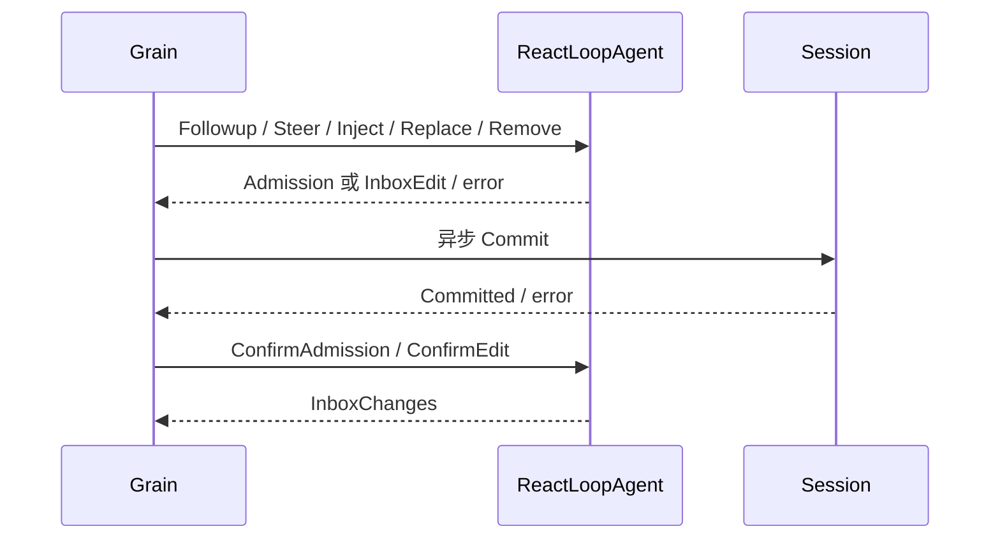
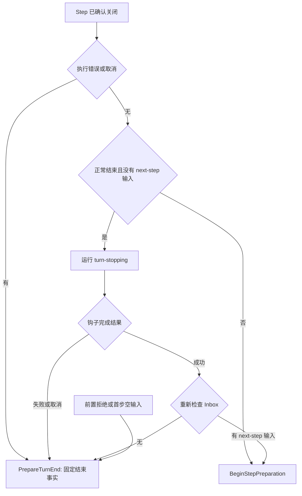
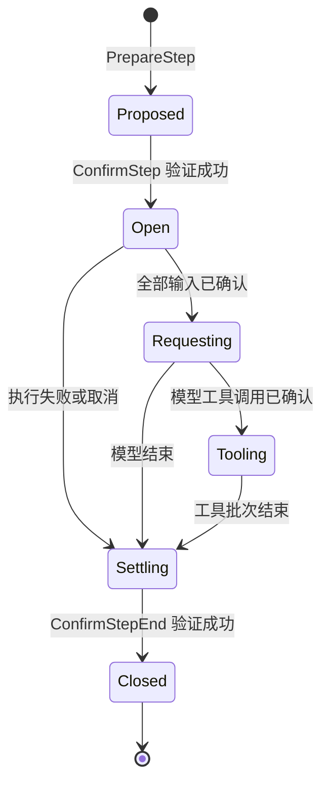

# ReactLoopAgent

纯业务的单 Agent 执行 owner，框架请求由 [actor](./actor/README.zh-CN.md) 适配。旧 Plugin/Scope 和同步执行路径已删除；完整对话驱动、工具执行及生产组合尚未完成。

ReactLoopAgent 负责单 Agent 的日志恢复、输入准入和关闭条件，拥有 Inbox、恢复出的 Turn 编号、模型配置、工具版本和首次请求头确认。它不持有 Actor 地址、回复句柄、Context、锁或队列，不执行存储及模型 I/O。

模块内，ReactLoopAgent 决定何时允许新增、替换、移除输入；agent.Inbox 决定具体 splice 并投影提交结果；turn.LastNumber 和 agent.ResolveModelSelection 解释恢复日志。模型请求的业务规则归相邻 modelrequest 包，Turn/Step 自身规则归各自包，不复制到 ReactLoopAgent。

上游 Grain 读取 Session 后调用 Restore。恢复解析全部成功才安装状态；模型及 Prompt 当前初始化段成功后调用 Initialize；该入口复制 CallConfig 的可变字段，Agent 不共享调用方持有的参数指针或 JSON 切片。Followup、Steer、Inject 返回 Admission；Replace、Remove 返回 InboxEdit。Actor 核对完整 Session 提交结果后调用 ConfirmAdmission/ConfirmEdit。失败不提前改变 Inbox。PrepareClose 停止新输入，已接纳输入或执行尚未结束时返回 ErrPending；移除输入仍通过日志提交。失败初始化的历史输入保留在日志中，不阻止资源回收。实际请求取消、等待执行结束及关闭资源由 Grain 编排，资源关闭成功才调用 Release。

依赖单向为 actor → agentloop → agent、turn、llm 配置值及 session 契约；ReactLoopAgent 不引用 actor。具名 Pending 返回 Inbox 的两个执行边界，避免调用方依赖返回值位置。

当前接口和边界见 [AgentLoop 设计](../zh-CN/actor-design/30-agentloop-business.md)。整体历史实现记录见 [实现进度](../zh-CN/08-implementation-progress.md)；该记录不作为本轮重构验证证据。当前 Agent 与 AgentLoop 子树已运行非缓存行为测试；这不代表完整生产调用链通过。

Cancel 使用具名 agent.CancelOptions：KeepInbox 保留输入并返回空编辑，否则准备整个 Inbox 的取消事件。关闭准备后仍接受取消；未完成初始化时拒绝。它不调用 Context 或框架取消函数。取消意图作为 agent.Cancellation error 传递，保留原始原因类型；字符串仅用于诊断。

模块内职责进一步划分：agent.go 负责初始化、输入准入和关闭条件；agent_turn.go 负责 Turn 开始确认及输入领取边界；agent_step.go 负责前置 Step 决策、Step 开始/结束确认与结论累计。ReactLoopAgent 单向拥有 Turn 和 Step，二者不引用 ReactLoopAgent，也不接触 actor。Prepare 方法生成草稿，Confirm 方法校验提交结果；ConfirmTurn 使用完整 WriteResult 核对 Session 身份及提交范围，并通过草稿 CheckCommit 校验事件，不重复解码 JSON；关闭准备期间允许消化已接纳输入，存在未闭合 Turn 时禁止释放资源。

Turn/Step 业务接口已实现，但 Grain 尚未接入完整调用链。Step 的消息提交仍采用原有逐条提交语义，开始模型请求必须在输入提交后；Turn 的幂等结束提交与 flush 由 Actor 直接编排，业务接口核对各次确认。不能把这些业务方法视为端到端执行已经完成。

agent_settlement.go 固定本轮结束草稿、校验单事件提交内容与范围，并保存待持久化的 WriteBarrier。只有同 Session 的成功 flush 覆盖该 barrier 后才清空当前 Turn。提交前可重试原草稿，提交后只能重试 flush。错误回复不调用确认方法。取消原因在生成 Session 事件时映射，业务规则使用 error 类型；准备结束草稿后结论固定，避免重试写入不同内容。

turn-stopping 通过 ContinueTurn/CompleteStopping 推进，直接读取业务对象保存的取消意图；agent_turn.go 中的私有 beginStopping 确认是否需要进入停止边界，私有 finishStopping 根据此期间已提交的 next-step 输入决定恢复 Step 或收尾。通知传输由上游编排，ReactLoopAgent 不接收函数回调。

turn_end.go 的 TurnEnd 是单轮结束事实的不可变值。Drafts 在 Session 提供的当前日志上判断追加或去重，Find 校验同轮结束内容并返回已提交位置。actor 的 WritePlan 适配器只持有该值，不持有可变 ReactLoopAgent；此职责用于解决提交响应丢失后的重试，不是新的业务 owner 或更新 ID。当前检查基于代码，尚未运行故障注入测试。

收尾操作解释协议已删除。PrepareTurnEnd 固定业务事实，ConfirmTurnEnd 核对提交结果，Session 幂等重试返回原事件与原提交范围，ReconcileTurnEnd 已删除，TurnBarrier 提供已确认位置，ConfirmTurnFlush 验证持久化并关闭 Turn。Actor 直接编排外部请求；业务层不返回 Commit/Read/Flush 操作。

PrepareStep 接收 StepInput，验证工具定义版本并捕获待提交 Step；同一提案可重试，不能替换在途快照。ConfirmStep 将该对象安装为当前 Step，不重新创建一个丢失输入的对象。BeginModel 仅接受提供者元数据，要求当前 Step 已进入 requesting，并从 Step 获取 Prompt 和位置，阻止外部模型请求绕过本步数据所有权。

本步消息提交由 ReactLoopAgent.MessageDraft/ConfirmMessage 驱动，消息来源固定为 Step 捕获的进入批次。确认要求本 Agent 的 Session 身份、有效提交区间及匹配消息内容；全部输入确认后才允许 BeginRequest。当前 actor 尚未由完整主驱动调用这些业务入口。

ConfirmStep 将提交事件交给候选 Step.ConfirmStart；Step 自己验证开始事实并限定后续输入事件位置，ReactLoopAgent 不再重复解析同一份 Step 开始 payload。

ConfirmStepEnd 在候选副本上调用 Step.ConfirmEnd，再根据其结论推进 Turn；任一验证失败均不安装候选。通用 confirmPosition JSON 解码已移除，Step 开始/结束 payload 由 Step 自己验证。

## Step 准备调用链

业务层的 Step 操作解释协议已删除。PrepareInput 创建唯一 preparation；ConfirmInput 核对实际领取提交并保存领取消息；PreparePreStep 接收 Session 与 Prompt 数据后组装默认准入，PrepareStep 消费中间件决策。调用方不能再供应 Claimed 消息替换真实领取结果。

准备状态只表示领取未确认、上下文待准备、准入待决定。重复领取、未确认就组装上下文、重复消费决策都由业务检查拒绝。AbandonPreparation 只能丢弃尚未使用且没有未确认写入的上下文。Step 开始结果不确定时保留 StateProposed，读取原请求之后的 Session 快照并调用 ReconcileStepStart。

Actor 的 grain_step.go 直接请求领取提交、Session 快照、Prompt 组装、pre-step 中间件、Step 开始及逐条消息提交。等待 Prompt 和中间件时允许输入/取消，Session 写入保持串行。只在全部消息确认后调用 BeginRequest。该内部驱动已实现，用户输入到完整模型/工具循环的主驱动仍未接通。

StartRequest 捕获当前 Step 并由 ReactLoopAgent 持有唯一 ModelRequest，只返回第一个操作。AdvanceRequest 消费具名完成值，RetryRequestClose 重试关闭；CompleteModel 从当前请求读取终态，成功转入工具或 Step 收尾后才释放引用。重复启动、运行中完成和关闭未确认的提前续步被拒绝。配置提案与恢复只由 ModelRequest 解释；旧 PrepareRequest/RequestProposal 已删除。Grain 当前单次 Attempt 入口尚未切换，业务接口完成不代表生产调度已接通。

`agent.Agent` 定义身份、只读 Inbox、状态及 Followup、Steer、Inject、Cancel 业务操作，由 ReactLoopAgent 直接实现。输入方法返回准入提案，完整 Session 提交确认后才更新 Inbox 并记录已接纳的执行。异步提交、取消投递和 WhenIdle 属于 actor.Client；客户端不实现业务 Agent。Grain 直接持有 ReactLoopAgent，删除了仅重复其方法清单的 execution 接口。依赖方向为 actor → agentloop → agent，业务对象不导入框架。完整执行调度仍须继续接线。

ReconcileStepStart 仅核对已停止准备流程的 Step 开始候选：已提交则安装 Step 并要求先收尾，确认未提交才删除候选。快照必须在原写入请求结束后读取，不能用任意历史快照推断未提交。

Step 准备现在将明确的整批拒绝与未确认的操作失败分开：前者停止准备，后者在 step/start 阶段请求 ReadStepStart 并核对日志。取消不跳过已发出写入的核对；读取失败保留候选并报告原错误及读取错误，不自动重发写入。

四个执行流程钩子是独立异步边界，不属于 Agent 的外部业务方法。ReactLoopAgent 决定调用时机并处理结果，Grain 映射具名请求和回复；中间件执行器提供空集合默认处理。等待钩子时须允许输入与取消进入，但不得启动第二条执行；停止钩子完成后重新检查 Inbox。完整驱动接线尚未完成。

`agent.Hooks` 是独立的异步发起窄接口，Agent 不嵌入它。方法返回值只报告能否发起；最终业务结果使用 agent 包的四类具名完成消息。Actor 执行器直接使用这些结果，不维护重复 DTO。注册、路由、Continue 与取消投递留在执行适配层；Hooks 发起适配器已实现，主驱动接线尚未完成。

agent_model_result.go 从自身持有的完整 ModelRequest 读取终态，选择 ExecuteTools 或 EndStep。max-tokens 优先结束 Step，普通成功按模型顺序提取工具调用；工具版本来自本 Step 快照。流关闭未确认时不进入后续流程。EndStep 保留原错误，待提交确认后继续 Turn 收尾。

agent_tools.go 的 CompleteTools 消费本地已关闭 ToolBatch：正常结果选择 continue 或 completed，批次执行错误选择 error，typed cancellation 选择 aborted。批次尚未关闭或排空缺少对应错误时拒绝推进。普通工具失败结果不等于批次执行失败；本方法不清空 Inbox，也不执行工具策略。模型与工具完成共用 agent_step.go 的 EndStep 草稿准备，提交确认仍由 ConfirmStepEnd 负责；实际工具执行接线尚未完成。

## Step 之后的推进

agent_turn_flow.go 的 ContinueTurn 消费前一阶段保留的错误，在现有 Turn 状态上选择下一步准备、停止钩子或结束提交。CompleteStopping 仅消费实际完成的钩子结果，成功后重新检查已提交的 Inbox；钩子错误或取消用于准备固定的 TurnEnd。此流程复用已有 Turn/Step 状态，不持有第二份阶段、Actor 或回调。框架接线尚未完成。

TurnOperation 当前只表达继续 Step、运行停止钩子或固定 TurnEnd 等业务决策。两套外部操作解释协议均已删除；异步准备与收尾由 Actor 直接编排，业务方法验证状态和事实。完整主驱动仍需接线。

已接纳执行及取消事实位于 agent_activity.go，输入业务入口位于 agent_admission.go，完整提交核对复用 agent_commit.go。需要唤醒的输入提交确认后，StatusValue 即为 running，此时 Turn 可能尚未开始。FinishActivity 只能在业务工作全部关闭后清除该执行；取消之后接纳的唤醒输入仍存在时，保留下一次待执行工作。维护互斥与主驱动接线仍待完成，不属于当前验证覆盖范围。

## 状态约束

agent_lifecycle.go 是恢复、就绪、关闭接纳与释放状态的唯一判断入口，替代 ready/closing 布尔组合。Restore/Initialize 不允许重复覆盖，Initialize 失败不开放输入，Release 必须满足关闭条件。Actor 技术停用直接丢弃对象，不调用业务 Release 伪装关闭完成。

PrepareTurn 现在保留 Turn 自身的 StateProposed，ConfirmTurn 只允许该状态进入 StateOpen。准备状态不得开始 Step；取消后仍接受已发出请求的真实提交确认并保留 Turn 等待收尾。未发起或重复确认被拒绝，不增加另一份 Turn 阶段字段。完整执行调度与 flow 协议的收敛仍在进行中。

Step 同样只保留一个对象，StateProposed 表示尚未确认开始，StateOpen 表示开始事件已经提交。proposedStep 字段删除；开始/结束确认都验证完整 WriteResult，然后在副本上推进 Step 与 Turn，全部验证成功才安装结果。未确认开始时禁止消息和模型请求；不确定提交结果保留原 Step，按序读取 Session 后再核对。

Turn 开始使用不可变 TurnStart 与 Session.IdempotentWrite。开始回复不确定时重试同一写入，Session 返回原事件或首次追加的结果，不再 Read/ReconcileTurnStart。候选已建立后收到取消，仍确认同一开始事实并按取消结论收尾。业务与 Actor 幂等重试测试已通过；用户输入到完整模型/工具循环的主驱动仍未接通。

模型请求统一读取业务取消意图。StartRequest 不允许取消后新建，AdvanceRequest 仅接收具名结果并内部附带已记录取消。已发出的操作仍按真实结果完成提交确认或清理；取消不是丢弃完成消息的理由。当前单次 BeginModel 也拒绝取消后启动或与完整请求并行，完整模型驱动尚待 LLM owner 迁移。
