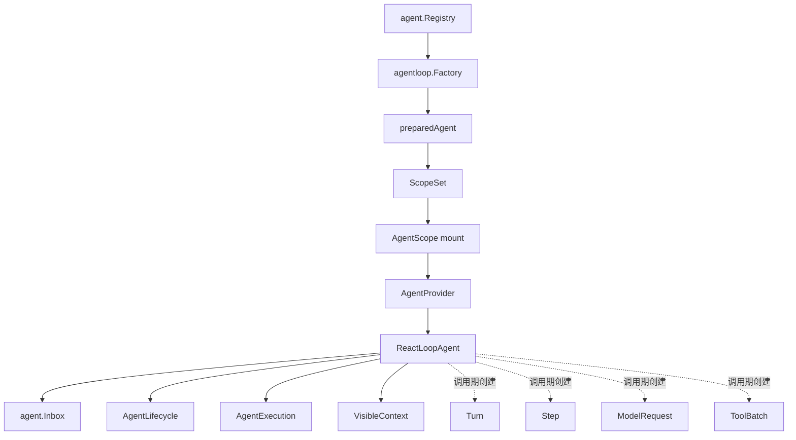
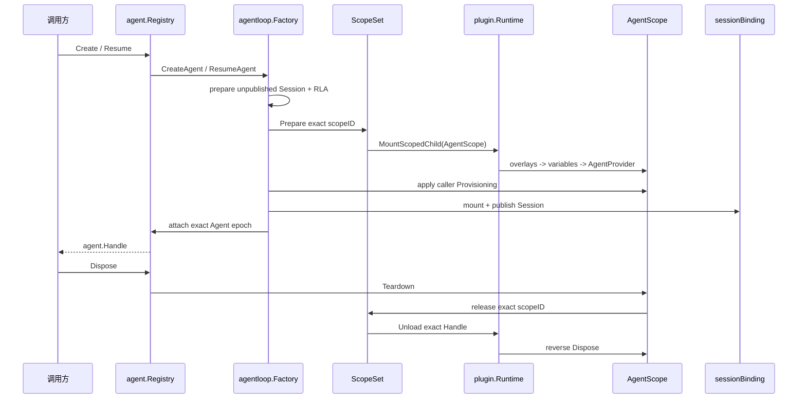
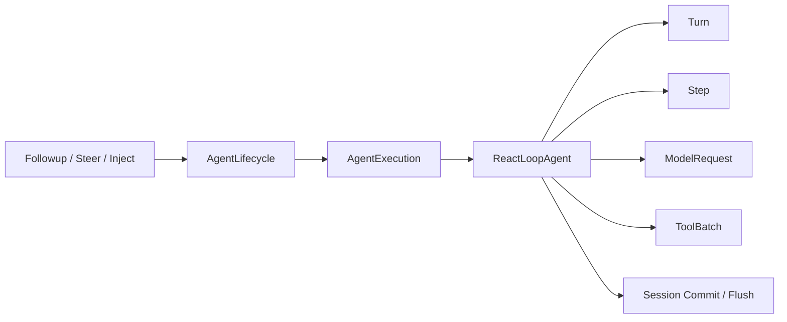

# Agent Loop 模块

`agentloop/` 是默认 Agent 的 concrete 构造与执行实现。根 `Plugin` 向 Agent Registry 注册 `agent.Factory`；每个 exact Agent 由一个 `ReactLoopAgent`（RLA）编排。权威职责、术语和状态机规则见[15 Agent Loop 与请求驱动模块设计](../zh-CN/15-agent-loop-and-request-driver.md)，实施证据只见[08 实施进度](../zh-CN/08-implementation-progress.md)。

## 职责与非职责

本模块负责 Agent/Session/Scope 构造事务、RLA API invocation、独占 execution、Turn/Step/ModelRequest/ToolBatch 编排、Session 可重建请求、取消 settlement、Flush 和 `VisibleContext`。

本模块不拥有 Registry/Inbox contract、Session surface/persistence、Prompt registration、Tool policy/body/result、LLM Adapter、transport 或 UI。Plugin 只做生命周期适配和 capability wiring，RLA 业务文件不依赖 Plugin Runtime。

## 文件职责

| 文件或目录 | 职责 |
| --- | --- |
| `plugin.go` | 根 Plugin、Factory 组装、Session Event 到 `VisibleContext` 的 exact 路由 |
| `plugin_registration.go` | commit-phase exact Factory registration |
| `plugin_scope_set.go` | exact Agent Scope mount handle 集合与卸载命令 |
| `plugin_agent_scope.go` | 单 Agent Scope Plugin、runtime event/waterfall 适配与 Scope resource |
| `plugin_agent_provider.go` | exact `agent.Agent` Service Provider 和 RLA shutdown owner |
| `plugin_session_binding.go` | Session publication、`VisibleContext` registration 与 release |
| `plugin_teardown.go` | Plugin topology teardown 到 Registry teardown 的适配 |
| `plugin_variables.go` | provider/model/cwd Prompt variable Plugin |
| `construction.go`、`prepared_agent.go`、`scope_preparation.go` | unpublished Session/Agent/Scope 构造事务 |
| `startup_plan.go` | 配置 Agent 的一次性启动计划与失败回滚 |
| `rla.go` | RLA identity、invocation admission、execution、wake/cancel、maintenance、shutdown |
| `rla_turn.go` | Turn/Step progression、`turn/end` 与 Flush |
| `rla_step.go` | pre-step proposal、Step boundary 与输入提交 |
| `rla_model_request.go` | request/header/context、fresh reconstruction、stream、retry 与 Assistant assembly |
| `rla_tool_batch.go` | ToolBatch 分组和 RLA 对 Tool group 暴露的窄接口 |
| `rla_events.go` | Agent/Inbox live event 与 observer failure containment |
| `tool_group_execution.go` | 短生命周期 Tool group、bounded body 并发和 model-order result acceptance |
| `internal/lifecycle`、`execution`、`turn`、`step`、`modelrequest`、`toolbatch` | 六个纯状态机模块 |
| `internal/visiblecontext` | retained Prompt Context 的 exact Agent 视图与 registration directory |
| `factory/` | raw JSON 严格解码、校验和根 Plugin 构造 |

Plugin 实现文件必须以 `plugin` 开头；RLA receiver 文件必须以 `rla` 开头。测试不拆到 `agentloop/tests`：白盒 RLA 测试和黑盒包行为测试与 owner 共置，状态机测试留在各自 package，跨包架构规则位于根[`tests/architecture`](../tests/architecture/)。

## Ownership 与运行模型

所有 lifecycle ownership edge 构成 DAG。`ScopeSet.handles` 的 key 是 process-local `scopeID`，value 是 exact `plugin.Handle`；key 存在表示该 mount 尚未卸载。`AgentScope` 只通过 `scopeParent` port 请求释放，不保存 `*ScopeSet`。`AgentProvider` 拥有 RLA shutdown；`sessionBinding` 对 RLA 和 `VisibleContext` 只有非拥有引用。

## 创建、发布与销毁

创建失败使用非取消 context 逆序释放已获得 effect，不发布半完成 Agent。关闭由 `AgentLifecycle.EnterClosing` 建立 invocation cutoff：cutoff 前接纳的 invocation 完成后，RLA 才取消 execution、清理 Inbox并等待 Tool/Step/Turn/Flush settlement。重复 Dispose 幂等，旧 handle 不能删除同 ID 的新 epoch。

## 执行与状态机

六个状态机互不 import、互不持有，也不访问 Session、Prompt、LLM、Tools 或 Plugin。RLA 是唯一副作用编排者：先完成外部事实，再调用对应 `Enter...` 接受目标状态。

`TurnResult` 和 `StepResult` 是明确的领域结论，不使用通用 `Outcome`。`ExecutionSnapshot` 一次返回 State、Generation 和 Cancellation。每个 State、Result、DrainReason 和其他常量逐项注释；map 字段说明 key、value 与 presence 语义。

## 请求、Tool 与取消

每个实际 Adapter dispatch 前，RLA 都重新从当前 Session surface 派生 messages，解析 canonical header/context 并构造 detached `llm.GenerateOptions`。把该 dispatch 前缀交给全新 Session，可以得到相同 options；RLA 不持有可变 conversation 副本。

Tool body 可以在 `maxParallelToolCalls` 内并发，但 Prepare、Finalize、result commit 和 additional context acceptance 始终按模型顺序。`toolGroupExecution` 消费自身定义的 `toolGroupAgent`，只获得 `commitSession` 与 `appendNextStep`；它不依赖 concrete RLA，也不接收 Session/Inbox 对象。

operation context 可中止 Prompt、Waterfall、LLM stream 与 Tool body；settlement context 不继承同一次取消，只关闭已承担的 Tool/Step/Turn/Flush 边界；wait context 只限制调用方等待。scheduler failure 不伪造结果，cancellation 则为未启动 call 生成 canonical synthetic pair。

## 验证所有权

- 六个状态机 package：合法/非法来源矩阵、重复命令、terminal、failure/cancel/successor 和 property-style sequence。
- `plugin_event_sequence_test.go`：fresh、blocked、completed、max-tokens、retry、LLM failure、Tool failure event sequence 与 fresh Session request reconstruction。
- `plugin_integration_test.go`、`rla_lifecycle_test.go`、`rla_tool_batch_test.go`：publication/teardown、Send/Cancel/Dispose 线性化、maintenance wake/cancel、Tool drain、Flush 和 scheduler failure。
- `internal/visiblecontext`：restore、dedupe、clear 和 surface replacement rematerialization。
- `tests/architecture/agentloop_boundary_test.go`：状态机纯度、旧符号禁入、concrete ownership DAG、文件前缀与 keyed struct literal。

跨模块兼容状态与全仓验证结果不在本 README 重复，统一由[08](../zh-CN/08-implementation-progress.md)记录。

## 扩展进入规则

Retry、Guard、Approval、Subagent、Workflow 和 Compaction 沿既有 Service/Event/Waterfall seam 接入。若新能力要求 RLA 认识数据库表、Echo frame、Provider credential、页面状态或 concrete Plugin，先修正 ownership 与依赖方向。
