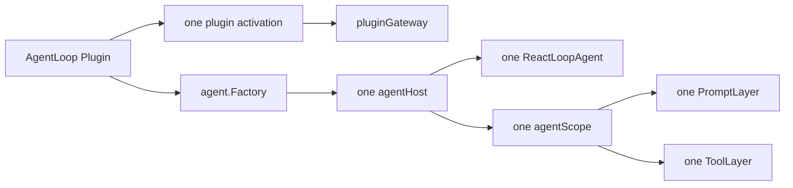
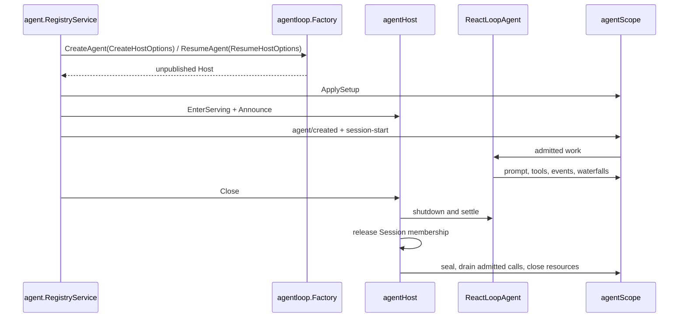

# Agent Loop

`agentloop/` 实现一个 exact Agent 的运行：构造一个 `ReactLoopAgent`（RLA），驱动 Turn/Step/ModelRequest/ToolBatch，并拥有该单实例的 Agent Scope 和 Session membership。完整设计见[15 Agent Loop 与请求驱动模块设计](../zh-CN/15-agent-loop-and-request-driver.md)，本次职责重构见[破坏性重构方案](./REFACTOR.zh-CN.md)，验证证据见[08 实施进度](../zh-CN/08-implementation-progress.md)。

## 模块边界

AgentLoop 只有一个全局 `Plugin`。该 Plugin 解析 Session、LLM、`PromptLayerFactory` 和 `ToolLayerFactory`，发布一个 `agent.Factory`，并通过 `pluginGateway` 把全局 Event/Waterfall 接到 Plugin Runtime。

单个 Agent 不是 Plugin：



`agentHost` 不保存 Registry、parent、children 或 Plugin。它是 Agent Scope 的唯一 owner。多 Agent membership、运行期父子关系、发布和 child-first 关闭全部由 `agent.RegistryService` 拥有。

## 文件职责

| 文件前缀 | 职责 |
| --- | --- |
| `plugin` | 唯一 AgentLoop Plugin 与全局 Event/Waterfall gateway |
| `rla` | RLA 的单 Agent lifecycle、Turn、Step、模型请求和 ToolBatch 编排 |
| `agent_host` | 一个 RLA、Session membership 和 Agent Scope 的单实例关闭 |
| `agent_scope` | Agent-local Tool/Prompt/Event/Waterfall 与资源生命周期 |
| `agent_setup` | AgentLoop 自身变量 Setup |
| `construction` | fresh/resume 的单 Host 构造 |
| `tool_group_execution` | 有界并行 Tool body 与模型顺序提交 |
| `startup_plan` | 配置的启动 Agent 值对象 |
| `internal/*` | 六个互不嵌套的纯状态机与 `VisibleContext` 派生视图 |

RLA receiver 文件统一使用 `rla` 前缀；Plugin 实现文件统一使用 `plugin` 前缀。

## Agent Scope

`agentScope` 是 ordinary Go object，不是 Plugin Runtime Scope。它拥有一个 child `PromptLayer`、一个 child `ToolLayer`、Agent-local observer/middleware 的有序 registration，以及 Setup 提交后的资源集合。

`ApplySetup` 串行创建私有 `scopeDraft`。Setup 的每次注册立即作用于尚未发布的 private Scope，并把精确撤销 Handle 记入 draft；commit 前执行 `ScopeCheck`，失败时逆序回滚。成功后生成 `ScopeResources` 并转交 Scope 持有。这里没有动态 Plugin mount、`UnloadChild` 或兼容释放路径。

本地事件先于全局事件派发：

```text
Agent-local observers
  -> pluginGateway
  -> Plugin Runtime observers
```

Waterfall 使用洋葱顺序：

```text
Plugin Runtime middleware
  -> Agent-local middleware
  -> RLA terminal action
```

`pluginGateway` 是无 Plugin 引用的 typed request queue。RLA 和 Scope 只依赖窄接口，不反向持有 AgentLoop Plugin。

## 独立状态机

| owner | 负责的状态 |
| --- | --- |
| `internal/lifecycle.AgentLifecycle` | Agent API invocation 的 serving/closing/closed 准入 |
| `internal/execution.AgentExecution` | idle、maintenance、turn 与 settlement 独占 |
| `internal/turn.Turn` | Turn 事实边界 |
| `internal/step.Step` | Step 事实边界 |
| `internal/modelrequest.ModelRequest` | request proposal、attempt、retry 与终止 |
| `internal/toolbatch.ToolBatch` | Tool call 调度、结算和完成 |

状态机只接收值，不导入其他 Goren 业务包，也不嵌套 peer state owner。进入状态的方法使用 `Enter...`；外部副作用由 RLA 使用 `Commit`、`Dispatch`、`Flush` 等实际动作名完成。`AgentExecution.Snapshot` 返回一个快照值，不泄漏 operation Context、cancel function 或 idle channel。

## 单 Agent 调用链



`toolGroupExecution` 不持有 RLA concrete object；RLA 通过窄函数/接口提供 dispatch 所需能力。Tool body 不用回调替代 Tool Runtime，结果仍按模型顺序提交。

## 失败与关闭

构造、Setup、Session announce 或 Agent publication 任一点失败，Registry 都关闭 exact Host；Host 再关闭自己拥有的 Scope。已经开始的 created/Session publication 必须产生配对 disposal。`agentHost.Close` 是 RLA shutdown 和 Scope close 的唯一调用者，并稳定 join 同一次结果。

Agent Scope 使用 `open → closing → closed`：Close 先封闭 Setup、Event 和 Waterfall 准入，等待已接纳调用返回，再逆序释放资源、ToolLayer 和 PromptLayer。Registry 只决定普通事件与 closing 事件能否进入 exact Agent；Scope 是最终线性化边界。

AgentLoop Plugin 的 gateway、driver 和 effect join set 属于一次 `pluginActivation`。`Dispose` 先停止 Factory 新构造，再停止本次 gateway 并等待已接纳全局 Event/Waterfall 调用；下一次 `Apply` 创建全新的 activation。Plugin 不遍历或关闭 Registry 中的 Agent，依赖方向保证 Agent Plugin 先关闭这些实例。
