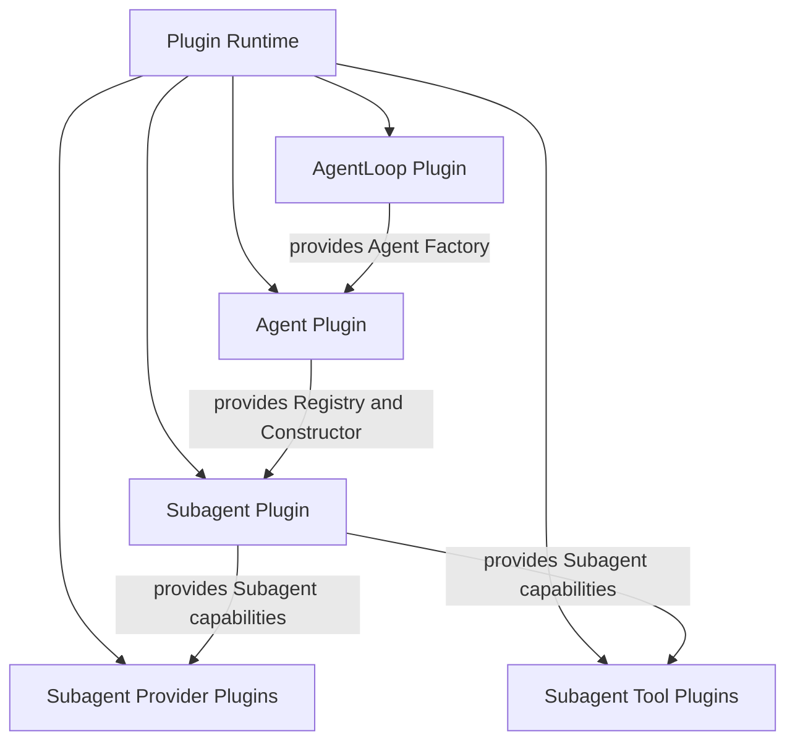
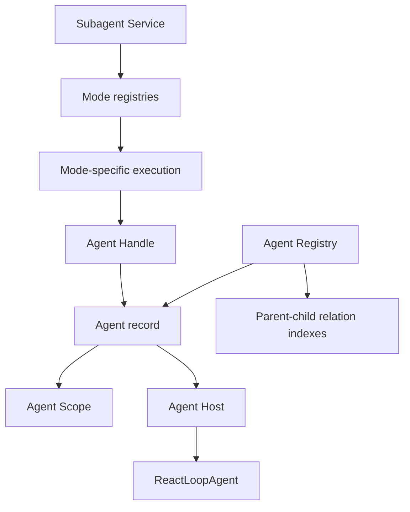
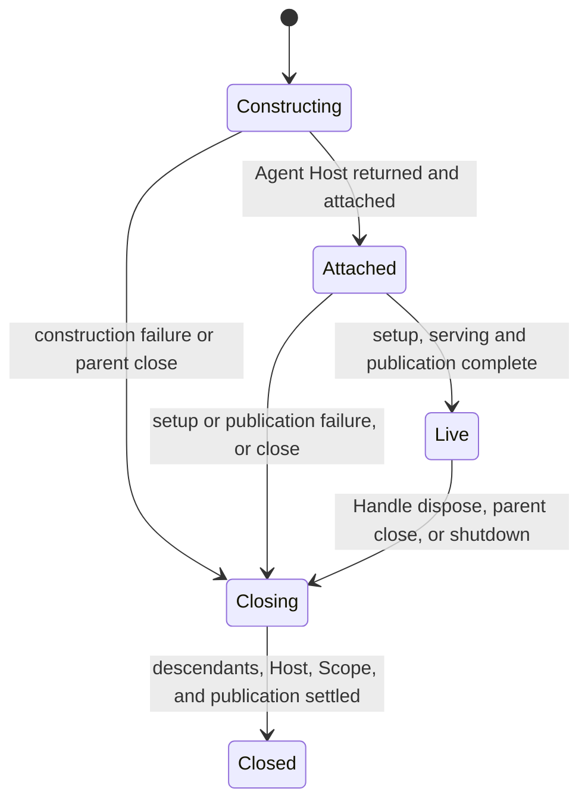

# Agent、AgentLoop 与 Subagent 破坏性重构方案

状态：Accepted / Implemented / Verified

本文记录本次破坏性重构的最终边界、术语、状态机、迁移结果和验收条件。跨模块权威边界已经同步到 `zh-CN/14-agent-registry-inbox-and-events.md`、`zh-CN/15-agent-loop-and-request-driver.md` 和各 package README；全仓验证证据由 `zh-CN/08-implementation-progress.md` 统一拥有。

实施期间遵守了文档门禁：未用未完成方案改写全局文档。代码与集成测试完成后，才按最终实现一次性校准直接受影响的权威文档和 package README。

## 1. 最终结论

最终设计不再把每个 Agent、Subagent execution 或 Agent-scoped contribution 建模为 Plugin。

目标结构是：

```text
三个全局模块 Plugin
  + 普通 Agent 和 Subagent 业务对象
  + Agent 自己拥有的逻辑 Scope
```

三个核心模块各自只有一个全局 Plugin：

```text
AgentLoop Plugin
  -> 提供构造单个 ReactLoopAgent 的 Factory

Agent Plugin
  -> 提供多 Agent Registry、Constructor、事件和 Scope 能力

Subagent Plugin
  -> 提供 Subagent Starter、Control、Directory、Definitions 和 Inbox
```

具体运行实例都不是 Plugin：

- 一个 `ReactLoopAgent` 是一个普通 Agent 运行对象；
- 一个 OneShot、Continuable 或 Bound execution 是一个普通 Subagent 业务对象；
- Persona、System Prompt、Tool Restriction、Descriptor、Structured Output 和 Report 是 Agent Scope 中的普通安装项；
- Plugin Runtime 不为每个 Agent 创建 Fiber，不参与 Agent parent-child 管理。

这是破坏性重构。不保留 per-Agent Plugin、旧 Scope Plugin、兼容 wrapper、双 Factory 路径、异步补偿式 `UnloadChild` 或旧新 teardown 并存。

## 2. 根因、历史证据与修复结果

### 2.1 重构前错误链路

重构前实现把 Agent 释放等同于 Plugin child unload：

```text
Subagent Plugin.Dispose
  -> Subagent Service.Close
  -> mode Execution.Terminate
  -> Agent Handle.Dispose
  -> plugin.UnloadChild
```

但 `Plugin.Dispose`、Event Observer 和 Waterfall Middleware 都运行在 Plugin Runtime callback 中。Plugin Runtime 明确禁止 callback 同步修改同一个 Runtime 的拓扑，违规返回 `plugin.ErrTopologyMutation`。

重构前可重复的失败证据：

```text
go test ./subagent \
  -run TestRuntimeShutdownCancelsRunningBoundChild \
  -count=1 \
  -v \
  -timeout=20s
```

重构前结果：

```text
plugin: Plugin callbacks cannot mutate Runtime topology
plugin: Plugin callbacks cannot mutate Runtime topology
```

当时的相关实现位置：

- `plugin/operation.go`：callback Context 拒绝 Runtime topology mutation；
- `agent/plugin_agent_mounts.go`：Agent 关闭调用 `plugin.UnloadChild`；
- `subagent/plugin/plugin.go`：Subagent Plugin Dispose 同步关闭 Subagent Service；
- `subagent/internal/oneshot/terminal.go`、`subagent/internal/continuable/resident_execution.go`、`subagent/internal/bound/resident_epoch.go`：终止 execution 时调用 `Agent Handle.Dispose`。

这不是简单的关闭顺序错误，而是两个生命周期模型管理同一对象：

```text
Agent Registry lifecycle graph
  与
Plugin Runtime topology graph
```

最终实现删除 per-Agent Plugin 和动态 unload。`agent.RegistryService` 负责 exact Agent 与 runtime parent-child，普通 `agentHost` 负责单实例 RLA/Session/Scope；Subagent Plugin Dispose 只调用普通业务关闭，不再修改 Runtime topology。对应回归由 `TestRuntimeShutdownCancelsRunningBoundChild` 和 Subagent Plugin shutdown 集成测试覆盖。

### 2.2 重构前 Plugin 泄漏到业务实现

重构前以下边界把 Plugin 当作 Agent 业务组合机制：

- `agent.PreparedAgent.Plugin()` 让 Factory contract 直接暴露 `plugin.Plugin`；
- `agent.MountPlugin`、`agent.MountPlugins` 允许业务 Setup 动态修改 Plugin topology；
- OneShot 为 Descriptor 和 Structured Output 构造 Plugin；
- child policy 为 Persona、System Prompt 和 Tool Restriction 构造 Plugin；
- Report Extension 再安装一个 child Plugin。

结果是业务资源的普通注册、提交和释放，被放大为 Plugin Manifest、Apply、Dispose、mount handle、topology admission 和 nested unload。

最终实现已删除这条路径。Plugin 只管理模块安装，业务 Setup 只管理 Agent Scope 资源。

### 2.3 DeepSeek Harness 对照

全仓 pinned Harness 基线是本地参考仓库 `../deepseek-harness` 的 commit：

```text
47f943859bef60e4160492346772ded9b24f765a
```

源 Harness 的关键语义是：

- `AgentRegistry` 管理 live Agent 和 runtime creator relation；
- `AgentLoop` 实现 `AgentFactory`，一次构造一个 concrete Agent；
- Agent setup 在 unpublished Agent scope 中安装能力；
- `SubagentRuntime` 是一个模块级 Service；
- 一个 Subagent run 或 continuable activation 不是一个 Plugin；
- accepted run 的结果和释放由对应 lifecycle owner 管理。

Go 实现不复制 Cordis `Context`、Fiber tracing 或 disposer closure。Go 目标用具名 Registry、Agent Scope、Setup、Scope Draft、Scope Resources 和 mode-specific state machine 表达相同语义。

目标设计有一项明确的内部边界调整：pinned Harness 的 `AgentLoop.createAgent` / `resume` 完成 setup、publication 并直接返回 `AgentHandle`；Go 目标中的 AgentLoop Factory 只构造一个 Agent Host，由 Agent Registry 完成多 Agent identity 准入、runtime parent-child 关系、setup transaction 和有序 publication。原因是已经确认 AgentLoop 只负责一个 Agent 的运行，而多 Agent 管理属于 `agent`。这是 Go 内部 Factory contract 的破坏性变更，不改变 HTTP、WebSocket、Session、事件名称、事件顺序、取消或 disposal 等可观察兼容语义；所有 Go 调用者和测试必须一次性迁移，不保留旧 Factory wrapper。

## 3. 锁定术语

| 术语 | 规范含义 |
| --- | --- |
| Agent | 对调用者公开的一个 live 对话 Agent 能力，不包含 Plugin topology 和关闭权限 |
| exact Agent | 某一次具体 Agent 生命周期；同一 Session ID 关闭后恢复得到的是另一个 exact Agent |
| ReactLoopAgent / RLA | 一个 Agent 的 Turn、Step、模型请求和 Tool 编排对象 |
| Agent Handle | Registry 返回的一个 exact Agent 生命周期控制权；旧 Handle 只能关闭它创建时对应的 Agent record |
| Agent record | Registry 私有的一条 exact Agent 生命周期记录；不是公共类型 |
| Agent Scope | 一个 Agent 独占的 Tool、Prompt、Policy、Event、Waterfall 和资源环境 |
| Factory | `agent` 定义、AgentLoop 实现的单 Agent 构造端口 |
| Agent Host | Factory 返回的单 Agent 生命周期对象；向 Registry 提供 Agent、启动和关闭能力 |
| Agent Setup | 向一个 Agent Scope 声明并应用一组业务能力的对象 |
| Scope Draft | Agent Scope 为一次 Setup 创建的未提交资源事务；只负责登记、校验、提交或回滚，不是公共生命周期对象 |
| Scope Resources | 一次 Scope Draft 提交后属于 exact Agent Scope 的资源集合；负责幂等关闭，不再承担提交职责 |
| publication | 将 prepared Agent 变成外部可观察 live Agent 的有序事务；已开始的 created 通知必须由 disposed 通知配对 |
| runtime parent | 当前进程内 Agent parent-child 关系，不等于 durable Session lineage |
| Subagent Service | 模块级 Subagent 应用服务，负责 mode 选择、目录和控制入口 |
| resident execution | Continuable 或 Bound child 当前驻留内存并持有 Agent Handle 的一次运行 |
| Terminal | execution 的不可变终止结果，明确区分完成、取消和失败；不用含义宽泛的 `Outcome` |
| mailbox message | 发送给状态 owner 串行处理的只含 ID 和事实值的消息；不携带 owner 指针 |
| Activity | Subagent 目录和 wire contract 的查询时快照；`running` 表示 child Session 当前在 live store，`inactive` 表示只存在于 persistence；不是生命周期状态机 |
| ConcludesTurn | canonical Tool success marker；为 true 表示完成同 Step 已提交工作并排空新输入后结束当前 Turn，不再启动下一 ModelRequest |
| OneShot Execution | `oneShotExecution`；一个一次性 Subagent 运行及其终止结果 |
| Continuable Child | 一个可冷恢复的 durable child 及其当前 resident execution |
| Bound Child | 一个 durable Binding 的串行 worker 及其当前 resident execution |
| Plugin adapter | 模块与 Plugin Runtime 的边界对象，只负责解析依赖、注册能力和逆序释放注册 |
| Plugin | 可撤销的模块安装单元，不是 Agent、Subagent execution 或 Agent-scoped resource |

禁止在目标设计继续使用：

- `AgentEpoch`：不再导出 epoch 概念；私有对象统一称为 `agentRecord`；
- `Instance`、`AgentInstance`：没有增加语义，容易和 Agent 混淆；
- `instanceID`：Session ID 已经唯一确定当前 live Agent；
- `AgentTeardown`：不存在 Plugin 到 Registry 的反向 teardown；
- `AgentMounts`、`mountedInstance`、`mount handle`：目标设计不存在 per-Agent Plugin mount；
- `pluginAgentScope`：Agent Scope 不是 Plugin Runtime child；
- `ScopeRuntimeValue`、`AgentScopeRuntime`：不通过隐藏类型断言恢复万能 Runtime；
- `EffectClient`、`runtimeContextProjection`：名称没有回答对象是什么，并且来自错误的 Plugin 反向桥接；
- 新增内部 `Outcome` 类型：使用具体的 `Result`、`Terminal` 或状态名；pinned wire field 仍按原名保留并注释语义；
- 把 `Activity` 当作通用运行状态：该名称只允许用于 Subagent 目录兼容字段；
- `TransitionTo...`：进入状态的方法使用 `Enter...`，真实动作使用 `Publish`、`Close`、`Dispatch` 等动作名；
- 含义不明确的通用 `Command`：使用 `StartRequest`、`FollowupRequest`、`InterruptRequest`、`CloseRequest` 等具体名称。

所有新增状态和常量必须逐项注释其语义、允许的来源状态和终止行为。

## 4. 硬约束

### 4.1 Plugin 不进入业务对象

- `ReactLoopAgent` 不实现 Plugin；
- Agent Factory contract 不返回 Plugin；
- Subagent mode package 不导入 `plugin`；
- Agent Setup、Scope Draft 和 Scope Resources 不接受或返回 Plugin；
- Tool、Prompt、Policy、Event 和 Waterfall 的 Agent-local contribution 不通过 Plugin mount 安装；
- Plugin implementation 文件统一使用 `plugin` 文件名前缀；普通业务实现不得使用该前缀。

### 4.2 所有 ownership 构成 DAG

同时禁止：

1. Go import cycle；
2. 模块 ownership cycle；
3. concrete struct pointer cycle；
4. 通过接口、callback、注册器、隐藏类型断言或双向 map 形成的运行期 ownership cycle；
5. DTO 或 JSON 的递归对象嵌套。

允许使用 ID 表达关系，但 ID relation 不代表对象 ownership。

### 4.3 AgentLoop 只负责单个 Agent

- Factory 每次调用只创建一个 RLA；
- RLA 只管理自己的执行和生命周期；
- AgentLoop 不保存 Agent map、parent、children 或 Subagent；
- 多 Agent membership、parent-child 和关闭顺序全部由 `agent` 管理。

### 4.4 每种状态机独立

- Agent Registry lifecycle、RLA lifecycle、RLA execution、Turn、Step、ModelRequest、ToolBatch 分别拥有状态；
- OneShot、Continuable、Bound 分别拥有自己的状态机；
- 不用一个共享 `Execution + Terminator` 抽象不同 mode 的终止行为；
- 可以共享 ID、只读结果类型和纯函数，不能共享状态 owner。

### 4.5 无过渡代码

重构不保留：

- alias；
- compatibility wrapper；
- feature flag；
- 新旧 Scope 并存；
- 新旧 Factory 并存；
- Plugin 和 Scope Resources 双释放路径；
- 失败后回退到旧 mount/unload 的 silent fallback。

## 5. 目标模块依赖

### 5.1 Plugin Service 依赖



Plugin Runtime shutdown 依赖安全顺序是：

```text
Provider/Tool Plugins
  -> Subagent Plugin
  -> Agent Plugin
  -> AgentLoop Plugin
```

由于没有 per-Agent Plugin，任何模块的 `Dispose` 都不需要修改 Plugin topology。

### 5.2 业务对象 ownership



禁止反向边：

- RLA 不持有 Agent Plugin；
- Agent Scope 不持有 RLA、Agent record 或 Registry；
- Agent record 不持有 Handle；
- Registry 不持有 Subagent Service；
- Subagent execution 不持有 AgentLoop Factory 或 Plugin；
- resident execution 不持有 owning child 的反向指针。

## 6. Agent Registry 设计

### 6.1 Session ID 是唯一 Agent identity

不定义 `instanceID`、`nextID` 或第二套数值身份。

Registry 当前 live Agent 索引：

```text
map[session.SessionID]*agentRecord
```

- key：当前 live Agent 的 durable Session ID；
- value：该 exact Agent 的私有生命周期记录。

同一个 Session ID 可以在旧 Agent 完全关闭后恢复为新 Agent，但同一时刻只能有一个已接纳 record。

旧 Handle 不通过 Session ID 重新查找当前 Agent。Handle 直接保留创建时对应的私有 record 引用：

```text
Handle -> old agentRecord
```

因此旧 Handle 只能 join 或关闭旧 record，不能关闭后来使用相同 Session ID 恢复的新 Agent。

### 6.2 runtime parent-child relation

关系使用 Session ID，不互相嵌套 Agent record：

```text
map[session.SessionID]session.SessionID
```

- key：child Agent 的 Session ID；
- value：runtime parent Agent 的 Session ID。

```text
map[session.SessionID]map[session.SessionID]struct{}
```

- 外层 key：parent Agent 的 Session ID；
- 内层 key：direct child Agent 的 Session ID；
- value：集合占位，不保存 child struct 指针。

两个索引由 Registry 在同一锁和同一事务中更新。它们表达关系和查询方向，不表达双向对象 ownership。

### 6.3 `agentRecord`

`agentRecord` 是 Registry 私有对象，保存：

- Session ID；
- Agent Scope；
- Agent Host；
- lifecycle state；
- construction、closing、closed completion；
- stable close result；
- `agent/created` 是否已经开始投递。

它不保存：

- parent record pointer；
- child record pointer；
- Agent Handle；
- Plugin、Fiber、ScopeKey 或 mount handle；
- Subagent execution。

### 6.4 Agent Registry 状态机



状态含义：

- `Constructing`：Session ID 和可选 runtime parent 已接纳，Factory 正在构造 Host；
- `Attached`：Host、Agent 和 Scope 已绑定，Setup、serving 或 publication 尚未全部完成；
- `Live`：可从 Registry 读取并接受正常工作；
- `Closing`：拒绝新工作和新 child，由一个关闭事务完成所有清理；
- `Closed`：终态，保留稳定 close result 供旧 Handle join。

`publicationPhase` 与 record phase 正交：`Unpublished`、`Publishing`、`Published`、`Retired` 只记录 `agent/created` 是否已经开始及配对 `agent/disposed` 是否已尝试，不创建第二个生命周期 owner。

Factory 不能读取或迁移这些状态。

## 7. Agent Scope 设计

### 7.1 Agent Scope 是什么

`Agent Scope` 是一个 exact Agent 独占的运行环境，隔离：

- Tool catalog；
- Tool policy；
- System Prompt layer；
- Agent-local Event observers；
- Agent-local Waterfall middleware；
- Setup 安装得到的资源。

它不是 Plugin Runtime Scope，不对应 Fiber，也不能 mount Plugin。

### 7.2 消费边界

Agent Scope 不能暴露一个万能 Runtime 接口。不同消费者取得自己的最小端口：

- RLA：Event dispatch、PreStep、Request、RequestError、Tool runtime、Prompt assembler；
- Agent Setup：Tool、Prompt、Policy、local Event 和 local Middleware 注册能力；
- Registry：commit、rollback 和 close；
- 外部事件 producer：通过 Agent-owned dispatcher 发布 exact Agent event。

Scope 不提供 `Agent()`，Setup 显式接收 Agent；Scope 因此无需保存 Agent back-reference。

### 7.3 Setup、Scope Draft 与 Scope Resources

`Installation` 同时表示“尚未提交的安装事务”和“提交后仍然存活的资源”，名称过宽且混合两个生命周期。目标设计删除该术语并拆分职责。

调用关系：

```go
type Setup interface {
	Apply(context.Context, Agent, ScopeEditor) error
}

type ScopeResources interface {
	Close(context.Context) error
}
```

语义：

- `agentloop.agentScope` 为每次 Setup 创建一个私有 `scopeDraft`；
- `ScopeEditor` 只向 Setup 暴露 Tool、Prompt、Policy、local Event、local Middleware 和资源登记能力，不暴露 `Commit`、`Rollback` 或 Scope owner；
- `Setup.Apply` 通过 draft 在尚未发布的 private Scope 上取得可撤销 registration，并把每个精确 Handle 登记为资源；这些 registration 在 Agent publication 前对外不可见；
- `scopeDraft.commit` 在 Setup 边界执行全部 `ScopeCheck`，再把资源所有权转移给 `ScopeResources`；
- Apply 或 Commit 失败时，draft 必须逆序回滚本次已经取得的资源；
- `ScopeResources.Close` 幂等释放一次已提交的 exact 资源集合；
- Agent Scope 逆序关闭其拥有的全部 Scope Resources；
- live Extension removal 直接关闭对应 Scope Resources，不修改 Plugin topology。

`scopeDraft` 是 `agentloop` 内部事务对象，不作为公共接口导出。`ScopeResources` 不提供 `Commit`，因此提交前事务和提交后资源所有权不会再次混合。

### 7.4 Tools 与 SystemPrompt 的必要拆分

当前 Tools Service 和 SystemPrompt Registry 同时承担业务 Layer 与 Plugin adapter。要移除 per-Agent Plugin，必须把两类职责拆开：

- plain `ToolLayer`：拥有 Agent-local tools、restriction、guard 和执行 middleware；
- Tools Plugin：只把 root Tool capability 安装到 Plugin Runtime；
- plain `PromptLayer`：拥有 Agent-local sections、variables 和 assembly middleware；
- SystemPrompt Plugin：只把 root Prompt capability 安装到 Plugin Runtime。

Agent Scope 直接创建 plain child Layer，并通过单向 parent capability 继承 root Layer。child Layer 不实现 Plugin。

这会修改 Tools/SystemPrompt 的 adapter 边界，但不修改 Plugin Runtime 框架。

## 8. AgentLoop 设计

### 8.1 唯一 Plugin

AgentLoop 只有一个全局 `Plugin`。它负责：

- 解析 Plugin Runtime 提供的 Session、LLM、`ToolLayerFactory` 和 `PromptLayerFactory` 根能力；
- 构造并发布一个 `agent.Factory`；
- Plugin Dispose 时停止新的 Factory 构造；
- 等待已经接纳的 Factory 调用返回。

它不保存 Agent 集合，不创建 per-Agent Plugin，不管理 parent-child，也不直接关闭 Registry 中的 Agent。

Agent Plugin 依赖 AgentLoop Factory，因此 Runtime 会先关闭 Agent Plugin，再关闭 AgentLoop Plugin。

### 8.2 Factory 与 Agent Host

Factory 由 `agent` consumer 定义，由 AgentLoop 实现。一次调用只构造一个 Agent Host。

Agent Host 表示一个 Agent 的运行期拥有者，向 Registry 提供：

- `Agent()`：返回公开 Agent capability；
- `EnterServing(context.Context)`：进入正常服务；
- `Announce(context.Context)`：发布 Session creation/resume 边界；
- `Close(context.Context)`：幂等关闭 RLA、flush 和 Session membership；
- `WhenClosed(context.Context)`：join 稳定关闭结果。

Agent Host 不实现 Plugin，不返回 Plugin，也不保存 Registry 或 parent。

Factory contract 不再出现：

- `PreparedAgent.Plugin()`；
- `plugin.Plugin`；
- `AgentEpoch`；
- `AgentTeardown`；
- `ScopeRuntimeValue`；
- Factory registration setter。

### 8.3 ReactLoopAgent

RLA 只负责一个 Agent：

- Agent lifecycle admission；
- Inbox 驱动；
- Turn、Step、ModelRequest 和 ToolBatch；
- cancellation；
- idle convergence；
- exact Agent 状态发布。

RLA 只持有 Agent Scope 提供的窄端口，不持有 Plugin、Plugin adapter 或 Runtime topology handle。

所有 RLA 方法所在文件继续使用 `rla` 公共前缀；`toolGroupExecution` 只消费 RLA 暴露的窄接口，不持有 RLA concrete implementation。

### 8.4 AgentLoop 状态机

以下状态机继续独立：

- Agent lifecycle：构造、serving、closing、closed；
- Agent execution：idle、turn、maintenance、settling；
- Turn；
- Step；
- ModelRequest；
- ToolBatch。

每个状态机放在独立模块中，只接收值对象和窄端口，不嵌套其他状态机 owner。

状态观察统一返回 snapshot struct，不返回多个位置相关的裸返回值。`AgentExecution.Snapshot` 只返回一个 `ExecutionSnapshot`，其中 `State` 是当前执行状态，`Generation` 标识当前或最近一次 operation，`Cancellation` 保存当前 operation 的第一次取消事实；operation Context、cancel function 和 idle channel 不从 snapshot 泄漏。

状态和 owner 固定如下：

| 独立模块 | 状态 | 状态语义 |
| --- | --- | --- |
| Agent lifecycle | `Constructed` | 已构造，尚未开放 Agent invocation |
| Agent lifecycle | `Serving` | 接纳新的 Agent invocation |
| Agent lifecycle | `Closing` | 拒绝新 invocation，排空已接纳 invocation |
| Agent lifecycle | `Closed` | 终态，Agent invocation shutdown 已完成 |
| Agent execution | `Idle` | 没有 Turn 或 maintenance operation |
| Agent execution | `Maintenance` | 独占一个可取消 maintenance operation |
| Agent execution | `MaintenanceSettling` | maintenance 正在结算，不能暴露 idle |
| Agent execution | `Turn` | 独占一个可取消 Turn operation |
| Agent execution | `TurnSettling` | Turn event 和 durability 正在结算，不能暴露 idle |
| Turn | `Proposed` | `turn/start` 尚未提交 |
| Turn | `Open` | Turn boundary 已提交，当前位于 Step 之间 |
| Turn | `Stepping` | 当前拥有一个已开启 Step |
| Turn | `Stopping` | 正在通知 Turn 即将结束；observer 可以追加下一步输入，随后重新读取 Inbox |
| Turn | `Settling` | 正在提交 `turn/end` 并完成 Flush |
| Turn | `Closed` | 终态，`turn/end` 和必需 Flush 均已完成 |
| Step | `Proposed` | `step/start` 尚未提交 |
| Step | `Open` | Step boundary 已提交，模型请求尚未开始 |
| Step | `Requesting` | 当前拥有一个 ModelRequest |
| Step | `Tooling` | 当前拥有 accepted response 产生的一个 ToolBatch |
| Step | `Settling` | 正在关闭已提交的 Step boundary |
| Step | `Closed` | 终态，`step/end` 已提交 |
| ModelRequest | `Proposed` | 尚未派发 Adapter stream |
| ModelRequest | `Streaming` | 当前拥有一个 Request attempt |
| ModelRequest | `RetryPending` | 已接受明确 retry decision，等待下一 attempt |
| ModelRequest | `Accepted` | 终态，已组装最终 Assistant response |
| ModelRequest | `Failed` | 终态，无可继续 retry 的 response |
| ModelRequest | `Aborted` | 终态，operation Context 已取消 |
| ToolBatch | `Planned` | 尚未接纳 Tool call |
| ToolBatch | `Dispatching` | 接纳调用并按模型顺序接收 settled result |
| ToolBatch | `Draining` | cancellation 或 scheduler failure 后停止新 dispatch |
| ToolBatch | `Settling` | 验证该 batch 要求的 Tool result 已全部接收 |
| ToolBatch | `Closed` | 终态，ToolBatch boundary 已完成 |

进入状态的方法命名为 `Enter<State>`。会产生外部效果的方法使用动作名；例如 `Dispatch` 派发 Tool、`Publish` 发布事件、`Close` 释放资源，不能把这些动作伪装成状态迁移。

## 9. Subagent 设计

### 9.1 Subagent Plugin 是模块 adapter

Subagent 核心只有一个全局 Plugin。它负责：

- 解析 Agent、Session、Projection、Persistence 和 Approval capability；
- 构造一个 Subagent Service；
- 发布 Starter、Control、Directory、Definitions 和 Inbox；
- 把 Plugin Event 转换为 Subagent Service 调用；
- Dispose 时关闭 Subagent Service 和自身注册资源。

它不持有 AgentLoop Plugin，也不构造 per-Subagent Plugin。

实际依赖链是：

```text
Subagent Service
  -> agent.Constructor
  -> Agent Registry
  -> AgentLoop Factory
  -> ReactLoopAgent
```

Subagent 只取得 `Agent Handle`，不知道 AgentLoop 的具体实现。

### 9.2 外部 Provider 和 Tool Plugin

以下可继续是独立部署 Plugin：

- spawn/fork SeedBuilder provider；
- delegation Tool；
- control Tools；
- report Tool；
- Bound turn relay。

它们有独立配置、注册和卸载生命周期，因此不是 Subagent 核心 Plugin 的内部碎片。

但是这些 Plugin 只能调用 Subagent 或 Agent 提供的业务注册接口，不能：

- mount Agent child Plugin；
- 保存 per-Agent Plugin handle；
- 让业务 Extension 实现 Plugin；
- 在 Plugin callback 中修改 Runtime topology。

Report Plugin 的目标行为是注册一个不依赖 `plugin` package 的 child Setup。该 Setup 通过 ScopeEditor 添加 report Tool 和 Prompt section；提交后由 Agent Scope 持有对应 Scope Resources。

### 9.3 OneShot

OneShot 使用独立状态机：

```text
Starting -> Active -> Stopping -> Stopped
```

`oneShotExecution` 直接拥有：

- Run ID；
- child Session ID；
- Agent Handle；
- activation boundary；
- structured result capture；
- Terminal；
- closing completion。

删除 `Execution -> Terminator -> Execution`。终止行为是 `oneShotExecution` 自己的方法，不通过 Terminator callback 回调自身。

状态含义：

- `Starting`：运行已接纳，正在创建 child Agent，尚无 live Handle；
- `Active`：child Agent 已发布，execution 持有 exact Agent Handle；
- `Stopping`：拒绝新控制操作，正在取消、关闭 Handle 并结算结果；
- `Stopped`：终态，保存稳定 Terminal，重复 join 得到相同结果。

### 9.4 Continuable

Continuable child durable identity 可以跨越多个 resident Agent，但同一时刻最多有一个 resident execution。

`continuableChild` 拥有该 durable child 的命令顺序和 `current` 引用；`residentExecution` 独立拥有一次 exact Agent 运行的 `Starting/Active/Stopping/Stopped`、Terminal 和关闭事务。resident 不回指 child。关闭完成只向 child mailbox 发送 Run ID 与 parent Session ID 值，child 在自己的串行 loop 中按 exact Run ID 清除 current 并决定是否退休。

Cold、materializing、resident、settling 只用于描述用例阶段，不再建立第二个枚举状态机；事实由 `current`、resident execution state、mailbox admission 和 child context 各自唯一拥有。

### 9.5 Bound

Bound child 是一个 durable Binding 的串行 worker。`boundChild` mailbox 拥有 Definition revision、Binding replacement、Inbox delivery 和 `current` 更新顺序；`residentEpoch` 独立拥有一次 exact Agent 运行的 `Starting/Active/Stopping/Stopped`、Terminal 和关闭事务。

resident epoch 不回指 `boundChild`，而是复制终止所需的 Session、failure reporter、event publisher、parent Agent 和 execution index 窄依赖。Waiting、materializing、resident 和 reconciling 只描述 worker 的用例阶段，不建立一个与 resident execution 重叠的共享状态 owner。

### 9.6 可共享内容

OneShot、Continuable 和 Bound 只能共享：

- Run ID 和 Child ID 生成；
- `Terminal` 数据；
- assistant output 选择纯函数；
- 只读 Execution directory；
- 不含状态的错误映射。

删除共享 `internal/execution.Execution` 状态 owner 和 `Terminator`。

## 10. 关键流程

### 10.1 Create / Resume

```text
Agent Registry
  -> 使用 Session ID 建立 private agentRecord
  -> 验证可选 runtime parent 是当前 live Agent
  -> 创建 Agent Scope
  -> 调用 AgentLoop Factory 构造一个 Agent Host
  -> 取得 Host.Agent
  -> 按顺序执行 Agent Setup
  -> 逐个提交 scopeDraft 并取得 Scope Resources
  -> Host.EnterServing
  -> Host.Announce
  -> agent/created
  -> agent/session-start
  -> agentRecord EnterLive
  -> 返回绑定 exact agentRecord 的 Agent Handle
```

任一步失败：

- 不发布半配置 Agent；
- 逆序关闭已经取得的 Scope Resources；
- 关闭 Agent Host；
- 已开始的 Agent/Session publication 必须发布配对 disposal；
- 已接纳的 child construction 必须在 parent close 中先结算；
- 不执行 Plugin mount 或 unload。

### 10.2 Handle Dispose

```text
Agent Handle.Dispose
  -> exact agentRecord EnterClosing
  -> 拒绝新 invocation 和新 child
  -> 等待已接纳 construction
  -> 根据 children Session ID child-first 关闭
  -> 发布 agent/disposed
  -> Agent Host.Close
  -> Agent Scope reverse close
  -> 删除 Registry 和 relation indexes
  -> agentRecord EnterClosed
```

旧 Handle 持有旧 record，不通过 Session ID 查找当前 record，因此不会影响同 Session ID 后来恢复的新 Agent。

### 10.3 Subagent Plugin Dispose

```text
Subagent Plugin.Dispose
  -> Subagent Service 拒绝新调用
  -> OneShot/Continuable/Bound 分别关闭自己的 execution
  -> execution 调用 Agent Handle.Dispose
  -> Agent Registry 普通状态迁移
  -> RLA 和 Agent Scope 完全关闭
  -> Subagent 清理目录、Extension registration 和 Projection handle
```

该流程不修改 Plugin topology，因此可以安全运行在 Plugin callback Context 中。

### 10.4 Plugin Runtime shutdown

```text
Provider/Tool Plugin Dispose
  -> Subagent Plugin Dispose
  -> Agent Plugin Dispose
  -> AgentLoop Plugin Dispose
```

- Subagent Plugin 完成 mode execution 和 Agent Handle 释放；
- Agent Plugin 关闭仍然存在的 root/config/API Agent；
- AgentLoop Plugin 最后停止 Factory dependency；
- 全流程不存在动态 child Plugin。

## 11. 输出与事件架构

### 11.1 Agent-local Event

Agent Scope 拥有 local Event observer registry。Agent-local contribution 直接注册 observer，不借助 Plugin Runtime Scope。

投递顺序保持 current-to-root 语义：

```text
Agent-local observers
  -> AgentLoop Plugin gateway
  -> Plugin Runtime global observers
```

exact Agent event 必须携带 `Subject Agent`。需要只观察某个 Agent 的业务模块，应通过 Agent Setup 安装 local observer，而不是在全局 Plugin callback 中自行维护 Agent map。

### 11.2 Agent Waterfall

执行顺序保持 root-to-current 语义：

```text
Plugin global middleware
  -> Agent Scope local middleware
  -> RLA terminal action
```

PreStep、Request 和 RequestError 分别拥有独立 middleware registry，不合并为通用 `Effects` 或 `Activity`。

### 11.3 Plugin adapter 边界

AgentLoop Plugin 是 Agent 事件和全局 Waterfall 的唯一 Plugin Runtime adapter。Agent Registry Plugin 只向其他模块提供 `EventDispatcher`，把 exact Agent event 路由到该 Agent Scope。业务 Registry、Scope 和 RLA 都不保存 Plugin 引用。

如果同步调用需要跨越业务对象和 Plugin callback anchor，使用一个私有、无 owner back-reference 的 typed request queue。该 queue 只属于全局 AgentLoop Plugin adapter，不为每个 RLA 创建，不命名为 `EffectClient`，也不承担业务状态。

## 12. 删除与迁移清单

### 12.1 `agent`

删除：

- `instanceID`、`nextID`；
- `pluginAgentMounts`；
- `pluginAgentMount`；
- `pluginAgentRoot`；
- `pluginAgentExtension`；
- `agent.MountPlugin`、`agent.MountPlugins`；
- `PreparedAgent.Plugin()`；
- 所有 per-Agent `plugin.Handle` map；
- parent/children record pointer 双向嵌套。

保留并重构：

- Registry；
- Constructor；
- Agent Handle；
- private `agentRecord`；
- Session ID relation indexes；
- Agent Scope；
- Setup、private scopeDraft 与 committed Scope Resources；
- Agent event publication。

### 12.2 `agentloop`

删除或替换：

- per-RLA `Plugin`；
- `preparedAgent` 对 Plugin 的包装；
- `effectClient` 和 effect request 类型；
- per-RLA Plugin session/prompt handles；
- `plugin_runtime.go` 中 exact Agent Plugin lifecycle；
- 所有为 dynamic mount/unload 服务的测试。

最终只保留一个全局 AgentLoop Plugin，并让普通 Agent Host 拥有 RLA、Session binding 和单实例关闭。

### 12.3 `subagent`

删除或改写：

- child policy `plugin_*` 实现；
- OneShot Descriptor 和 Structured Output Plugin；
- Report child Plugin；
- Extension 中的 `agent.MountPlugin`；
- `pluginEventPublisher` child Plugin；
- 共享 `Execution/Terminator` 状态 owner；
- resident execution 到 child owner 的反向 pointer。

替换为：

- plain child Setup；
- private scopeDraft 与 committed Scope Resources；
- Subagent Plugin 自己的 event adapter；
- mode-specific execution state machine；
- 只含 ID 和事实值的 mailbox message。

## 13. 文件职责规则

本次不为每个对象拆目录，也不创建 ownerless helper package。

文件规则：

- Plugin implementation 文件使用 `plugin` 前缀；
- `ReactLoopAgent` 方法文件使用 `rla` 前缀；
- 一个对象的方法跨多个文件时，所有文件使用该对象的公共前缀；
- 一个文件不能混合多个主要 method receiver；
- 文件名必须回答文件实现的对象或职责；
- 状态机文件只包含对应状态机及其值，不混合 IO、Plugin 或其他 mode；
- package behavior tests 与 owner colocated；
- repository architecture tests 放在 `tests/architecture/`；
- AgentLoop package behavior 与 integration tests 继续和 owner colocated；仅全仓 architecture/policy tests 放在 `tests/architecture/`。

## 14. 破坏性实施顺序

不增加兼容 wrapper，每一步以目标边界迁移全部直接调用者。

1. 增加 architecture tests，锁定三个核心全局 Plugin、禁止 per-Agent Plugin、禁止业务包导入 Plugin、禁止 object cycle 和禁止 `instanceID`。
2. 将 Tools 和 SystemPrompt 的 plain Layer 从 Plugin adapter 中拆出。
3. 重构 Agent Scope、Setup、private scopeDraft 和 Scope Resources，迁移所有 Agent-local contribution。
4. 重构 Agent Registry，使用 Session ID 索引和 private `agentRecord`，删除 mount topology。
5. 将 AgentLoop 改为一个全局 Plugin；Factory 返回普通 Agent Host，RLA 不再依赖 Plugin。
6. 将 Subagent Persona、Policy、Descriptor、Structured Output 和 Report 改为 plain Setup。
7. 分离 OneShot、Continuable、Bound 状态机，删除共享 Terminator 和所有 owner back-reference。
8. 更新 composition、integration tests 和 architecture tests；删除旧文件和旧 fixture。
9. 运行完整验证；任何失败不得通过恢复旧 Plugin 路径绕过。
10. 全部实现和验收完成后，统一更新全局设计和 package README，并单独提交文档。

## 15. 验收标准

### 15.1 架构验收

- AgentLoop、Agent、Subagent 核心各只有一个全局 Plugin；
- 不存在 per-Agent、per-RLA 或 per-Subagent Plugin；
- `agent.Factory`、Agent Host、Agent Scope、Setup、ScopeEditor 和 Scope Resources 不引用 `plugin.Plugin`；
- Subagent mode package 不导入 `plugin`；
- 仓库不存在 `agent.MountPlugin`、`agent.MountPlugins` 和业务 `UnloadChild`；
- Plugin callback 中不存在 Runtime topology mutation；
- Registry 不存在 `instanceID`、`nextID` 或第二套 Agent identity；
- Handle 绑定 private `agentRecord`，不按 Session ID 重新查找当前 Agent；
- parent-child 只保存 Session ID relation；
- concrete struct、interface owner 和 registration graph 都不存在 cycle；
- RLA 不持有 Plugin；
- Subagent 不持有 AgentLoop Plugin 或 Factory；
- OneShot、Continuable、Bound 各自拥有独立状态机；
- 所有状态和常量逐项注释；
- keyed struct literal 每行一个字段；
- Plugin 文件和 receiver 文件遵守公共前缀规则。

### 15.2 行为验收

必须继续覆盖：

- Create 与 Resume 的 publication 顺序；
- 同 Session ID 并发只有一个 Agent record 准入成功；
- 旧 Handle 不影响同 Session ID 后来恢复的新 Agent；
- parent close 取消并等待已接纳 child construction；
- parent publication listener 创建 child 后，parent publication 失败仍 child-first 回滚；
- child close 失败不跳过 sibling 和 parent；
- construction、Setup Apply、scopeDraft commit、Session Announce 或 Agent Created 任一点失败都无资源泄漏；
- Agent Scope 隔离 Tool、Prompt、Policy、Event 和 Waterfall；
- live Extension removal 能关闭对应 Scope Resources；
- OneShot、Continuable、Bound 的取消、settlement、flush 和 terminal 语义不互相污染；
- Runtime shutdown child-first 关闭 Agent，并完成 Agent/Session disposal 配对；
- Subagent Plugin shutdown 不再产生 `plugin.ErrTopologyMutation`；
- configured startup、API Agent 和 Subagent child 都经过相同 Registry admission。

必须将以下当前失败测试改为通过：

```text
go test ./subagent \
  -run TestRuntimeShutdownCancelsRunningBoundChild \
  -count=1
```

### 15.3 完整验证

实施完成后至少运行：

```text
go fmt ./...
go test ./agent ./agentloop ./subagent ./tests/architecture -count=1
go test ./... -count=1
go test -race ./... -count=1
go vet ./...
go build ./...
git diff --check
```

如果事件顺序、取消、disposal 或 wire-visible 行为变化，必须增加 pinned Harness fixture 或 differential evidence。不能用静态检查代替运行期行为验证，也不能把 cached test 描述为 fresh evidence。

本次最终实现已通过 `go test -count=1 ./...`、`go test -race -count=1 ./...`、`go vet ./...`、`go build ./...`、`git diff --check` 和本次修改 Markdown 的相对链接检查。Web 源码未变化，本次未重新运行 Web build。默认装配顺序由 `TestDefaultSpecsPublishAgentRegistryBeforeUserQuestions` 锁定；`TestOptionalRegistryChangesReactivateQuestionService` 证明 UserQuestions 生命周期不依赖该顺序；`TestAgentExecutesAskUserQuestionWithExactRegisteredSubject` 锁定 Agent-local Tool schema、exact Agent subject、Provider 与 Tool result 调用链；Agent/AgentLoop/Subagent ownership 与 Mode 状态机边界由 `tests/architecture` 的 AST tests 锁定。

## 16. 文档更新门禁

实施完成前禁止修改：

- `zh-CN/README.md`；
- `zh-CN/08-implementation-progress.md`；
- Agent、AgentLoop、Subagent 的全局权威设计；
- `agent/README.zh-CN.md`；
- `agentloop/README.zh-CN.md`；
- `subagent/README.zh-CN.md` 及其内部 package README；
- 其他会把目标方案描述成已实现行为的文档。

实现和全量验收完成后，文档更新必须一次性说明：

- pinned Harness 证据；
- Go 与 Cordis Scope 实现差异及原因；
- 三个核心 Plugin 的最终边界；
- Session ID、Agent record 和 Handle 的 identity 规则；
- 最终 ownership DAG；
- 每种状态机的 owner；
- 删除的旧术语、接口和文件；
- 最终实现与测试位置；
- 实际运行的完整验证及结果。

代码与全局文档分别提交。
