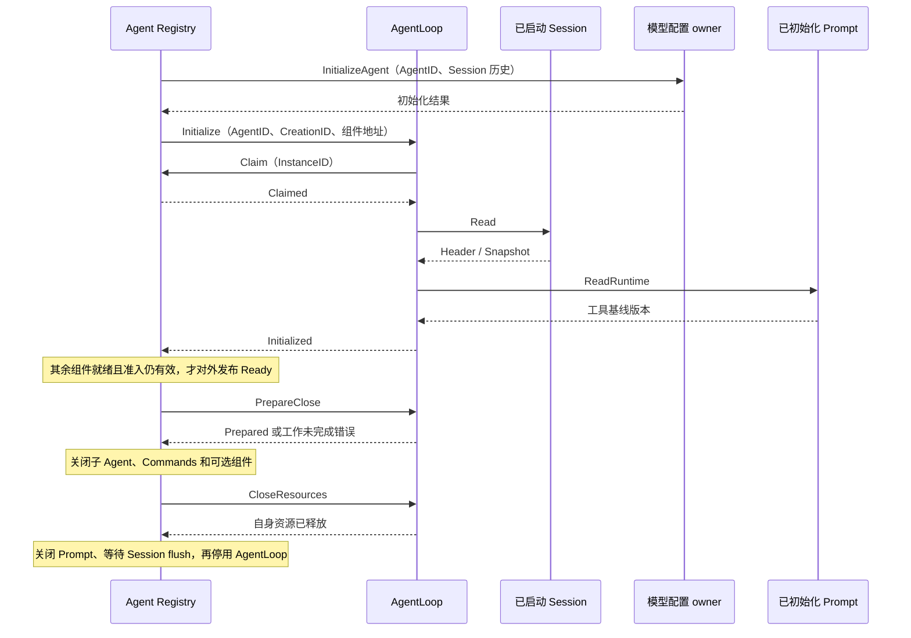
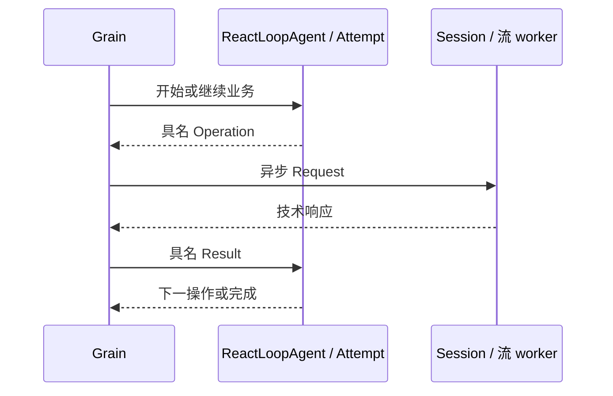
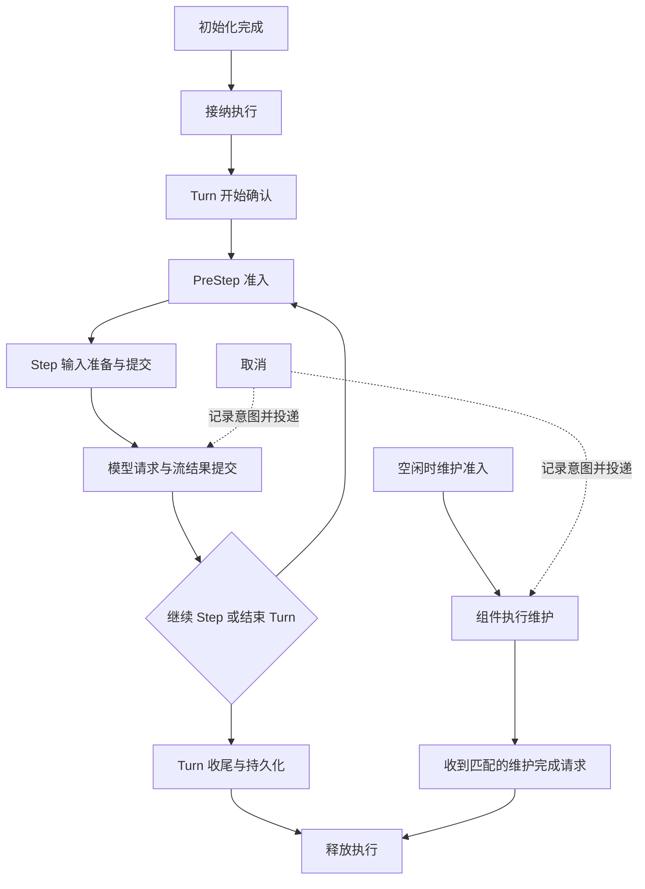

# AgentLoop Actor

本包是单 Agent 执行的 GoAkt 边界，生命周期设计见 [Agent 生命周期](../../zh-CN/actor-design/39-agent-activation.md)，业务设计见 [AgentLoop](../../zh-CN/actor-design/30-agentloop-business.md)。Grain 不启动其他 Actor，也不关闭 Session、Prompt 或 Commands；这些职责由 Agent Registry 与能力 Registry 协调。

## 对象和模块职责

- Grain 保存 ReactLoopAgent、已启动组件地址、当前请求关联。业务状态与准入规则由 ReactLoopAgent 决定。
- grain_initialize.go 接收共享 Initialize，按显式 AgentID/CreationID 请求 Claim、读取 Session.View 并恢复 Inbox。
- grain_prompt.go 请求已初始化 Prompt 的 ReadRuntime，读取工具基线版本。
- grain_close.go 处理 PrepareClose、CloseResources。准备关闭停止新准入；已有消息或维护未结束时返回错误。资源释放只清理本 Agent 执行状态，不代表 Session flush 已完成。
- messages.go 包含运行消息和 RuntimeName；Grain 名称为 `<sessionID>.agentloop`。共享初始化、关闭和激活校验消息位于 agent/actor，不保留旧 Initialize 别名。



每次激活生成新的 InstanceID，不能重新使用旧创建的授权。Registry 返回运行地址前通过 Verify 校验激活身份。初始化失败保留原创建状态供生命周期清理，历史 Inbox 不因失败被消费。关闭期间取消既有输入仍须通过 Session 提交；失败不修改业务投影。技术停用不能作为业务资源已经关闭的证据。

框架异步 RequestGrain 与 PipeToSelf 管理请求及邮箱续接，不保留池化 GrainContext，没有业务消息队列或 mutex。创建、关闭、恢复与故障交错的完整验证范围见 [Registry README](../../agent/registry/README.zh-CN.md)；这些生命周期测试不代表完整模型循环和生产 HTTP 装配完成。

LLM Router 将生成、读取、取消与关闭消息分配给固定 Worker 池。AgentLoop 不持有 Binding、Worker PID、ChunkStream 或提供者取消函数。Worker 返回具名结果，AgentLoop 按 CallID 和 RequestID 关联；取消接收结果与实际关闭结果分开确认。

## 模型与 Turn 收尾的职责边界

`grain_request.go` 调度 ReactLoopAgent.StartRequest/AdvanceRequest 返回的完整 ModelRequest 操作：读取 Session、配置中间件、保存 LLM 配置、执行 Attempt、恢复中间件。只有 ModelRequest 创建 Attempt；BeginModel 独立入口已删除。requestModel 仅提供组件路由，业务对象自行提供当前 Step 的参数。

`grain_stream.go` 把 Attempt 的 ReadLog、CommitEvents、OpenStream、ReadChunk、CloseStream 映射为异步请求，再将具名结果交回 ModelRequest。日志派生、chunk 确认、AssistantMessage、取消结论和是否重试均不由 Actor 决定。框架回复关联和 worker 地址保留在适配层。

业务确认 CallClosed 后才能结束当前调用；恢复中间件允许重试时使用新的 CallID，Worker 继续复用。CloseResources 通过 RetryRequestClose 请求清理，不能重新发起生成。真实 Actor 测试覆盖 Router、自定义恢复和默认 Retry 中间件；完整 Turn 主驱动、生产装配和异常生命周期清理尚未完成。

`grain_settlement.go` 直接编排 Session 幂等 Commit 和 Flush，没有另一层业务操作解释协议。PrepareTurnEnd 固定结束事实，ConfirmTurnEnd 接受真实提交；有 barrier 就 flush；未确认提交时重试原 IdempotentWrite，Session 返回原 WriteResult，无需 Read。ConfirmTurnFlush 负责最终状态转换。重试先查已有 barrier，已确认提交只重试 flush；未确认提交重用同一去重计划。框架响应必须匹配发出的请求类型。turn_end_write.go 只持有不可变结束事实，不引用可变业务对象。



初始化授权、组件请求顺序、路由校验、回复关联和框架停用仍在 actor 层。日志恢复、输入编辑和关闭准入通过 ReactLoopAgent 方法执行。没有扩展本次清理范围到其他真实消费者或整个旧 Plugin 组合层。

已提交范围的测试、构建证据及剩余缺口见 [Actor 实施进度与 Backlog](../../zh-CN/actor-design/12-implementation-plan.md#13-已完成进度2026-09-08)。局部验证不代表生产 Agent 已能驱动完整对话。

内部 requestModel 不再携带 PromptAssembly 或 Step 位置；这些数据由 ReactLoopAgent 当前 Step 提供。适配层只传入 PreparedLlmCall 的提供者元数据和 I/O 句柄。完整主驱动必须先完成 PrepareStep/ConfirmStep 及消息提交，再进入模型请求。


`agent.Agent` 定义 Followup、Steer、Inject、Cancel 等业务操作；异步提交及 WhenIdle 由 Actor Client 提供。输入接纳与执行完成分开确认，完整主驱动仍待接通。

## 业务接口与运行客户端

Grain 直接持有 ReactLoopAgent，不保留重复方法清单的 execution 接口。OnReceive 使用一个类型 switch，仅分发具名命令与完成消息。grain_inbox.go 处理输入请求：先核对 CreationID 和异步回复能力，再调用业务 Followup/Steer/Inject/Replace/Remove，最后请求 Session 提交并交回完整确认。目标队列、取消后的输入归属及执行预约由业务层决定。Session 提交期间显式使用框架 StashNonReentrant，禁止第二条输入基于未确认投影准备编辑。

Client 持有 GrainIdentity 与 CreationID，不保存池化 GrainContext，也不实现 agent.Agent。调用方 Grain 须启用框架 reentrancy；Followup/Steer/Inject/Cancel 返回具名请求句柄，Then 在调用方邮箱中接收 Changed。WhenIdle 独立返回空闲确认请求。错误保留 error 类型，业务交互不暴露 any。

空闲等待由 grain_idle.go 承担，使用每段忙碌期间的完成信号和框架任务，不把等待者放入业务对象或自建消息队列。输入提交确认只证明接纳；取消确认只证明取消投递及所需 Inbox 提交。执行预约、模型资源或收尾仍存在时不得回复空闲。技术停用使尚未完成的等待返回错误，不能冒充业务正常结束。完整对话驱动仍未接通，当前测试不证明 Followup 已驱动模型和工具执行。

实际 Actor 请求测试覆盖正常提交不回读、提交回复丢失后直接重试取得原结果及 flush 失败只重试持久化。该测试使用真实 GoAkt 邮箱和 Session.Log，存储失败由夹具注入；不作为真实磁盘 flush 或完整对话链路的验证证据。

## Step 准备编排

grain_step.go 负责领取、Session 读取、Prompt.Assemble、ResolvePreStep、Step 开始提交和逐条输入提交。每次完成通过具名消息回到邮箱；临时请求对象只保存回复、取消资源、调用标识和待交付快照，不持有业务阶段枚举。业务合法性由 ReactLoopAgent 的 preparation 与 Step 状态验证。

取消通过当前调用标识投递给 Prompt 和中间件；投递失败随取消回复返回，不能阻止已经要求的 Inbox 清理。取消期间仍确认真实写入。step/start 返回错误或无法确认时，在原请求结束后读取 Session 并进行业务恢复，不把错误解释成未提交。领取结果不确定时回读完整 Session 快照，由 ReconcileInput 根据领取前的日志位置核对原提交：已提交则仅投影一次，未提交则保留输入；冲突或回读失败仍保留未确认状态并报错。主驱动的后续恢复调度尚未接通。

当前 Actor 测试覆盖正常准备到模型准入，以及领取、开始提交回复丢失后的回读恢复。使用真实邮箱与 Session.Log，Prompt/中间件使用具名契约夹具；不能视为真实模型、工具及完整生产组合已完成。


## Turn 停止钩子

grain_turn.go 调用 ContinueTurn 获取业务决定，需要停止钩子时异步请求 Agent 中间件 RunTurnStopping，具名完成消息调用 CompleteStopping 后返回下一业务动作。等待允许 Steer 与取消，调用期间拒绝绕过钩子的直接 Turn 收尾。取消使用异步 RequestGrain 获取 Completion；取消确认不等于原钩子已结束。框架停用使等待请求失败。

Grain 仅持有调用回复、CallID、地址与取消资源，业务状态仍归 ReactLoopAgent。真实邮箱测试覆盖 Steer、取消和提前收尾拒绝，使用实际中间件协调器，具体钩子由具名测试端点实现；完整主驱动及真实业务钩子仍待接通。


准备阶段的取消使用当前请求对应的取消契约，Prompt 等待期间只请求 CancelAssembly，pre-step 等待期间只请求 CancelCall。取消确认与原准备结果独立，原请求返回前不清除准备资源；测试验证取消确认不提前完成准备，之后不得打开 Step。详见 [取消实现](./grain_cancel.go) 与 [测试](./grain_cancel_test.go)。


Turn 开始由 grain_start.go 提交 turnStartWrite。失败保留业务候选，重试请求返回相同 TurnStart 并交给 Session 幂等提交；不再自行读取日志。确认原结果后才能准备 Step。测试覆盖普通提交、回复丢失、提交拒绝和已有候选重试，全部无需 Session Read。


LLM Router 的结果等待由显式 replyTimeout 限定，计时任务只携带 CallID 和 RequestID。Generation 或 ReadChunk 超时进入同一调用的关闭流程，CloseCall 超时保留未释放状态；取消确认超时向取消请求方返回错误，不冒充资源关闭。`grain_generation_test.go` 验证这些情况以及迟到生成结果不被当作关闭结果。

## 消息分派职责与依赖

OnReceive 只处理共享 LLM Client 的协议回复、按职责分派和刷新空闲通知。
`grain_receive_*` 只路由消息，不新增业务状态或修改执行顺序；未识别消息最终交给框架 Unhandled。

| 分派文件 | 消息职责 | 前置条件与后续依赖 |
| --- | --- | --- |
| grain_receive_initialization.go | 创建授权、Session 恢复、模型与 Prompt 初始化回复 | 创建身份校验后逐段初始化；完成前不能开始执行 |
| grain_receive_inbox.go | 查询、Followup、Steer、Inject、Replace、Remove | Session 确认提交后才更新 Inbox 投影 |
| grain_receive_turn.go | Turn 开始、继续与收尾 | 已接纳执行才能开始 Turn；关闭 Step 和模型工作后才收尾 |
| grain_receive_step.go | PreStep 准入、输入准备及提交回复 | 准入先于输入派生；异步完成必须匹配原 preparation |
| grain_receive_model.go | 模型请求与流、持久化进度 | 输入准备完成后发起；回复推进同一 ModelRequest |
| grain_receive_lifecycle.go | 维护、取消、等待空闲和资源关闭 | 取消只表达意图；工作收尾后才释放；关闭沿既有父子生命周期执行 |



图中表示消息组之间的契约依赖，完整 Turn 主驱动尚未接通，不能据此宣称自动循环已完成。
通用维护协议已实现 Begin/Finish 和取消投递；Compaction 内部执行器消费该协议，
`compaction/command` 的运行适配仍待迁移。

创建共享协议位于 `agent/actor.Initialize` / `Initialized`，初始化调度仍由本包实现。Registry 无需 import 具体 AgentLoop 来取得消息类型；普通运行操作继续使用本包协议。已删除原 Initialize 类型，不保留兼容别名。当前创建入口与组件收尾契约见 [普通 Agent 激活设计](../../zh-CN/actor-design/39-agent-activation.md)。

### Step 收尾提交

`finishStep` 接收业务 Agent 已选定的 `EndStep`，异步请求 Session 并暂存普通请求。Session 在 Commit 内核对原 Step 身份并返回已有确认；Actor 将结果交给 `ConfirmStepEnd`，成功后才允许后续 Turn 边界。写入错误和原执行错误分开返回，写入成功不会抹除模型错误。无需独立 Step flush，持久化屏障仍在 Turn 收尾。

```mermaid
sequenceDiagram
    participant Driver as Loop 调度
    participant Loop as AgentLoop Grain
    participant Agent as ReactLoopAgent
    participant Session as Session Grain
    Driver->>Loop: finishStep(EndStep)
    Loop->>Session: Commit(幂等 Step end)
    Session-->>Loop: 原确认或新确认 / error
    Loop->>Agent: ConfirmStepEnd
    Loop-->>Driver: 写入结果 + 原执行错误
```

新增验证覆盖提交确认丢失后的重试、唯一 step/end 和原执行错误保留。主驱动与工具批次接线仍未完成；该请求目前由集成夹具驱动，不能据此宣称 Followup 已自动执行。设计见 [AgentLoop 业务](../../zh-CN/actor-design/30-agentloop-business.md)。

关闭时，业务对象区分已接纳但未开始的活动与已开始的 Turn。前者可以保留 Inbox 并结束活动，随后由 Registry 完成 Session flush；后者（含确认未定的 Turn start）继续等待实际收尾。Actor 不以“没有模型请求”推断整个执行已经结束。对应 HTTP prompt→关闭→重启输入保留与单次 SIGINT 验证见 [INT-48](../../zh-CN/actor-design/40-integration-findings.md#int-48提交输入后-ctrl-c-关闭超时)。
