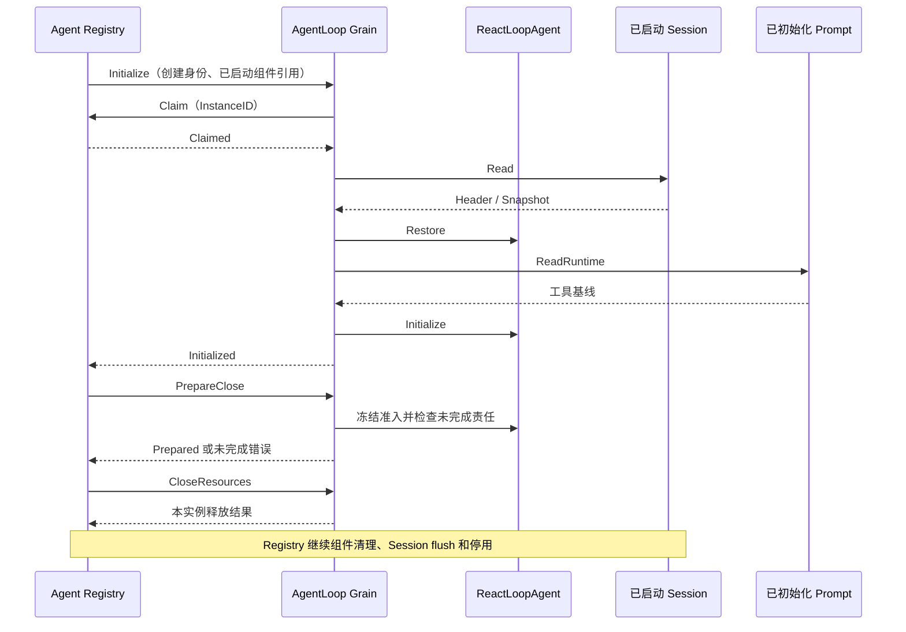
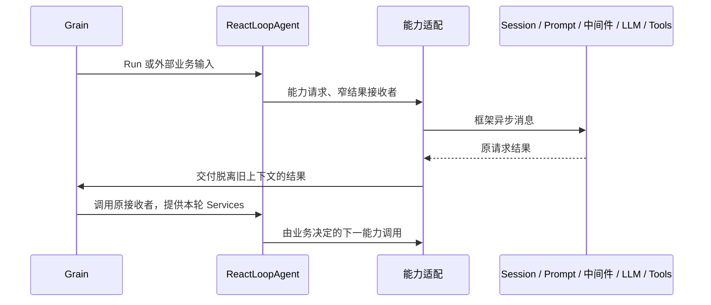

# AgentLoop Actor

本包实现 AgentLoop 的 GoAkt 通信与生命周期适配。完整业务执行流程属于 [ReactLoopAgent](../README.zh-CN.md)，Actor 不根据模型或工具结果选择下一业务步骤，也不启动其他 Actor。组件由 Agent Registry 与对应能力 Registry 管理。

## 对象与模块职责

| 文件或对象 | 职责 |
| --- | --- |
| Grain / grain.go | 保存业务对象、组件地址、通信请求与激活身份；按职责分派消息 |
| grain_initialize.go | 校验创建授权，读取 Session 恢复业务，确认 Prompt 已初始化 |
| grain_inbox.go | 将外部输入映射到业务入口，提交提案并交付真实确认，唤醒已接纳执行 |
| grain_services.go | 将业务能力映射为异步请求，将解码结果交付给业务指定接收者 |
| grain_generation.go | 适配 LLM Client 的生成、读取、关闭结果，维护 CallID 与请求关联 |
| grain_tool_calls.go | 适配工具能力请求，登记当前调用以便取消；不选择工具阶段或审批结果 |
| grain_cancel.go / grain_maintenance.go | 取消投递、确认关联及维护开始/完成协议 |
| grain_idle.go / grain_close.go | 空闲等待、关闭准入与本实例资源释放；不替代业务完成判断 |
| Client | 对外异步提交和等待接口；持有 GrainIdentity 与 CreationID，不实现业务 Agent 接口 |

原有 grain_start、grain_step、grain_turn、grain_request、grain_stream 及 Step/Turn 收尾驱动已经删除。Actor 不再接收 startTurn、prepareStep、finishStep、finishTurn 等内部流程命令。

## 依赖与生命周期

Grain 名称为 `<sessionID>.agentloop`。CreationID 对应 Registry 的创建授权，InstanceID 每次激活重新生成；旧激活的回复不能修改新实例。共享 Initialize / Initialized 协议在 agent/actor，普通输入与运行消息在本包。

Grain 仅收到取消确认时不能回复空闲；业务活动、未交付结果或模型/工具资源仍存在时继续等待。技术停用使等待失败，不能冒充业务完成。失败初始化不消费历史 Inbox。

## 能力交互

Services 只在当前串行调用期间有效，业务对象不保留它。延迟回调不捕获池化 GrainContext；结果关联保存创建身份、请求身份及业务接收者。`capabilityDelivery` 只交付已经确定的结果，不包含业务阶段或下一步指令。立即发送失败也通过适配交付，避免业务在能力发起尚未返回时收到完成。

Session 输入提案提交期间使用 RequestGrain 的 StashNonReentrant；Prompt 和中间件等待允许取消与输入。能力请求当前通过 PipeToSelf 将结果带回新的处理上下文。**请求暂存解除到结果再次进入邮箱之间的输入交错尚未验证完整**，不能据此声称整个提交到业务确认边界已经串行封闭。

LLM 使用独立 Client 和 Router Worker 池，Actor 保存 CallID 及窄接收者，不持有 ChunkStream，也不解释 ModelRequest 操作。工具适配仅发送业务选择的 Prepare、ApplyApproval、Dispatch、Finalize、Release；Tools Runtime 负责实际实例，审批生产接线仍未完成。

## 验证范围与剩余工作

能力交付探针覆盖延迟成功、立即失败、超时和迟到结果；业务完整流程及持久化重试已迁入业务包测试。真实 HTTP/WebSocket 文本集成已通过当前执行路径。

旧内部流程命令测试已迁移为完整 Run、真实能力请求和外部 Client 测试，Actor 测试包的非缓存 race 测试已通过。工具审批、完整取消和资源失败恢复、Session 确认交错及恢复 Inbox 自动唤醒仍有缺口，不保留旧流程入口来使测试编译。

设计见 [AgentLoop](../../zh-CN/actor-design/30-agentloop-business.md) 与 [Agent 生命周期](../../zh-CN/actor-design/39-agent-activation.md)。本轮证据及问题见 [集成记录](../../zh-CN/actor-design/40-integration-findings.md)，总体计划见 [Actor 实施计划](../../zh-CN/actor-design/12-implementation-plan.md)，历史记录见 [实现进度](../../zh-CN/08-implementation-progress.md)。

中间件选择通过生命周期的 Handlers 传入，分别对应 PreStep、RequestError、TurnStopping；能力适配仅传递有序路由。恢复测试位于 grain_recovery_test.go，覆盖真实协调器、自定义恢复与默认 Retry actor；停止钩子测试覆盖 Steer、取消与失败取消重投，均不发送内部 Turn/Step 指令。关闭超时测试验证保持 CallID、迟到生成回复不替代关闭结果、未确认关闭时继续保留执行责任。

关闭接线验证：`PrepareClose` 在业务对象中冻结准入并记录执行取消，Actor 复用取消通道通知正在执行的能力；收到取消确认后仍等待业务收尾。`internal/server/server_conversation_test.go` 的 `TestHTTPCloseCancelsStreamingModelAndFlushesTurn` 通过真实 HTTP 提交消息、保持模型流打开、再关闭服务，验证提供方收到取消、Step/Turn 结束写入 SQLite，以及后续排队输入仍能从日志恢复。
