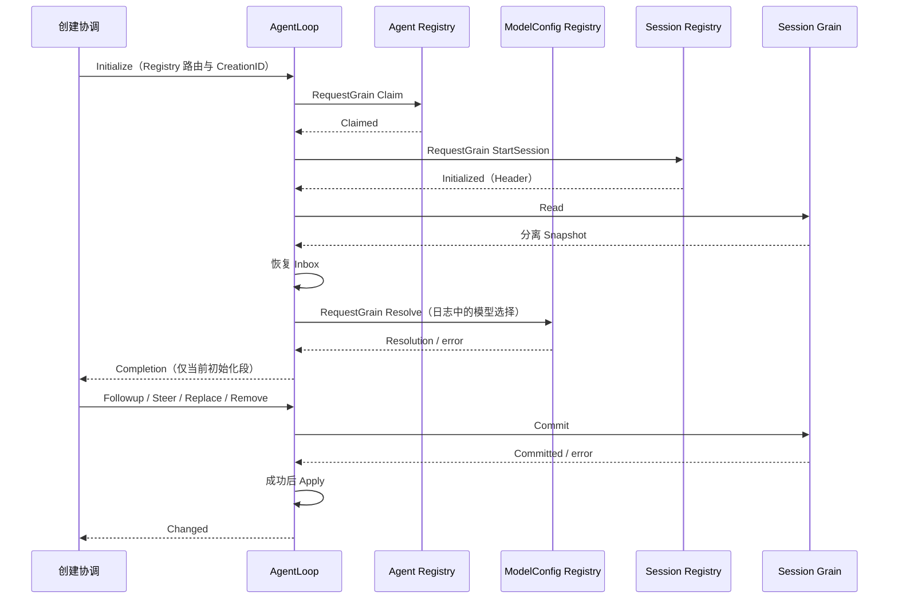
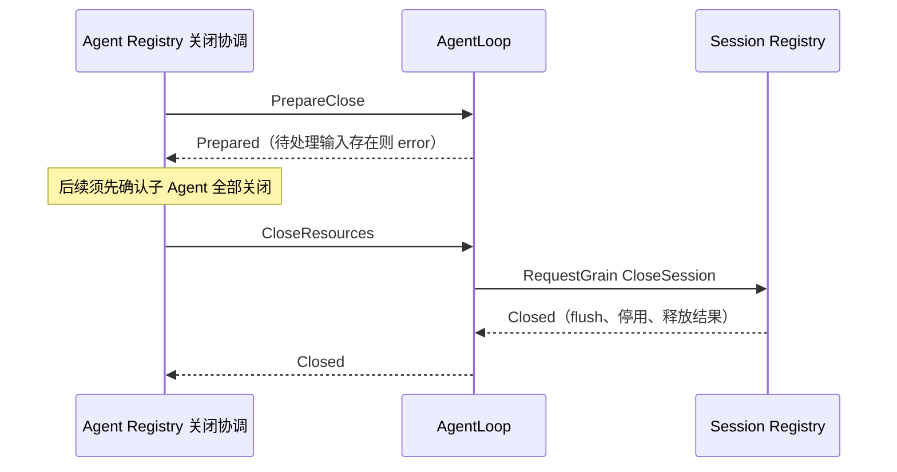
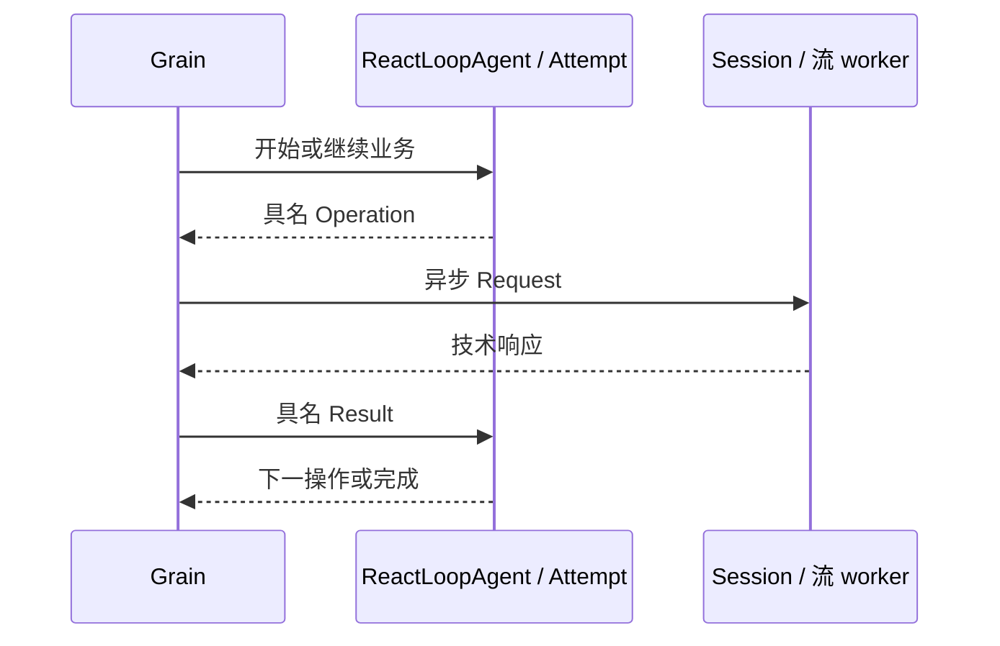

# AgentLoop Actor

本包是每个 Agent 的执行框架边界，设计见 [AgentLoop 业务迁移](../../zh-CN/actor-design/30-agentloop-business.md)与 [Agent 职责](../../zh-CN/actor-design/32-agent-module.md)。当前接通授权、Session 请求初始化、Inbox 恢复与提交、模型配置解析、Prompt Runtime 请求初始化；完整模型循环和其余组件初始化尚未完成。

`Grain` 按 SessionID 寻址，持有 Inbox 业务投影。`grain_initialize.go` 管理 Session 与 Inbox 初始化，`grain_model.go` 根据日志恢复的选择请求 ModelConfig Registry，保留解析后的参数、版本和凭据引用；`messages.go` 定义初始化与 Inbox 命令。创建授权 Claim/Claimed 属于 agent/actor 共享运行契约。Registry 与 AgentLoop 都依赖该契约；agent 不导入 agentloop，AgentLoop 也不导入具体 Registry。

每次激活生成 InstanceID，必须先取得授权，再向 Session Registry 请求已登记的 Session，随后读取日志。Initialize 不接收 Header、Session 结果或存储适配器。初始化持有原输入和独立 GrainReply，异步阶段不保留池化上下文。框架 StashNonReentrant 串行化 Session 请求与 Inbox 更新，没有业务消息队列或 mutex。初始化停止时取消等待并失败回复，Session 提交失败不改变 Inbox。Claim 成功后即绑定原创建的 Session 清理责任；读取或 Inbox 恢复失败保留绑定，Registry 仍可关闭这次失败创建。初始化尚未结束时不允许资源释放，Inbox 缺失不作为资源关闭成功的依据。

`grain_prompt.go` 请求 Prompt Runtime 自行读取提示词定义及工具基线，并在关闭时等待其业务关闭和框架停用。`grain_close.go` 处理 agent/actor 的 PrepareClose 与 CloseResources。前者禁止新增/替换输入，有待处理 Inbox 时返回 ErrPending；Remove 取消既有输入仍需提交 Session。后者要求已经停止接纳且 Inbox 为空，异步请求初始化时提供的 Session Registry 执行 CloseSession，等待 flush、停用与释放。失败保留状态供重试；成功清空本地视图并保留原创建身份，重复关闭不再访问 Session，也不能重新初始化本实例。

技术停用只释放本地派生视图，不代表 Session 或 Agent 已业务关闭。当前关闭覆盖已实现的 Inbox、Prompt Runtime 和 Session 绑定；Registry 已接通当前资源范围内的父子关闭编排；配置就绪、消息驱动执行与其他组件收尾仍待实现。不能把 Inbox 初始化成功报告为生产 Agent 已 Ready。

初始化成功之前不接纳 Inbox 写入。模型配置失败后即使已恢复 Inbox，也仍属于失败创建；关闭该创建不消费历史输入，日志保留供后续恢复。完整 Prompt/Tools 初始化接入后，成功回复必须继续后移到全部必需组件就绪。

`stream_reader.go` 是独立的模型流 I/O Actor，独占 PreparedLlmCall 打开的 ChunkStream，按请求逐块读取并返回分离值。读取不占用 AgentLoop 邮箱；取消由本次模型尝试的 Context 传递，关闭请求按 worker 邮箱顺序等待前次读取结束。关闭失败保留流供重试，PostStop 仍尝试释放。此 worker 尚待接入 Turn/Step 的模型请求驱动，不能作为主流程已完成的证据。

## 模型与 Turn 收尾的职责边界

`grain_stream.go` 只执行 Attempt 返回的 ReadLog、CommitEvents、OpenStream、ReadChunk、CloseStream 和 Completed，并将技术响应转换为具名业务结果。请求头派生、发送前一致性检查、chunk 确认、消息生成、取消结论和关闭重试都由 Attempt 决定。旧 grain_request.go、streamStage、options/chunk/failure/contextDraft 业务副本已删除。

模型资源释放仍归适配层：业务报告 StreamClosed 后停止 reader；技术停止失败保留 PID 以便重试。CloseResources 通过 Attempt.RetryClose 请求清理，不能自行切换业务阶段。请求完成与业务资源关闭分开，关闭失败不能提前丢弃 worker。requestModel 仍是已准备模型调用的内部入口，LLM 替代流、请求中间件及完整 Turn 驱动尚未接入。

`grain_settlement.go` 直接编排 Session 幂等 Commit 和 Flush，没有另一层业务操作解释协议。PrepareTurnEnd 固定结束事实，ConfirmTurnEnd 接受真实提交；有 barrier 就 flush；未确认提交时重试原 IdempotentWrite，Session 返回原 WriteResult，无需 Read。ConfirmTurnFlush 负责最终状态转换。重试先查已有 barrier，已确认提交只重试 flush；未确认提交重用同一去重计划。框架响应必须匹配发出的请求类型。turn_end_write.go 只持有不可变结束事实，不引用可变业务对象。

初始化授权、组件请求顺序、路由校验、回复关联和框架停用仍在 actor 层。日志恢复、输入编辑和关闭准入通过 ReactLoopAgent 方法执行。没有扩展本次清理范围到其他真实消费者或整个旧 Plugin 组合层。

已提交范围的测试、构建证据及剩余缺口见 [Actor 实施进度与 Backlog](../../zh-CN/actor-design/12-implementation-plan.md#13-已完成进度2026-09-08)。局部验证不代表生产 Agent 已能驱动完整对话。

内部 requestModel 不再携带 PromptAssembly 或 Step 位置；这些数据由 ReactLoopAgent 当前 Step 提供。适配层只传入 PreparedLlmCall 的提供者元数据和 I/O 句柄。完整主驱动必须先完成 PrepareStep/ConfirmStep 及消息提交，再进入模型请求。

`agent.Agent` 定义 Followup、Steer、Inject、Cancel 等业务操作；异步提交及 WhenIdle 由 Actor Client 提供。输入接纳与执行完成分开确认，完整主驱动仍待接通。

## 业务接口与运行客户端

Grain 直接持有 ReactLoopAgent，不保留重复方法清单的 execution 接口。OnReceive 使用一个类型 switch，仅分发具名命令与完成消息。grain_inbox.go 处理输入请求：先核对 CreationID 和异步回复能力，再调用业务 Followup/Steer/Inject/Replace/Remove，最后请求 Session 提交并交回完整确认。目标队列、取消后的输入归属及执行预约由业务层决定。Session 提交期间显式使用框架 StashNonReentrant，禁止第二条输入基于未确认投影准备编辑。

Client 持有 GrainIdentity 与 CreationID，不保存池化 GrainContext，也不实现 agent.Agent。调用方 Grain 须启用框架 reentrancy；Followup/Steer/Inject/Cancel 返回具名请求句柄，Then 在调用方邮箱中接收 Changed。WhenIdle 独立返回空闲确认请求。错误保留 error 类型，业务交互不暴露 any。

空闲等待由 grain_idle.go 承担，使用每段忙碌期间的完成信号和框架任务，不把等待者放入业务对象或自建消息队列。输入提交确认只证明接纳；取消确认只证明取消投递及所需 Inbox 提交。执行预约、模型资源或收尾仍存在时不得回复空闲。技术停用使尚未完成的等待返回错误，不能冒充业务正常结束。完整对话驱动仍未接通，当前测试不证明 Followup 已驱动模型和工具执行。

实际 Actor 请求测试覆盖正常提交不回读、提交回复丢失后直接重试取得原结果及 flush 失败只重试持久化。该测试使用真实 GoAkt 邮箱和 Session.Log，存储失败由夹具注入；不作为真实磁盘 flush 或完整对话链路的验证证据。

## Step 准备编排

grain_step.go 负责领取、Session 读取、Prompt.Assemble、ResolvePreStep、Step 开始提交和逐条输入提交。每次完成通过具名消息回到邮箱；临时请求对象只保存回复、取消资源、调用标识和待交付快照，不持有业务阶段枚举。业务合法性由 ReactLoopAgent 的 preparation 与 Step 状态验证。

取消通过当前调用标识投递给 Prompt 和中间件；投递失败随取消回复返回，不能阻止已经要求的 Inbox 清理。取消期间仍确认真实写入。step/start 返回错误或无法确认时，在原请求结束后读取 Session 并进行业务恢复，不把错误解释成未提交。领取结果不确定时回读完整 Session 快照，由 ReconcileInput 根据领取前的日志位置核对原提交：已提交则仅投影一次，未提交则保留输入；冲突或回读失败仍保留未确认状态并报错。主驱动的后续恢复调度尚未接通。

当前 Actor 测试覆盖正常准备到模型准入，以及领取、开始提交回复丢失后的回读恢复。使用真实邮箱与 Session.Log，Prompt/中间件使用具名契约夹具；不能视为真实模型、工具及完整生产组合已完成。

## Turn 停止钩子

grain_turn.go 调用 ContinueTurn 获取业务决定，需要停止钩子时异步请求 Agent 中间件 RunTurnStopping，具名完成消息调用 CompleteStopping 后返回下一业务动作。等待允许 Steer 与取消，调用期间拒绝绕过钩子的直接 Turn 收尾。取消使用异步 RequestGrain 获取 Completion；取消确认不等于原钩子已结束。框架停用使等待请求失败。

Grain 仅持有调用回复、CallID、地址与取消资源，业务状态仍归 ReactLoopAgent。真实邮箱测试覆盖 Steer、取消和提前收尾拒绝，使用实际中间件协调器，具体钩子由具名测试端点实现；完整主驱动及真实业务钩子仍待接通。

准备阶段的取消使用当前请求对应的取消契约，Prompt 等待期间只请求 CancelAssembly，pre-step 等待期间只请求 CancelCall。取消确认与原准备结果独立，原请求返回前不清除准备资源；测试验证取消确认不提前完成准备，之后不得打开 Step。详见 [取消实现](./grain_cancel.go) 与 [测试](./grain_cancel_test.go)。

Turn 开始由 grain_start.go 提交 turnStartWrite。失败保留业务候选，重试请求返回相同 TurnStart 并交给 Session 幂等提交；不再自行读取日志。确认原结果后才能准备 Step。测试覆盖普通提交、回复丢失、提交拒绝和已有候选重试，全部无需 Session Read。
