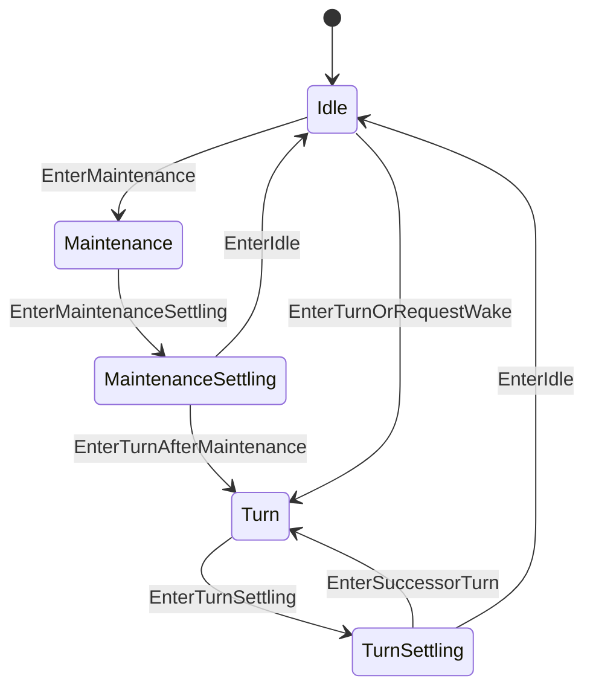

# AgentExecution 状态机

本 package 拥有一个 exact Agent 的唯一 execution slot。权威术语与跨模块契约见[15 Agent Loop 与请求驱动模块设计](../../../zh-CN/15-agent-loop-and-request-driver.md)，验证状态见[08 实施进度](../../../zh-CN/08-implementation-progress.md)。

## 职责边界

`AgentExecution` 拥有 Maintenance/Turn 互斥、generation、operation context、首个 typed `Cancellation`、wake latch 和 idle completion signal。它不拥有 Turn/Step number、Session fact、模型请求或 Tool result。

`ExecutionSnapshot` 一次返回 State、Generation 和 Cancellation，不暴露 context/cancel function。successor Turn 直接取得下一 generation，不关闭共享 completion signal，因此 `WhenIdle` 看不到 transient idle。`RecordCancellation` 只保留第一个原因；`keepWake` 决定是否丢弃已锁存 successor work。

generation stale、maintenance wake、取消分支和任意 accepted sequence 由本 package 测试拥有。
