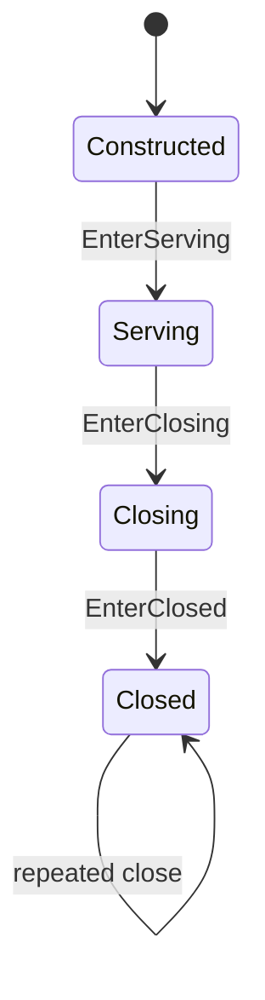

# AgentLifecycle 状态机

本 package 拥有一个 exact Agent 的 API invocation 接纳、关闭 cutoff 和排空规则。权威术语与跨模块契约见[15 Agent Loop 与请求驱动模块设计](../../../zh-CN/15-agent-loop-and-request-driver.md)，验证状态见[08 实施进度](../../../zh-CN/08-implementation-progress.md)。

## 职责边界

`AgentLifecycle` 拥有 `Constructed`、`Serving`、`Closing`、`Closed` 四个 State，以及 `AgentInvocation` 的 exact admission/finish。它不拥有当前 execution、Inbox、Session、cancel cause 或 Plugin teardown。

`activeInvocations` 的 key 是单调递增 invocation identifier，value 是空 membership marker；存在表示 cutoff 前已接纳但尚未完成。

RLA 在 `Send`、`Cancel` 和 Maintenance 等 API 入口先调用 `AdmitInvocation`，退出时调用 `FinishInvocation`。`EnterClosing` 拒绝新 invocation并返回排空信号；caller wait context 取消不改变内部 cutoff。

非法来源、重复 finish、terminal 与任意 accepted sequence 由本 package 测试拥有。
