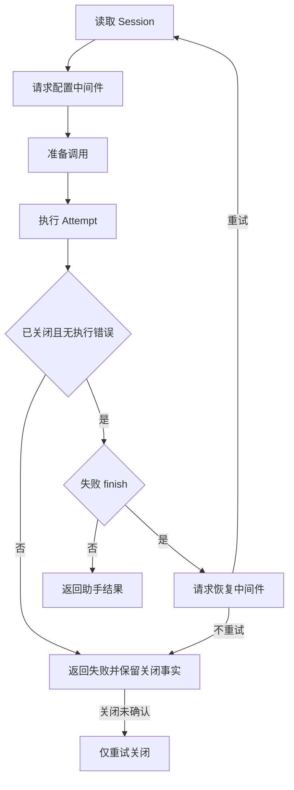

# ModelRequest 状态机

本 package 拥有一个 Step 内模型请求的 attempt progression 与终态。权威术语与跨模块契约见[15 Agent Loop 与请求驱动模块设计](../../../zh-CN/15-agent-loop-and-request-driver.md)，验证状态见[08 实施进度](../../../zh-CN/08-implementation-progress.md)。

## 职责边界

`ModelRequest` 拥有完整请求的业务进度、当前 Attempt、已提交请求头事实和取消原因。Start/Advance 驱动配置基线读取、请求中间件、调用准备、模型尝试与恢复决策。它不持有 stream、Adapter、Context 或 Actor；重试策略只作为分离值传递给恢复中间件，不计算重试次数上限或退避。

Attempt 成功 Start 后才增加尝试计数，不能将计数解释为 provider HTTP 请求数。配置读取、准备或执行失败由 Advance 统一收尾；恢复中间件返回显式 Retry=true 才重新读取 Session。旧的公开 Enter* 阶段修改方法已删除，重试读取复用私有 readingHistory 等待位置。

旧阶段矩阵测试已迁移为具名操作的协议测试；本轮尚未运行，完整重试及清理行为仍需后续验证。

`request_header.go` 提供纯业务的 HeaderDraft、ContextDraft 和 Proposal：决定请求快照事件是否需要写入、保留 initial/resume/change 区别，并从下一次提案中移除适配器自动默认值。函数不持有 Session 或执行 I/O；提交确认和模型流启动由 Actor 负责。调用方只有在草稿提交成功后才能标记本次激活已记录请求头。

`Attempt` 是单次模型尝试的纯业务对象：保存有效请求参数、Step 位置、块组装状态和已提交来源序号。Prepare 决定请求头草稿，ChunkDraft/ConfirmChunk 区分提案与已提交块，MessageDraft/ConfirmMessage 区分待提交与已确认的助手消息。错误 finish 不生成成功助手消息，重试决策由上层 ModelRequest 流程负责。对象不引用 Context、Actor、Session 实例或 provider。

## Actor 重构中的提交确认

当前 Attempt 的目标流程见 [AgentLoop 业务方案](../../../zh-CN/actor-design/30-agentloop-business.md)。EventsCommitted 使用完整 Session.WriteResult，而不是裸事件数组。确认时校验 Session 身份、单事件区间、已观察日志位置，以及待提交草稿的 payload、surface 操作与来源元数据。确认成功后才推进下一操作；匹配失败不接受助手响应。

Attempt 保留 pendingDraft 直到对应提交确认，messageDraft 保留已生成助手消息的不可变提案，供消息确认核对；confirmedNext 是已观察的提交前缀下界，允许其他合法 Session 写入占用中间序号，不要求本次写入紧邻上一事件。它们不是 actor 请求关联或持久化后端状态。

当前 Grain 已接入单次 Attempt；完整 ModelRequest 驱动尚未接入 Grain，不能据此声称 AgentLoop 主链完成。

### 发送前的请求一致性

Attempt 首次读取日志时要求自己的 Turn/Step 仍处于打开状态。完成必要 Header/context 提交后，再读取 Snapshot，核对 Session、完整前缀、当前 Step、已提交 Header 和 Surface 派生消息。任何不匹配都返回业务错误，不自动重写待发送请求。检查全部通过后才产生 OpenStream 操作。

检查只证明所提供 Snapshot 时点的一致性；真实派发前的跨 actor 更新隔离、替代流接入仍未验证，不能把该局部业务检查当作完整生产不变量已成立。

### 调用协议与终态

Start、Advance、RetryClose 的 error 返回值表示调用协议错误，不会修改在途阶段。外部操作失败通过 Failed 输入进入正常失败收尾，业务结论放在 Completed.Err。错误类型结果、重复启动、终态后继续推进和运行中的关闭重试均被拒绝。

RetryClose 仅用于已结束但资源关闭未确认的尝试；已关闭的终态返回保留的结论。关闭重试不得清除原失败或重新提交助手消息。助手消息提交与取消交错时，先确认真实写入，再报告取消；不伪造回滚，也不忽略取消。

NewAttempt 从 Step 的 Prompt 数据构造 system/tools，不从 Prompt 取得对话。Start 请求 Session，deriveInput 在 AgentLoop 业务包内构造 messages；请求重试应创建新的 Attempt 重新读取，而不是把本步进入消息当作完整历史。

## 完整请求驱动

model_request_flow.go 通过 ReadRequest、ResolveConfiguration、PrepareCall、RunAttempt、ResolveRecovery 和 RequestFinished 串起已定义的业务边界。配置中间件先运行，再验证 provider/model；只有 NO_ADAPTER 准备错误进入未绑定适配器的流扩展路径。真实终端是否有可用适配器仍由 LLM owner 判断。

每次明确重试都重新读取 Session，重新解析配置和构造 Attempt。失败 finish 才进入恢复，其他操作错误直接结束；取消优先于重试，provider aborted finish 本身不是 Agent 取消。多次尝试共享本次请求的 HeaderCommitted 累计事实，不能因后一次失败丢失。RetryClose 只处理已结束但未确认关闭的当前 Attempt，成功后仍保留原业务失败。

RequestResult 与 Attempt.Result 分层，AttemptAdvanced 仅封装当前尝试的具名结果。检查回复类型后才记录取消或推进；缺失活动 Attempt、重复启动和终态后继续推进报调用错误。业务对象无 I/O，适配器执行返回操作。当前仅构建通过，行为测试与完整生产接线尚未完成。

ReactLoopAgent 持有当前完整请求；Outcome 只在终态返回分离的助手消息、finish 和资源关闭事实，恢复或清理进行中不能读取终态。Step 续步前由 AgentLoop 检查该结果；驱动没有指向 AgentLoop 的反向引用。

请求阶段已收为私有 requestPhase，只用于匹配异步操作完成。对外不暴露 StateValue；成功、失败、取消共享完成位置，由 Outcome.Err 解释结果。runningAttempt 表示整个尝试，包括日志核对，不能解释成流已经打开。完成位置与 StreamClosed 各自表达请求结束和资源退出，不相互代替。
