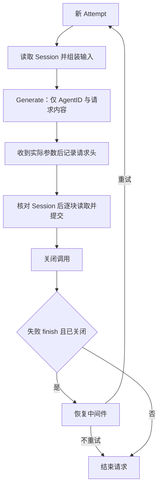

# ModelRequest

本包是 AgentLoop 内部的模型请求业务实现。跨组件契约见 [LLM 与 AgentLoop 方案](../../../zh-CN/actor-design/33-llm-module.md)，业务流程见 [AgentLoop 方案](../../../zh-CN/actor-design/30-agentloop-business.md)，迁移进度见 [实施计划](../../../zh-CN/actor-design/12-implementation-plan.md)。

## 职责划分

ModelRequest 拥有一个 Step 内的尝试序列、已确认请求头事实、取消原因及恢复结果执行。ReactLoopAgent 持有它，不实现第二套重试流程。请求阶段只用于匹配操作结果；成功、失败和取消统一通过最终结果解释。

Attempt 拥有一次尝试的输入、实际模型参数、块组装和 Session 提交确认。NewAttempt 根据 Prompt 生成 system/tools，Start 读取 Session，deriveInput 组装对话；它不引用 Actor、Context、Session 实例、Binding 或流。LLM 内部固定配置并生成，Attempt 只消费结果。

## Session 与流的交互

Generate 是一次外部操作；没有 PrepareCall/OpenStream 协议。GenerationStarted 表示 LLM 已执行打开操作，其元数据用于 request/header 和模型上下文事实。完成这些提交并核对日志后才读取首块。该时序不再保证模型请求发出前已经持久化最终参数；Session 记录失败时取消并关闭调用。

HeaderDraft、ContextDraft 保留 initial/resume/change 和实际参数的默认值标记。请求头只能在真实提交确认后标记已记录。Attempt 提交时验证 Session 身份、事件区间、payload、surface 操作及来源元数据；confirmedNext 是已观察前缀下界，允许合法的其他事件占用中间序号。

ChunkDraft/ConfirmChunk 分开待提交块和已确认块，MessageDraft/ConfirmMessage 分开待提交助手消息与真实确认。错误 finish 不产生成功助手消息。读取当前块并完成必要提交后，才请求下一块。

## 失败、取消与恢复

Start/Advance/RetryClose 的 error 返回值表示协议错误，不修改不匹配的在途阶段。外部失败通过具名失败结果进入收尾，最终结论通过 Completed.Err 返回。状态检查先于取消记录，错误类型的回复不能改变当前请求。

失败 finish 且资源已关闭时才请求恢复中间件；它决定是否重试以及退避，ModelRequest 只执行 Retry 结果。再次尝试重新读取 Session，LLM 自行选择调用配置，每次只创建一个 Attempt。取消优先于恢复，provider aborted finish 不自动等于 Agent 取消。

Close 失败保留原错误和未释放事实，只能重试关闭，不能重新生成或重复提交助手消息。请求结束与资源关闭是不同事实。Outcome 只在请求终态可读；Step 续步前必须确认资源已经释放。

当前真实 Actor 请求测试已经接入 Router，覆盖自定义恢复和默认 Retry。Followup 到完整 Turn/工具循环以及异常关闭的整体完成情况仍以实施计划为准。
