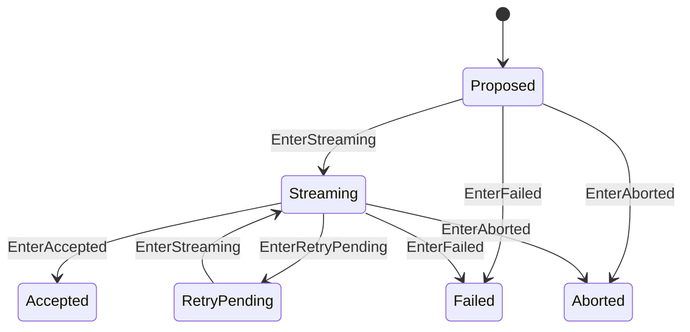

# ModelRequest 状态机

本 package 拥有一个 Step 内模型请求的 attempt progression 与终态。权威术语与跨模块契约见[15 Agent Loop 与请求驱动模块设计](../../../zh-CN/15-agent-loop-and-request-driver.md)，验证状态见[08 实施进度](../../../zh-CN/08-implementation-progress.md)。

## 职责边界

`ModelRequest` 只拥有 State 和已 dispatch attempt count。它不保存 Session messages、request options、stream、Adapter 或 retry delay policy。

每个 `EnterStreaming` 表示一个真实 Adapter stream attempt。pre-stream request proposal/prepare 失败可以直接进入 Failed/Aborted；Accepted 只能来自 Streaming。`agent/request-error` 是否 retry 由外部 Consumer 决定，RLA 只把明确决定交给 `EnterRetryPending`。

attempt count、terminal 不可重开、完整来源矩阵和任意 accepted sequence 由本 package 测试拥有。
