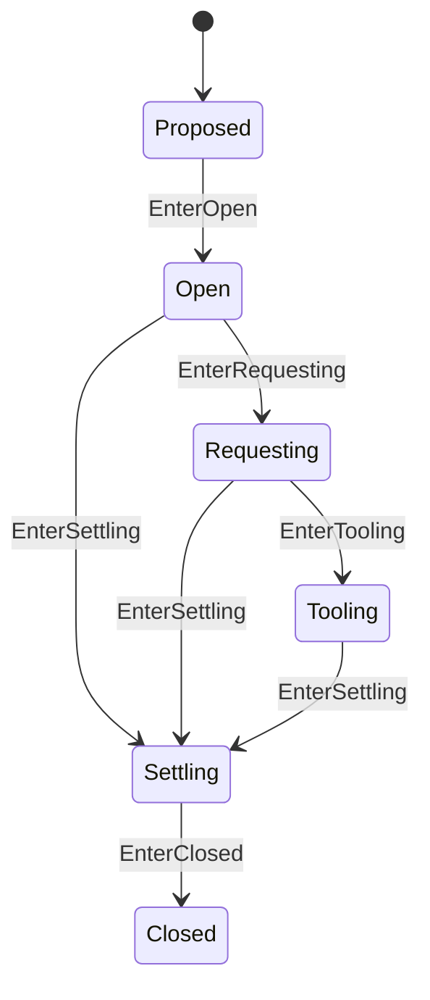

# Step 状态机

本 package 拥有一个 admitted Agent Step 的纯状态与 boundary 不变量。权威术语与跨模块契约见[15 Agent Loop 与请求驱动模块设计](../../../zh-CN/15-agent-loop-and-request-driver.md)，验证状态见[08 实施进度](../../../zh-CN/08-implementation-progress.md)。

## 职责边界

`Step` 拥有 exact Turn/Step position、`StepResult` 和 `step/start`/`step/end` 配对状态。它不调用 LLM/Tools、不 Commit，也不持有 ModelRequest 或 ToolBatch。

pre-step reject 或空 initial batch 不创建 Step。Tool continuation 以 `StepResultContinue` 关闭当前 Step，再由 Turn 打开 successor Step；request retry 保持在同一 Step。取消或失败后，RLA 使用 settlement context 提交 `step/end`，再调用 `EnterClosed`。

非法 Tooling、opened-operation failure、terminal 和任意 accepted sequence 由本 package 测试拥有。
