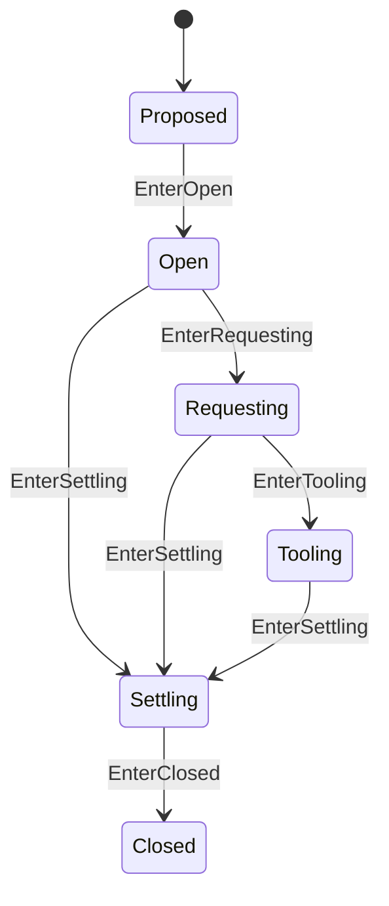

# Step 状态机

本 package 拥有一个 admitted Agent Step 的纯状态与 boundary 不变量。权威术语与跨模块契约见[15 Agent Loop 与请求驱动模块设计](../../../zh-CN/15-agent-loop-and-request-driver.md)，验证状态见[08 实施进度](../../../zh-CN/08-implementation-progress.md)。

## 职责边界

`Step` 拥有 exact Turn/Step position、`StepResult` 和 `step/start`/`step/end` 配对状态。它不调用 LLM/Tools、不 Commit，也不持有 ModelRequest 或 ToolBatch。

pre-step reject 或空 initial batch 不创建 Step。Tool continuation 以 `StepResultContinue` 关闭当前 Step，再由 Turn 打开 successor Step；request retry 保持在同一 Step。取消或失败后，RLA 使用 settlement context 提交 `step/end`，再调用 `EnterClosed`。

非法 Tooling、opened-operation failure、terminal 和任意 accepted sequence 由本 package 测试拥有。

`step_events.go` 由 Step 生成开始事件草稿，不执行存储或提前改变状态。调用方提交成功后才能 EnterOpen；回合和步骤编号均校验正安全整数。Session 请求与调度属于 Actor 层。

MessageDraft 只在已打开的 Step 上生成用户消息 SurfaceAppend 草稿，EndDraft 只在已进入收尾的 Step 上生成结束草稿。调用方仍逐条提交输入，全部成功后 EnterRequesting；结束事件提交成功后才 EnterClosed。业务对象不因“已生成草稿”提前推进状态。

Step 现在持有一次 Capture 的 Input：已准入消息、PromptAssembly、ToolsVersion。Capture 只允许在 proposed 阶段执行一次；InputValue 返回分离副本。Prompt、工具 schema 和消息不会经返回值别名修改本步快照。此数据不包含 actor 路由或 Tool Runtime 实例。

Input.Messages 是当前 Step 的进入批次，不是完整对话。Input.Prompt 只保存本步提示词与工具定义。完整 messages 由 AgentLoop 的每个 Attempt 在相关提交和中间件处理之后，从 Session 重新派生。

MessageDraft 从 Input.Messages 选择下一条，不再接收外部消息。ConfirmMessage 校验对应草稿、单事件区间和递增序号后推进 inputOffset；失败不推进。EnterRequesting 要求全部输入确认。inputOffset 是本步已提交消息数量，lastInputSeq 是最后确认的输入事件位置，两者不表示 actor 邮箱或消息投递状态。

ConfirmStart 消费实际 step/start，验证位置与草稿后进入 open，并以开始序号初始化消息确认下界。旧 EnterOpen 无事实推进入口已删除；现有生命周期测试夹具改为提供开始事件和空进入批次，尚未执行测试。

ConfirmEnd 替代无提交事实的 EnterClosed。它验证实际结束事件与 EndDraft 匹配，并且结束序号在本步开始和已确认消息之后，才关闭 Step。
