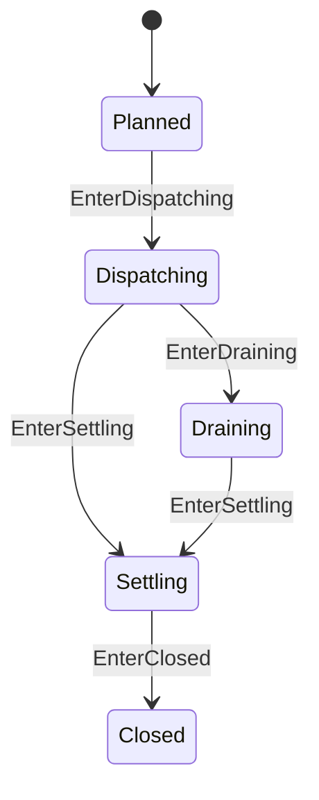

# ToolBatch 状态机

本 package 拥有一个 Assistant Tool-call batch 的模型顺序与结算不变量。权威术语与跨模块契约见[15 Agent Loop 与请求驱动模块设计](../../../zh-CN/15-agent-loop-and-request-driver.md)，验证状态见[08 实施进度](../../../zh-CN/08-implementation-progress.md)。

## 职责边界

`ToolBatch` 拥有 call count、parallel limit、started/settled/accepted positions、in-flight count、`DrainReason` 和 model continuation decision。它不拥有 Tool definition、policy/body、Session 或 concrete RLA。

call 只能按模型 index 开始，真实 result 只能按模型 index accepted。`DrainCancellation` 允许 `RecordSkippedResult` 为未启动 call 记录 canonical synthetic pair；`DrainFailure` 禁止伪造结果。进入 Settling 前不得有 in-flight body。

model-order acceptance、parallel limit、取消 synthetic pair、scheduler failure 和任意 accepted sequence 由本 package 测试拥有。
