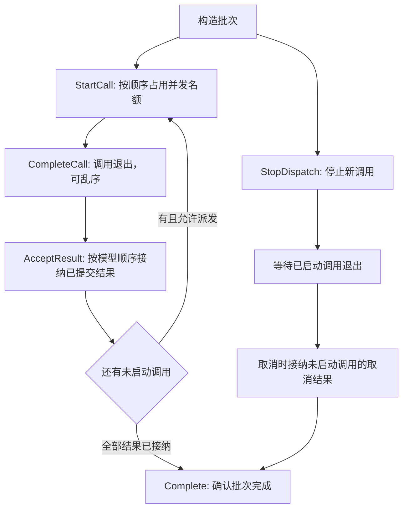

# 工具批次

本 package 拥有一个 Assistant Tool-call batch 的模型顺序与结算不变量。权威术语与跨模块契约见[15 Agent Loop 与请求驱动模块设计](../../../zh-CN/15-agent-loop-and-request-driver.md)，验证状态见[08 实施进度](../../../zh-CN/08-implementation-progress.md)。

## 职责边界

`ToolBatch` 拥有 call count、parallel limit、启动与接纳游标、乱序调用退出标记、in-flight count、`StopReason` 和 model continuation decision。它不拥有 Tool definition、policy/body、Session 或 concrete RLA。

call 只能按模型 index 开始，真实 result 只能按模型 index accepted。`Canceled` 允许 `AcceptCancellation` 为未启动 call 记录 canonical synthetic pair；`ExecutionFailed` 禁止伪造结果。Complete 确认完成前不得有 in-flight body，且必须满足对应的有序结果接纳规则；不再维护无实际操作的 Settling 中间阶段。

model-order acceptance、parallel limit、取消 synthetic pair、scheduler failure 和任意 accepted sequence 由本 package 测试拥有。

关闭后的批次由 ReactLoopAgent.CompleteTools 读取结论，准备 Step 结束事件；该方法不保存批次反向引用。失败或取消排空的原 error 由调用方一起传入，不能把调用全部退出误认为成功。当前 Actor 重构契约见 [AgentLoop 业务设计](../../../zh-CN/actor-design/30-agentloop-business.md)。实际执行接线和本轮行为测试尚未完成。

启动和结果接纳都按模型顺序形成连续前缀，由游标表达，不再保存重复的 started/accepted 数组。调用可能乱序退出，仍需逐项记录；已合成取消结果的位置拒绝调用退出通知，防止错误减少在途数量。

构造后可直接 StartCall，无额外启动阶段。IsComplete 表达已经通过完成校验，StopReason 表达为何禁止新调用；不再暴露批次状态枚举。ExecutionFailed 路径只要求已启动调用全部退出，不要求伪造缺失结果。
