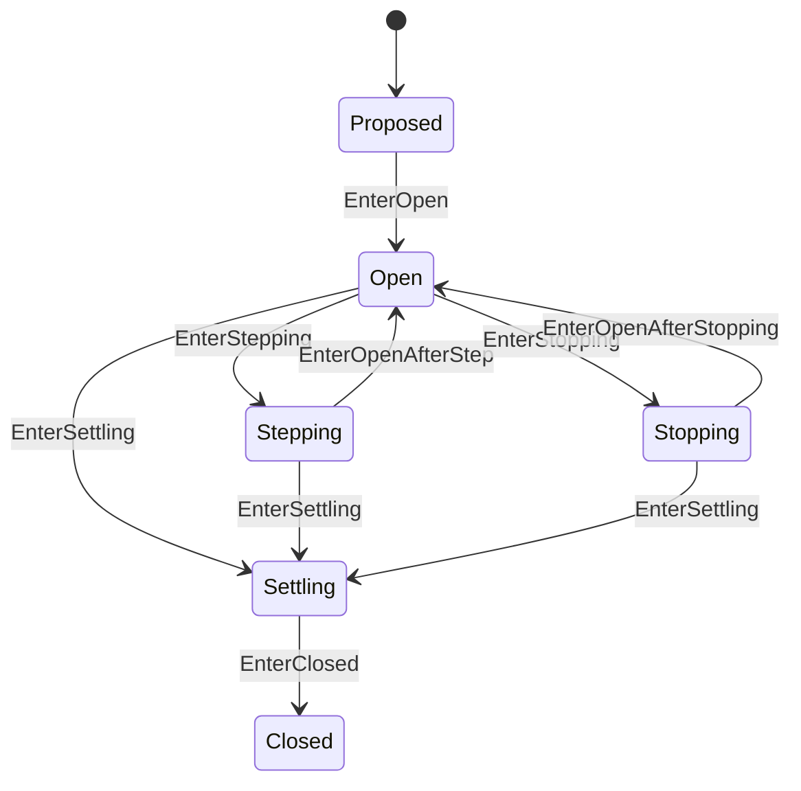

# Turn 状态机

本 package 拥有一个 Agent Turn 的纯状态与 boundary 不变量。权威术语与跨模块契约见[15 Agent Loop 与请求驱动模块设计](../../../zh-CN/15-agent-loop-and-request-driver.md)，验证状态见[08 实施进度](../../../zh-CN/08-implementation-progress.md)。

## 职责边界

`Turn` 拥有 Turn number、连续 Step progression、`TurnResult` 和 `turn/start`/`turn/end` 配对状态。它不 claim Inbox、不调用 Waterfall、不 Commit、不 Flush，也不持有 Step。

RLA 只在对应 Session 副作用成功后调用 `Enter...`。`TurnResultMaxTokens` 是唯一保留的正常结论，后续 completed/continue Step 不能降级；error 或 abort 可以覆盖。普通 completed 会被后继 Step 的 continue 替换：停止钩子追加输入后，如果下一步产生工具调用，仍须继续模型请求，不能沿用之前的 completed 提前停止。Step result 由 RLA 映射成 Turn owner 自己的 `TurnResult`。

Step number、stopping continuation、Result precedence 和任意 accepted sequence 由本 package 测试拥有。

`turn_events.go` 从分离的 Session 事件列表恢复最近回合编号，并由 Turn 生成开始事件草稿。生成草稿不改变状态，调用方必须先提交成功再 EnterOpen；编号必须是正安全整数。该层不持有 Session 实例或 Actor 地址。

EndDraft 从 Turn 已接纳的最终结论生成结束事件，并在持久化边界映射失败与取消原因。调用方确认事件提交和 Flush 都成功后才 EnterClosed。ResultFromStep 统一 Step 到 Turn 结果的转换；业务对象不读取执行 Context 或 Actor 状态。

本轮结论覆盖修正见 [AgentLoop 业务设计](../../../zh-CN/actor-design/30-agentloop-business.md)。对应测试已补充，尚未执行行为测试。
