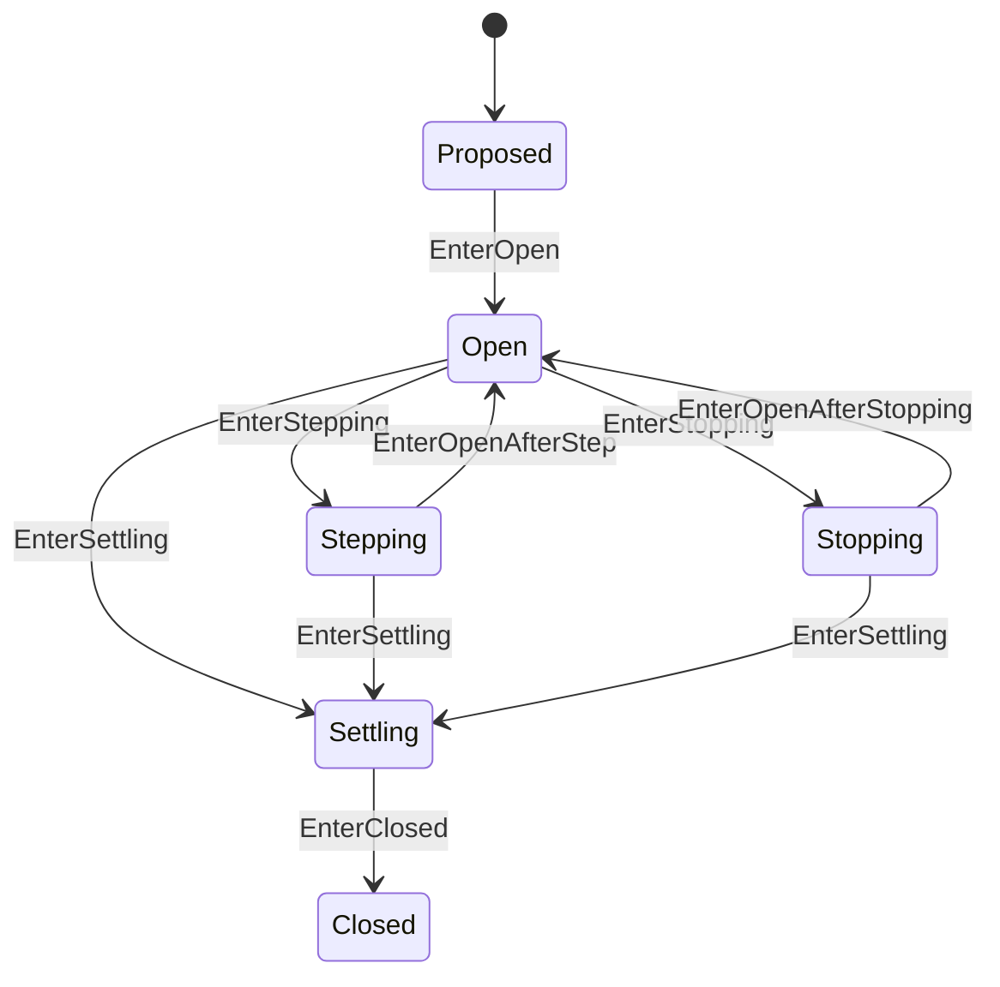

# Turn 状态机

本 package 拥有一个 Agent Turn 的纯状态与 boundary 不变量。权威术语与跨模块契约见[15 Agent Loop 与请求驱动模块设计](../../../zh-CN/15-agent-loop-and-request-driver.md)，验证状态见[08 实施进度](../../../zh-CN/08-implementation-progress.md)。

## 职责边界

`Turn` 拥有 Turn number、连续 Step progression、`TurnResult` 和 `turn/start`/`turn/end` 配对状态。它不 claim Inbox、不调用 Waterfall、不 Commit、不 Flush，也不持有 Step。

RLA 只在对应 Session 副作用成功后调用 `Enter...`。`TurnResultMaxTokens` 是 sticky result，后续 completed Step 不能降级；error 或 abort 可以覆盖。Step result 由 RLA 映射成 Turn owner 自己的 `TurnResult`。

Step number、stopping continuation、Result precedence 和任意 accepted sequence 由本 package 测试拥有。
