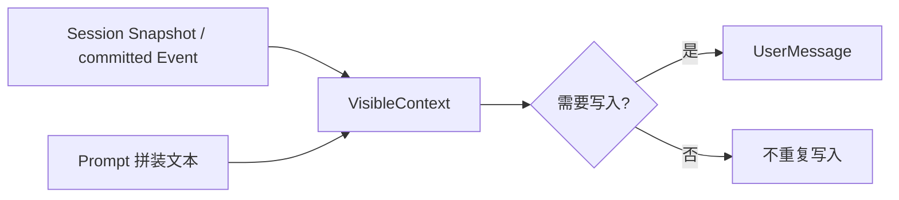

# VisibleContext

本包负责单个 Agent 的模型可见 Prompt 上下文派生视图，设计见 [AgentLoop 业务层迁移](../../../zh-CN/actor-design/30-agentloop-business.md)。

`VisibleContext` 从分离的 Session Snapshot 恢复 Surface 保留的上下文，以序号和文本记录当前值；observed 标记历史是否出现过上下文，用于决定是否需要清空消息。`ContextSnapshot` 是派生值，不持有 Session 对象。

`visible_context.go` 负责恢复、已提交事件观察以及消息生成判断。AgentLoop Actor 串行调用这些方法，模块不使用锁、不订阅事件、不维护 Session 注册目录，不执行提交、Prompt 拼装或 compaction。

步骤开始时 Refresh 当前快照；消息成功提交后才 Observe。提交失败不更新视图。新建视图和 Refresh 不执行 I/O；Message 传播消息构造错误。Actor 销毁时直接丢弃视图，无需 disposer。持久化来源名保留原格式，用来识别既有日志。

测试覆盖恢复、去重、空上下文清除和 Surface 替换后重新写入。
