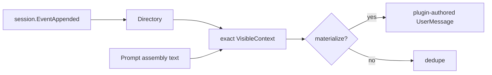

# VisibleContext

本 package 拥有 exact Agent 对 retained Prompt Context message 的派生视图和 exact Session registration directory。权威术语与跨模块契约见[15 Agent Loop 与请求驱动模块设计](../../../zh-CN/15-agent-loop-and-request-driver.md)，验证状态见[08 实施进度](../../../zh-CN/08-implementation-progress.md)。

## 职责边界

`VisibleContext` 从 Session events/surface 恢复最后一个 retained `ContextSnapshot`，判断是否需要 materialize、去重、clear 或在 surface replacement 后重新 materialize。它不是状态机，不拥有 Commit、surface replacement、Prompt assembly 或 compaction。

`Directory.entries` 的 key 是 exact `session.Context` object identity，value 是对应 `*VisibleContext` 非拥有引用；存在表示该 live Session registration 仍有效。`Registration` 只释放自己的 exact pair，不能删除 replacement。

SessionBinding 在 Session publication 前注册，在 Session release 前撤销。根 AgentLoop Plugin 只负责 exact event routing，不接管 `VisibleContext` 判断。

restore、dedupe、clear 和 surface replacement rematerialization 由本 package 测试拥有。
