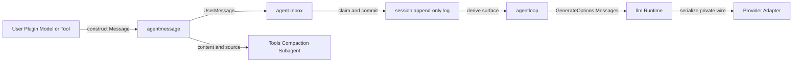

# Agent Message 协议

`agentmessage` 是 Agent 交互消息协议的唯一 owner。它定义稳定消息 identity、role、producer source、content block、Tool call correlation、构造与不可变 clone，以及 durable JSON codec。权威边界见[Agent Message 协议重构设计方案](../zh-CN/AgentMessage协议重构设计方案.md)，实施证据只见[专项进度矩阵](../zh-CN/AgentMessage协议重构进度矩阵.md)和[08 实施进度](../zh-CN/08-implementation-progress.md)。

## 职责与非职责

本包保证 Message、MessageSource 和 ContentBlock 的核心 discriminant、必需字段、stable ID、specialization invariant、detached clone 与 opaque extension 无损保留。`UserMessage`、`AssistantMessage` 和 `ToolResultMessage` 是同一协议的约束化形态，不是 LLM 请求 DTO。

本包不拥有 Agent Inbox 排队、Session append/surface、Tool 执行、Compaction 选择、LLM route、StreamChunk、Provider wire、HTTP/WebSocket 或存储 adapter。`llm` 只是消费 `agentmessage.Message` 的一个下游能力；Provider 私有 DTO 不得进入本包。

## 生产、持久化与消费

Agent 主动接收和调度 Message；Session 主动持久化完整 JSON 并从 surface 重建有序 Message；AgentLoop 主动把已重建的 Message 放入 `llm.GenerateOptions`；`llm` 再把它映射为 Provider 私有请求。调用方向和事件归属分别见[14 Agent Registry、Inbox 与事件](../zh-CN/14-agent-registry-inbox-and-events.md)、[15 Agent Loop 与请求驱动](../zh-CN/15-agent-loop-and-request-driver.md)和[13 LLM Runtime 与 DeepSeek Provider](../zh-CN/13-harness-llm-runtime-and-deepseek-provider.md)。

## Clone、Codec 与失败

- constructor、decode 和 clone 都在发布前复制 content、source 与 opaque JSON；调用方修改输入 slice 或 bytes 不得回写已发布 Message。
- core Message envelope 使用严格 unknown-field 检查；可扩展的 source/content union 对合法未知 discriminant 保留原始 JSON。
- malformed core variant、缺失 identity/source、specialization invariant 破坏或 extension clone panic 都返回 error，不静默降级成另一种核心消息。
- `ReplaceSource` 只替换 producer provenance，保留 stable identity、role、content 和 specialization；当前由 LLM Runtime 在 Adapter identity 变化时清除不应转发的 replay state。
- cancellation 不属于不可变 Message value；它由 Agent、Session、LLM stream 和 transport 的各自运行期 owner 处理。

Wire 字段和兼容要求见[03 协议与 API 兼容设计](../zh-CN/03-protocol-and-api-compatibility.md)。
