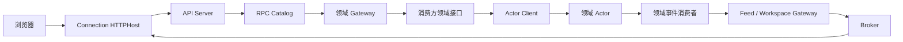

# API Proxy

本包将既有浏览器协议映射为领域操作。Actor 架构与模块契约见 [API 方案](../zh-CN/actor-design/38-api-proxy-module.md)，实施证据见 [进度](../zh-CN/08-implementation-progress.md) 和 [集成问题](../zh-CN/actor-design/40-integration-findings.md)。Subagent 重构与装配暂缓。

## 主要对象与职责划分

| 对象或模块 | 职责 |
| --- | --- |
| Server | 构造并注册领域 Gateway，提供 Connection 消费的 Service，关闭 API 交互和下行资源 |
| rpc.Catalog | 严格请求解码、具名结果、RPCID 关联与响应登记 |
| session.Gateway / Reader | Session 生命周期、历史、队列和模型选择用例；组合独立领域查询 |
| session/actor | 实现消费方定义的 Agents、Agent、Logs、Projections、Titles 接口 |
| llm、commands、workspace、credentials | 各自 API 的注册、错误和 wire 映射；业务事实归下游领域 owner |
| preset、settings | 可选部署能力的协议视图；不存在时保留明确的既有语义 |
| session/events.Feed | Session 基线、增量事件和队列下行 |
| stream.Broker | 下行订阅、有界缓冲、待答交互重放与慢消费者隔离 |
| interaction.Gateway | 问答和审批响应关联、取消与结算 |

Server 不启动 Actor，不执行 Agent Turn、Tool、模型或 Title 生成，不持有 Session 业务对象。Actor Client 负责领域契约和框架请求之间的转换；HTTP goroutine 可以等待客户端，Actor 内部继续异步请求。Echo 及 WebSocket 仅存在于 internal/connection。

## 装配与生命周期

进程组合根提供领域端口，构造 Server 后才开放网络监听。Server 固定 API 目录，公开 SessionEvents、WorkspaceEvents 和 Interactions 供组合根连接各领域订阅者及问答 Provider，避免无类型事件分派。不存在 Plugin、Factory、服务定位器或旧 EventStreams 转发层。

关闭顺序为停止网络准入、结算在途请求与下行、Server.Close、领域生命周期关闭和框架停止。Server.Close 拒绝后续请求，先结算交互，再关闭 Broker；它不声明 Agent 已停止或 Session 已 flush。领域写请求超时不代表回滚，客户端不自动重试。

## 验证与当前限制

Server 方法注册、真实 Echo HTTP 请求、Mux 关闭和关闭后拒绝已验证，连接层原有 trust fence、严格协议及 WebSocket 测试通过。Session API 的真实 Registry/Title 生命周期验证见子包 README。

完整进程装配仍在迁移：internal/assembly 的旧 Plugin 树将由 internal/server 取代。Session 事件订阅与不同创建之间的流过滤仍需完成，完整模型对话链及生产 HTTP/WebSocket 验收尚未通过。Bound API 独立代码保留，但本轮 Server 不注册暂缓迁移的 Subagent 能力。
