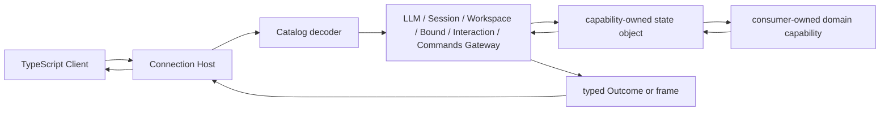
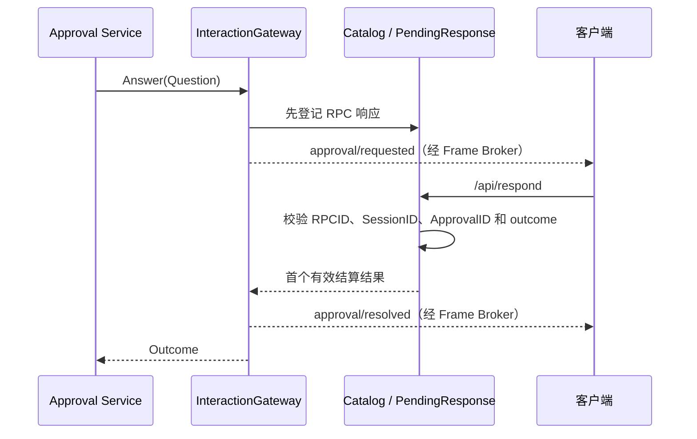

# API Proxy 子模块

Actor 迁移的目标职责与目录归属见 [API Proxy 领域模块与组装设计](../zh-CN/actor-design/38-api-proxy-module.md)。根包将统一编排各领域子模块；当前仍有平铺代码和旧 Plugin/Agent/Session 依赖。下文旧实现说明及历史测试结果不代表当前整包可编译，迁移进度以该设计的逐项验收为准。Subagent 暂缓重构。

`apiproxy` 是浏览器 wire 与 Go application/domain capability 之间的 anti-corruption boundary。权威设计见[`zh-CN/07-api-proxy-module.md`](../zh-CN/07-api-proxy-module.md)、[`zh-CN/13-harness-llm-runtime-and-deepseek-provider.md`](../zh-CN/13-harness-llm-runtime-and-deepseek-provider.md)、[`zh-CN/16-session-api-gateway-and-live-frames.md`](../zh-CN/16-session-api-gateway-and-live-frames.md)、[`zh-CN/17-approval-user-questions-and-interaction-gateway.md`](../zh-CN/17-approval-user-questions-and-interaction-gateway.md)、[`zh-CN/20-workspace-registry-and-api.md`](../zh-CN/20-workspace-registry-and-api.md)、[`zh-CN/22-credentials-and-api-key-management.md`](../zh-CN/22-credentials-and-api-key-management.md)、[`zh-CN/24-context-compaction.md`](../zh-CN/24-context-compaction.md)与[Bound技术设计](../subagent/docs/parent-bound-design.zh-CN.md)。

## 职责

- method-owned request decoder、typed `Outcome` 和 canonical RPC error；
- `host.describe` 与当前纳入的 `agentPreset.list`、`settings.describe`、`credentials.*`、`bound.list/tools/create/replace`、`llm.providers`、`llm.models`、`session.*`、`workspace.*`、`commands/list`、`commands/execute` handlers；
- selected Typert Remote 的 `{args:{...}}` decoder、HTTP 200 内 RPC failure 和 absent `value` 结果；
- `LLMGateway` 对 configurable provider directory、active route 和 model catalog 的 Host wire 投影；
- `apiproxy/session.Gateway` 实现 unary `session.*` façade，把读取、生命周期、模型和对话分别委派给独立状态对象；
- Session/Agent/Workspace/interaction facts 到 Mux/Host frame 的 projection；
- pending response correlation 与 reconnect replay；
- per-subscriber ordering、high-water 和 shutdown。

本包不运行 Agent Turn、生成 title、计算 domain projection、执行 Tool、调用模型或承载 HTTP/WebSocket。Echo carrier 位于 `internal/connection`。

## 工作原理

[`apiproxy/session`](./session/README.zh-CN.md) 拥有 Session API 实现。`Gateway` 自身只保持 façade 引用：`sessionReader` 负责 list/history/visibility，`sessionLifecycle` 负责 create/rename，`sessionModels` 负责 model catalog/selection，`sessionConversation` 负责 prompt/queue/cancel。它们共享的 ordinary Agent 解析进入 `AgentSessions`；该对象拥有并发 acquisition、cold resume、adoption 校验和 `ModelSelectionRef` 生命周期，不依赖 wire 类型。根 `apiproxy` 只保留 `SessionAPI`、request/result DTO、method decoder/registration 和 wire projector，因而不反向依赖实现子包。

Session list 合并 live LiveStore 与 cold Persistence，history 对 live facts 取 detached snapshot、对 cold facts 取 validated inspection，再由 reader 完成 wire pagination；两者只消费 projection capability，不拥有 projection fold。`session.create` 指定已有 cold identity 时触发 Agent resume。`session.rename` 把 raw title 交给 `sessiontitle.TitleService`；成功只映射 `{title, seq}`。Projection change 被映射为 `session/projection`，value 必须存在且是合法 JSON。

Session Feed 负责日志与重连基线投影，stream.Broker 管订阅、待答重放及帧缓冲，不解析 unary method。旧 LiveFrameSource/liveFrameHub 已删除；真实事件订阅与生产组合仍待接通。

Workspace Gateway 将七个 `workspace.*` method 映射到 `workspace.Registry`/`Workspace`，并把 post-commit domain publication 投影为四个 Host frame。`session.create({workspaceId})` 只通过 Registry 读取 canonical path 并在创建后 accounting，不读取 Workspace SQLite 或复制 membership 规则。

[LLM API](./llm/README.zh-CN.md) 已迁入独立领域模块。`Catalog` 消费 Directory 进行目录投影与逐 provider 失败隔离，Gateway 只包装 RPC；Session 消费 Catalog。查询适配和 Router 请求关联均位于 `llm/actor`，业务层不依赖 GoAkt。

`AgentPresetGateway` 持有可选的 `AgentPresetRoster` capability。当前默认组合未提供 roster，因此 `agentPreset.list` 按固定源 absent-provider 分支返回空列表并声明不可 author；这让原客户端隐藏 preset 控件而不把合法的无 preset 部署误报成失败。Preset 发现、Agent child scope composition、`agentPreset.select` 与 authoring API 尚未实现，空列表不代表这些能力已经完成。

`SettingsGateway` 持有可选的 `SettingsDescriber` capability。当前默认组合未提供 Settings Provider，因此 `settings.describe` 按固定源返回 HTTP 200 内的 canonical `internal` absent-service failure，让客户端按 RPC 失败降级而不是遇到未注册方法。接口已经约束 redacted schema/value、secret slot、revision 和 `live/restart` 字段，但尚未装配文件 Provider 或任何 mutation method。

[Credentials API](./credentials/README.zh-CN.md) 已迁入独立领域模块。`Gateway` 消费不含 Resolve 的 `Provider`，请求解码、凭据元数据投影及错误映射均由模块拥有；根组装只注册方法并注入能力。真实 Credentials Grain 和临时文件存储的局部测试已通过，生产 Host 仍待迁移。

`BoundGateway`持有公共`bound.Definitions`能力，以及consumer-owned只读`BoundToolDirectory`和`BoundExtensionDirectory`。`bound.list`返回完整committed snapshots；`bound.tools`只投影root Tool registry当前可继承工具的canonical name与description；`bound.extensions`只投影Subagent Extension Directory中的named selections，不包含自动安装的common Extension。两个目录都不暴露schema、执行、registration或mutation。`bound.create`和`bound.replace`直接使用Bound包定义的`Creation`与`Replacement`命令，API Proxy不重新定义业务输入。Gateway只把稳定Definition错误映射为RPC error，SQLite、reconcile、Binding、Tool restriction执行和Agent replacement都留在各自owner。

[Commands API](./commands/README.zh-CN.md) 的 Gateway 通过 Resolver 取得当前 Agent 创建对应的 Executor。方法契约、Remote 解码与结果映射已迁入模块；旧 Registry.Execute 消费已删除。运行客户端、Resolver 和生产接线尚未完成。

## 上下游

- 上游：Connection dispatcher/event source、TypeScript wire requests。
- 下游：`apiproxy/session.Gateway`、Commands Registry、Agent Registry、Session LiveStore、SessionPersistence、Workspace Registry、Credentials Provider、`bound.Definitions`、root ToolRuntime与named Extension Directory只读投影、LLM、DefaultModel、SessionProjection、SessionTitle、Approval/UserQuestions。
- wire DTO 到此为止；下游包不依赖 RPC/frame 类型。

## 生命周期、错误、取消与背压

`AgentSessions` 的 Agent dispose listener 与 `LiveFrameSource` 的 Session/Agent/Projection listener、hub 都归 API Proxy Scope；subscriber 断开只取消该 stream，不取消 Agent Turn。显式 `session.cancel` 才进入 Agent cancellation。业务拒绝编码为 RPC error value，transport/内部故障返回技术 error。

每个 subscriber 有独立有序队列；Session event 的 high-water 只在 frame 成功生成后推进。已经 committed 的 Session/title/projection 派生通知不能因慢客户端或 frame 失败回滚。

## Actor 迁移：审批回答边界

本轮仅迁移审批回答契约，目标见 [Interaction 审批设计](../zh-CN/actor-design/21-interaction-approval.md)。`InteractionGateway` 已实现 `approval.Answerer`，旧 Approval Waterfall 注册及 Session 审计扫描已删除；Gateway 尚未转换成 Actor，其他旧生命周期描述不代表目标实现。

### 模块内职责与主要对象

| 职责 / 对象 | 文件 | 边界 |
| --- | --- | --- |
| 交互生命周期 / `InteractionGateway` | [gateway.go](interaction/gateway.go) | 管 pending 审批与问答、关闭和清理；不决定审批策略或写审计 |
| 审批关联 / `pendingApproval` | [gateway_approval.go](interaction/gateway_approval.go) | 从 Question 的明确身份生成 request frame，验证回答，完成 resolved frame；不读取 Session |
| 响应登记 / `PendingResponse` | [rpc/pending.go](rpc/pending.go) | 按 RPCID 关联回答，首个结算者生效；错误业务载荷可修正重试，晚到响应不能重复完成 |
| Frame 发布 / `InteractionFrameBroker` | [broker.go](interaction/broker.go)、[stream/broker.go](stream/broker.go) | 发布、保留待回答请求供重连重放，并在结算后清除 |

依赖方向为 `Approval Service → Answerer 接口 ← InteractionGateway → Catalog / Frame Broker`。Question 只传审计 ID、SessionID、工具信息，不携带 Approval Service、Agent 或 Session 对象；Frame/HTTP 类型不会进入 Approval。

缺少必要身份或并发重复 SessionID/审批 ID 时，不新增 pending 请求。取消、关闭或发布失败会清理本次等待；回答与取消竞争仍以 PendingResponse 的首个结算者为准。Approval 在返回后的业务取消检查与其终态审计仍由 Approval 负责。

根包 `go test -race -count=1 ./apiproxy` 与 vet 通过，覆盖正常回答、重连重放、错误 ID、并发请求、取消及关闭。`apiproxy/...` 仍因 Session 模型选择的旧构造入口未迁移而无法整体构建；这些检查不证明 Host 组合入口或真实 Interaction Actor 已接入。
