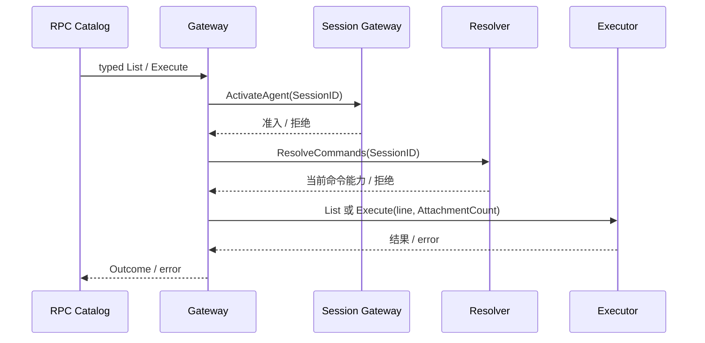

# Commands API

本模块拥有 `commands/list`、`commands/execute` 的严格 Remote 解码、方法注册和 Gateway。设计见 [API Proxy 模块设计](../../zh-CN/actor-design/38-api-proxy-module.md)，执行生命周期见 [Commands 设计](../../zh-CN/actor-design/37-commands-module.md)，服务器历史证据入口见 [实施进度](../../zh-CN/08-implementation-progress.md)。

| 对象 / 文件 | 职责 |
| --- | --- |
| `api.go` | `{args:{...}}` 字段约束、图片元数据、Remote 错误和方法注册 |
| `Gateway` / `gateway.go` | 访问检查后调用当前 Agent 的 Executor，处理 absent 结果 |
| `Access` | 由 Session Gateway 实现普通 Agent 准入和持久化恢复 |
| `Resolver` / `actor.Directory` | 查询 Registry 当前创建及 Commands 地址，再次检查当前归属，返回固定 CreationID 的命令客户端 |
| `Executor` | 只含 List/Execute，不暴露 Agent 对象、配置注册表或框架类型 |

命令解析、run/done 事件、能力调用和取消结算归 Commands 执行 owner。Gateway 不发模型 turn，不启动 Actor，不访问持久化。未识别命令返回不含 value 的成功结果；Remote 技术错误按原协议编码在 RPC envelope。Context 交给 Resolver 和 Executor，业务取消传播由运行客户端实现，不能把 HTTP 返回视为能力已释放。

测试覆盖原严格 descriptor 解码、Remote absent/失败语义，以及 Gateway 的访问拒绝、图片数量传递和缺少执行能力时失败。Directory 已实现 Registry 路由解析，API Server 已将 Session Gateway 注入 Commands Gateway；进程组合根仍需注入 Directory。客户端映射测试不替代 Registry 生命周期测试，局部测试不证明真实压缩命令已通过 HTTP 可用。
