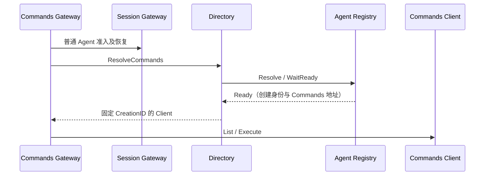

# Commands API Actor 客户端

Directory 实现 Commands API 的 Resolver，向 Agent Registry 查询已经就绪的命令实例，不启动 Actor、不持有业务执行状态。设计见 [API Proxy](../../../zh-CN/actor-design/38-api-proxy-module.md)，执行与取消见 [Commands](../../../zh-CN/actor-design/37-commands-module.md)，验证记录见 [集成问题](../../../zh-CN/actor-design/40-integration-findings.md) 与 [项目进度](../../../zh-CN/08-implementation-progress.md)。

Directory 核对回复的 AgentID、Registration、CreationID、当前父子归属和命令地址；缺少组件或身份错误不能返回可执行能力。准入后归属可能变化，因此再次检查当前父子关系。绑定后的关闭与重建由命令 owner 校验 CreationID，Directory 不重新绑定旧客户端。

`directory.go` 负责解析及错误映射，实际执行沿用 commands/actor.Client 的取消与最终回复契约。目录没有需要关闭的资源；Registry 与命令 Actor 的生命周期由其 owner 管理。
