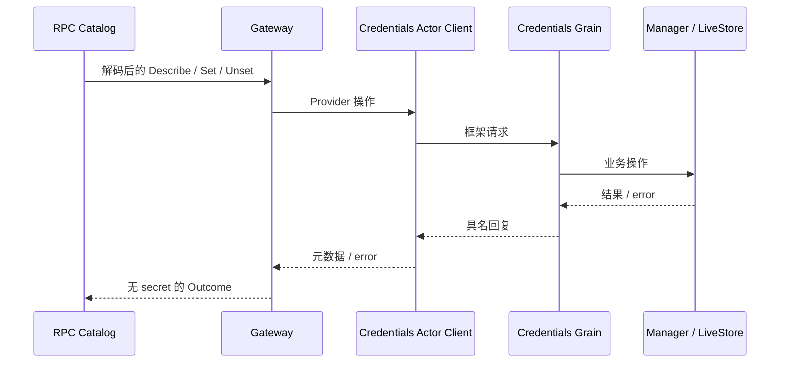

# Credentials API

本模块拥有 `credentials.describe/set/unset` 的请求解码、Gateway、消费接口和结果投影。设计与迁移状态见 [API Proxy 模块设计](../../zh-CN/actor-design/38-api-proxy-module.md)，服务器历史验证入口见 [实施进度](../../zh-CN/08-implementation-progress.md)。

| 文件 / 对象 | 职责 |
| --- | --- |
| `api.go` | 请求/结果 DTO、固定方法注册、引用和数量校验 |
| `gateway.go` / `Gateway` | 调用 Provider 并映射安全元数据、空写入结果和 credential-rejected 错误 |
| `Provider` | Describe/Set/Unset 消费接口；不包含取出 secret 的 Resolve |

根 API Proxy 组装 Gateway 并注册到 rpc.Catalog。Gateway 不依赖根包、Plugin 或 GoAkt；进程组装可注入已初始化的 Credentials Actor Client。环境优先级、可写性和存储规则属于 credentials.Manager，文件存储属于 credentials/local，API 不复制这些规则或缓存凭据。

只有 SetRequest 携带写入值；Describe 仅返回 configured/source/writable，写入成功返回空对象。Gateway 不拥有 Actor 生命周期和存储，不关闭注入的 Provider。取消沿调用 Context 传给 Provider；API 停止等待不证明底层写入已回滚。

`gateway_test.go` 验证浏览器值只写行为和引用拒绝；`gateway_actor_test.go` 使用真实 Catalog、Credentials Grain、Manager 和临时文件存储，验证写入、元数据、幂等删除、环境只读拒绝及全部 RPC 响应不包含测试凭据值。局部链路测试不宣称生产 HTTP 入口已接通。
