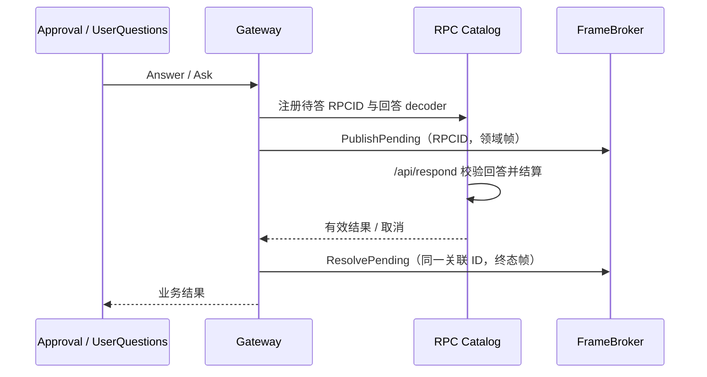

# 浏览器交互

本包负责审批和结构化提问的浏览器请求、回答校验与结算。设计见 [API Proxy](../../zh-CN/actor-design/38-api-proxy-module.md)，问题修复见 [集成记录](../../zh-CN/actor-design/40-integration-findings.md)，整体进度见 [实施计划](../../zh-CN/actor-design/12-implementation-plan.md)。

| 对象 / 文件 | 职责 |
| --- | --- |
| Gateway / gateway.go | 注入 Catalog 和 FrameBroker；停止准入并等待所有交互结算 |
| gateway_approval.go | 实现 approval.Answerer，关联审批 ID、工具调用与 Session，校验结果 |
| gateway_questions.go / gateway_question_response.go | 实现 userquestions.Provider，投影题目并校验回答；不决定调用方资格 |
| frames.go | 审批和提问 wire DTO、规范 type 与字段校验 |
| FrameBroker / broker.go | 消费方发布端口；下游负责稳定 RPCID 的待答帧重放和终态替换 |

Gateway 不引用 Plugin、Agent 对象、Session 存储或 GoAkt，所有者在组合根连接接口并调用 Close。map 只关联浏览器请求，不是 Agent 生命周期表；锁用于并发 HTTP、取消与关闭，业务 Actor 不进入这些锁。

错误回答返回 bad-response 并允许修正；重复或迟到回答返回 not-pending。调用上下文取消会撤销待答项目并发布取消结果；连接断开由 Broker 处理，不等同于取消业务。Close 停止新准入、取消待答项目并确认结算；并发 Close 等待同一 closeDone，调用方取消等待不能被误报为关闭成功。

当前测试使用真实 RPC Catalog、编码器和发布录制端口，验证回答、取消、关闭和规范 JSON；stream 包还通过真实 Broker 验证断开后重放与回答结算；不将其等同于真实 Actor 审计事件或 WebSocket 重连集成，这些仍需后续完成。
