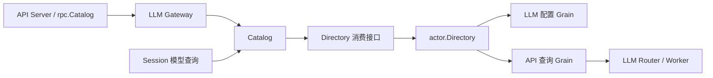

# LLM API

本模块拥有 `llm.providers/models` 的方法契约、目录视图和查询业务，不拥有模型生成或提供者注册。模块边界见 [API Proxy 设计](../../zh-CN/actor-design/38-api-proxy-module.md)，查询取消契约见 [模型查询方案](../../zh-CN/actor-design/35-api-model-queries.md)，历史服务器验收入口见 [实施进度](../../zh-CN/08-implementation-progress.md)。

| 对象 / 文件 | 职责 |
| --- | --- |
| `Gateway` / `gateway.go` | 将 Catalog 结果转换为 RPC Outcome |
| `Catalog` / `catalog.go` | 提供者顺序、模型/推理选项投影、逐提供者失败隔离 |
| `Directory` / `catalog.go` | 消费方只读查询接口，不含生成、注册或关闭 |
| `api.go`、`models.go` | 方法注册、Host 目录和 Session 共用的模型目录 DTO |
| `actor.Directory` | 普通请求 goroutine 到 LLM Grain/查询 Grain 的具名消息适配 |
| `actor.Grain` | Router 查询关联、期限和取消调度，不执行提供者业务 |

Session 消费 Catalog，并独立决定当前选择和 routable；不调用 LLM Gateway 的 RPC 方法。查询目录失败返回 error；某个 provider 的列举或模型解析失败进入该 provider 的 failure 视图，不隐藏其他 provider。Gateway 不缓存第二份注册配置。

框架适配仅在 [actor](./actor/README.zh-CN.md) 内。装配方提供已启动的入口，API Directory 不创建或关闭共享 Actor。Context 取消时，客户端使用同一 RequestID 投递 CancelQuery；确认取消投递不等于提供者已退出。迟到回复不能重新完成原请求。

测试覆盖目录顺序、reasoning 投影、失败隔离、真实 Router 并发查询，以及通过 Directory 客户端取消后提供者实际退出。整个 Host 与 Session API 的旧依赖仍待迁移，局部通过不证明生产 API 已接通。
