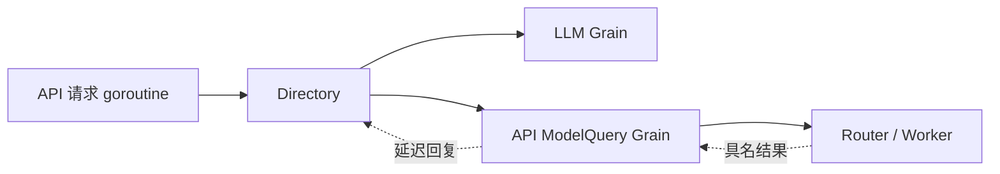

# API Actor 查询适配

本包把 API 的普通 Go 查询接口映射到 Actor 消息，不拥有模型选择策略、注册表或生成资源。设计见 [API 模型查询迁移](../../../zh-CN/actor-design/35-api-model-queries.md)，LLM 消息契约见 [LLM 方案](../../../zh-CN/actor-design/33-llm-module.md)，进度见 [实施计划](../../../zh-CN/actor-design/12-implementation-plan.md)。

Directory 保存已装配的 LLM Grain、API ModelQuery Grain 和 ActorSystem 引用，提供 API 所需的目录、模型能力及配置校验接口。它不创建 Actor，不通过 Plugin 找服务，也不直接调用 Binding。ReadCatalog 映射同一次注册快照；模型查询经 API ModelQuery Grain 转入 Router 工作池。

Directory 的等待发生在入站请求 goroutine，不在 Actor mailbox。每次操作使用装配时给定的超时上限。请求等待取消后，Directory 按预先生成的 RequestID 发送 CancelQuery，并保留投递失败信息。API ModelQuery Grain 经 Router 转发，Worker 取消提供者查询 Context；投递确认不等于提供者已经退出。不吞掉框架错误或伪造空目录。API ModelQuery Grain 内部异步调度，截止时间限制未完成关联的生命周期。Directory 不拥有 endpoint 的关闭责任，应用先停止入站请求再关闭查询与 LLM 组件。

当前生产装配仍在迁移。API Proxy 整包还被其他模块的旧 Agent/Session 依赖阻断，不能把本适配代码的存在当作完整 API 可用的证据。

Directory 同时通过 Configuration/Configure 对接 LLM 的配置所有权，不经过 AgentLoop。配置操作不创建 Actor，读取返回独立快照，写入错误原样传播。验证见 directory_configuration_test.go。
