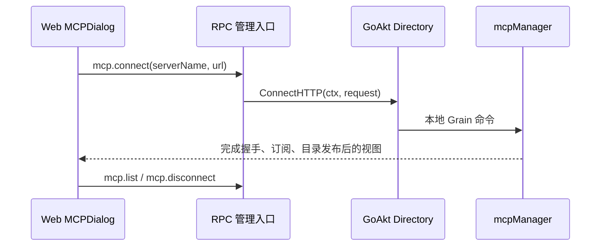

# MCP Web 管理入口

本包拥有 Goren 自有 `mcp.connect`、`mcp.list`、`mcp.disconnect` 的入站 payload 和状态视图，
不是外部 MCP wire 的 owner，也不持有连接、Agent 或 UserQuestions。
完整契约见 [Actor MCP 设计](../../zh-CN/actor-design/42-mcp-client.md)；
[历史进度](../../zh-CN/08-implementation-progress.md)不替代该 Actor 模块的验收记录。

API 沿用现有 RPC Catalog 和 `/api` carrier，严格拒绝未知管理字段。
`mcp.connect` 只接受 `serverName` 与 `url`；不允许浏览器启动子进程或提交凭据。
`mcp.list` 返回进程内连接名、transport、connected/failed 和工具数，不返回 URL、秘密或远端错误。
`mcp.disconnect` 按名称幂等断开，不持久化任何配置。

Directory 由消费者定义，组合根用 GoAkt identity 接线，避免 API Catalog 经 Manager、UserQuestions
回指自身。35 秒的管理操作总期限和 HTTP caller cancellation 传到 SDK I/O；工具调用不经过管理
mailbox，仍使用自己的 MRTR 与提问期限。API 不负责关闭 Manager；Server 拒绝新接入、排空
Agent 后关闭所有连接。业务失败使用安全通用信息，绝不返回可能包含凭据的底层错误文本。
