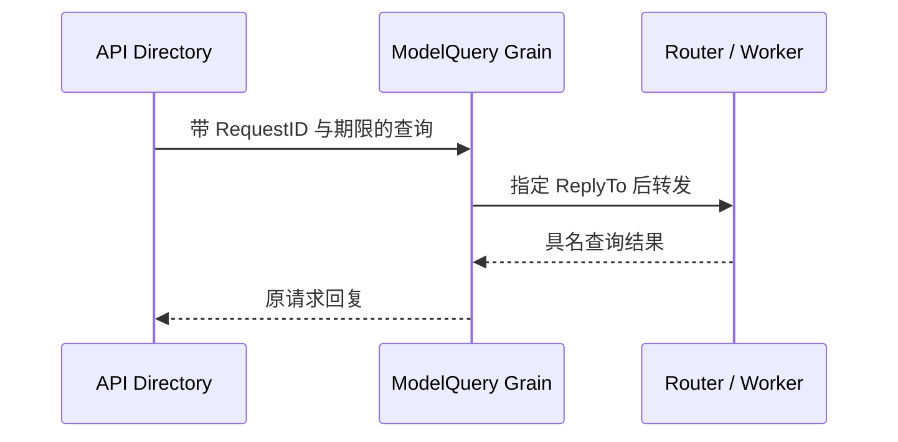

# API 模型查询

本包属于 API 入站边界，关联普通 API 请求与 LLM Worker 的显式回复。Grain 保留等待中的请求、截止时间和取消能力，不持有模型配置、不执行 Provider I/O。业务能力由 LLM 提供，见 [LLM README](../../llm/README.zh-CN.md)；整体进度见 [实施计划](../../zh-CN/actor-design/12-implementation-plan.md)。

初始化绑定 Router，允许请求重入。超时、调用方显式 CancelQuery 或停用会取消等待并向 Worker 转发取消。处理确认不代表 Provider 已退出。迟到结果不能恢复已经完成的 API 请求。

测试包括真实 Router 的慢查询隔离和取消传播；它们不证明整个 API Proxy 已完成 Actor 接线。生成流不经过本包。
