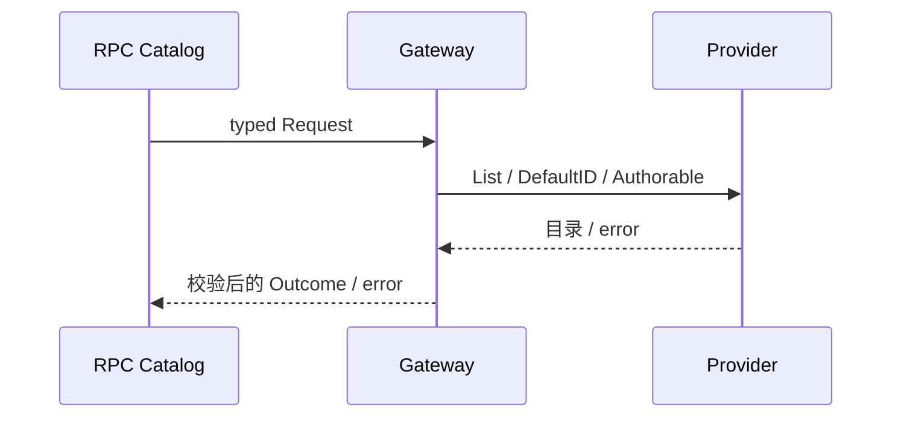

# Preset API

Gateway 消费 Roster，投影默认项、信任类型和部署可打开路径能力。API 不创建 Agent，不实现配置继承、authoring 或 Subagent 生命周期。

设计与迁移状态见 [API Proxy 设计](../../zh-CN/actor-design/38-api-proxy-module.md)，历史服务器验证入口见 [实施进度](../../zh-CN/08-implementation-progress.md)。

`api.go` 拥有方法契约和注册，`gateway.go` 拥有消费接口与视图映射，`gateway_test.go` 随业务迁移。根 API Proxy 组装并注入 Provider，模块依赖 rpc，不依赖根包或 GoAkt。没有独立后台任务，不增加 Actor。

未配置 Roster 时返回空数组和不可 author 的成功结果；非法条目或 Provider 失败返回 error。 Gateway 不释放共享 Provider；请求结束不改变部署配置。现有模块 race 测试与 vet 通过，生产 Host 组装仍待迁移。
