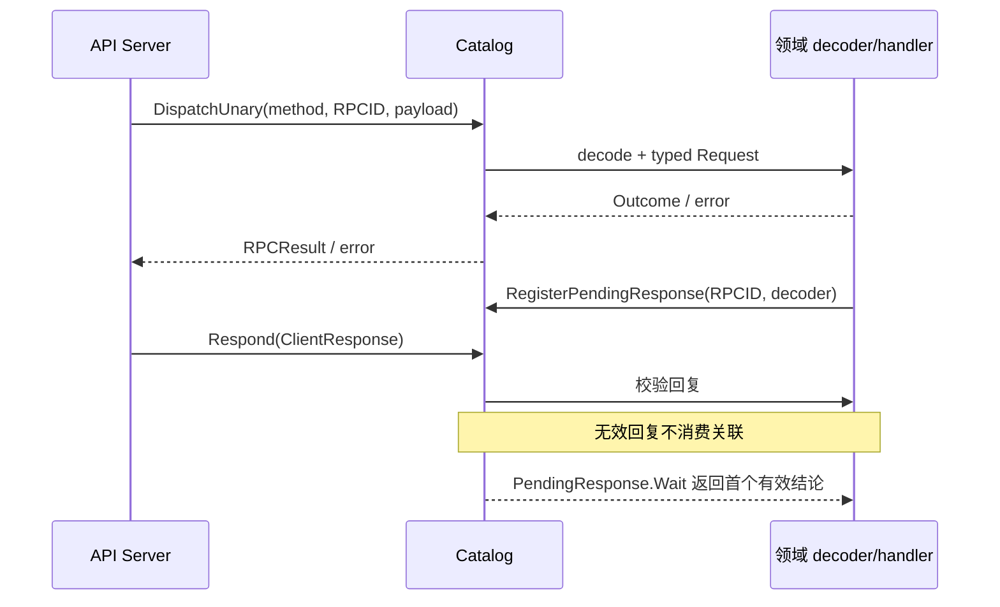

# API RPC

本包拥有通用 RPC 路由和浏览器回复关联，不拥有 Session、Commands、Approval 等业务规则。模块设计与迁移状态见 [API Proxy 模块设计](../../zh-CN/actor-design/38-api-proxy-module.md)；历史服务器验证入口见 [实施进度](../../zh-CN/08-implementation-progress.md)，不据此推断当前 Actor 服务器已接通。

| 对象 / 文件 | 职责 |
| --- | --- |
| `Catalog` / `catalog.go` | 注册和分发 typed unary/Remote 方法，编码 Outcome，区分协议错误与技术错误 |
| `PendingResponse` / `pending.go` | 同一 RPCID 的待答句柄、等待和撤销；由 Catalog 关联浏览器回复 |
| `Request`、`Outcome` | 具名 payload/result 的 RPC 边界；保留 absent value 语义 |

上游是 API Server 与 Connection；各领域模块提供 decoder/handler。RPC 只依赖 Connection 协议值，不依赖根 apiproxy 或业务子包。HTTP 并发请求由现有 Catalog 锁保护；本包不是业务 Actor，也不启动 ActorSystem。

普通 unary 的技术错误返回 Go error；Remote 的技术错误与取消保留在 RPC failure envelope。`Absent` 编码为不包含 value 字段的成功结果。

Wait 的 Context 取消只停止本次等待；业务 owner 使用 Withdraw 撤销待答关联。断开连接不自动撤销仍可重连回答的业务请求。有效回复与撤销互斥，旧句柄不能删除同一 RPCID 下后续注册项；decoder panic 不消费待答项。

测试覆盖路由重复注册、技术错误/panic、Remote absent 编码、待答首个结论、并发回答/撤销和 decoder 失败重试。整个 API Proxy 仍有旧 Agent/Session/Plugin 依赖；本包测试不等于生产验收。
