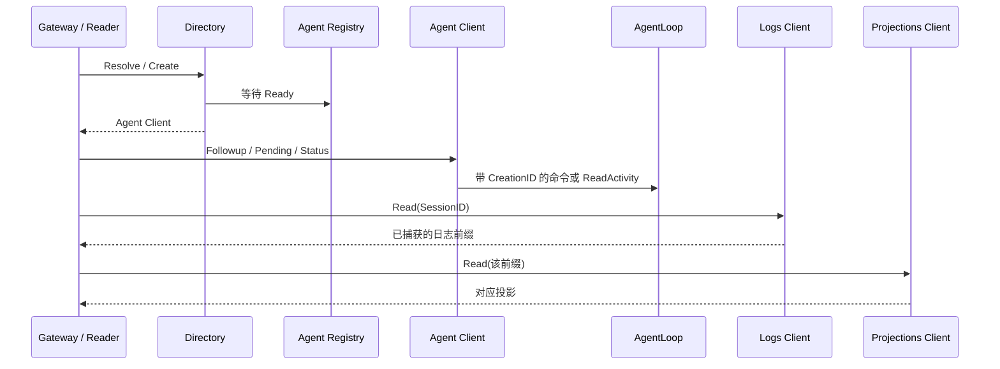

# Session API Actor Client

本包实现 [Session Gateway](../README.zh-CN.md) 消费的领域接口。客户端只转换消息与结果，不持有业务对象、不创建组件、不管理父子关系。模块契约见 [API 重构方案](../../../zh-CN/actor-design/38-api-proxy-module.md)，实施证据见 [进度](../../../zh-CN/08-implementation-progress.md) 与 [集成问题记录](../../../zh-CN/actor-design/40-integration-findings.md)。

## 模块内职责与依赖

| 对象 | 消费方接口 | 下游与职责 |
| --- | --- | --- |
| Directory | Agents | 请求 Agent Registry 创建或解析；校验 Ready 身份后构造 Agent 客户端 |
| Agent | Agent | 固定创建身份，仅向 AgentLoop 查询执行概况、提交输入和取消 |
| Logs | Logs | 从 Session Registry 取得当前创建，读取该创建的日志 |
| Projections | Projections | 请求 Projection.Compute 折叠指定日志前缀，不替换已有实例的投影缓存 |
| Search | Search | 请求 Query Actor 查询已观察索引；不采集 Session 或维护索引 |
| Titles | Titles | 从 Registry 已就绪的组件中解析 Title，提交人工标题 |

API 业务层的 Reader 消费 Logs、Projections、Agents，组合列表和历史视图。Agent 不提供 Session 日志、标题或模型配置方法。AgentLoop 的 Pending 和 Status 来自同一次 ReadActivity；Reader 的日志与执行状态属于独立观察，不宣称跨 Actor 原子快照。

## 生命周期与失败

Directory 委托 Registry 启动资源。初始化失败的创建仍保留到 CloseAgent 确认清理；通信超时不等于创建已撤销。API 创建失败后的生产清理接线尚待完成。

Agent 始终携带原 CreationID，旧客户端不能访问同 ID 的新创建。Titles 独立解析当前就绪组件，再以该 CreationID 提交。Rename 直接折叠本次返回的已提交事件，避免后续并发标题覆盖本次响应。该结果确认内存提交，Session flush 才确认持久化。

客户端供 HTTP goroutine 等待 AskGrain；Actor 内部使用异步请求。取消和错误原样返回，写请求不自动重试，不将超时解释为回滚。Replace/Remove 未改变任何待处理记录时返回 agent.ErrInputMissing。

## 验证范围

真实 Registry、Session、Title、Projection 与 SQLite 集成测试覆盖创建、标题修改、关闭、同 ID 恢复、旧客户端拒绝及指定日志前缀的投影。Title 部分启动失败后的关闭和重新创建也已验证。Projection.Compute 每次重建指定前缀，尚未做性能优化；这些测试不替代生产 HTTP/WebSocket 对话验收。

`TestSearchClientUsesObservedQueryIndex` 验证真实 Query Actor 与 SQLite 中的人工消息能经 Search 端口检索，取消保留 context.Canceled。源采集仍由 Query Collector 和生产组合根接线。
