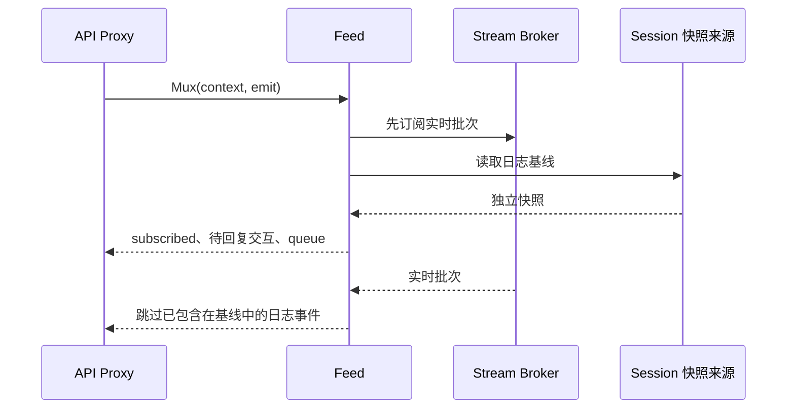

# Session 下行事件

本模块负责 Session 日志和投影的协议表示、队列重建与订阅基线衔接。
不拥有 Session 日志、Agent 执行状态或 Actor 生命周期，也不依赖根 API Proxy。

| 文件 | 职责 |
| --- | --- |
| `notifications.go` | Session 的 Mux 和 Host 下行通知 |
| `event.go` | 日志事件、Tool 展示意图及 JSON 校验 |
| `queue.go` | Inbox 事件回放、队列视图和校验 |
| `jobs.go` | 后台任务视图和校验 |
| `projection.go` | 日志与投影快照的协议映射 |
| `feed.go` | 订阅、读取基线及实时批次衔接 |

`EventFrame` 是下行通知，`LogEvent` 是日志在协议中的表示。
前者携带后者，但网络帧本身不是持久化事件。类型名称不重复叠加 Host、Session 前缀。

Feed 只借用 Broker；取消订阅会释放本次连接，不关闭 Session 或清除未完成交互。
队列变化与对应日志通知组成一个批次，避免单独过滤事件后仍发送过期队列。

当前测试覆盖基线读取期间收到事件时的去重和取消退出。`actor.Subscriber` 已连接真实 PubSub 到 Feed.Committed，按序消费并在停止时取消、等待当前工作；Session 创建／移除、Agent 状态通知与生产 HTTP/WebSocket 全链路仍待接通。不能因 CreationID 改变就假定持久化日志序号重置。
详细边界见 [API Proxy 设计](../../../zh-CN/actor-design/38-api-proxy-module.md)，
集成证据见 [问题记录](../../../zh-CN/actor-design/40-integration-findings.md)。

`actor/Snapshots` 已连接真实 Session Registry 和 Session.Read，向 Feed 提供独立数据，不把框架类型带入 Feed。
测试验证缺失创建被拒绝、读取不暴露可变 Header、关闭后列表移除、同 SessionID 重建后旧 CreationID 失效，以及日志事件复制和关闭持久化屏障。
传输超时或实例未初始化错误会向调用方传播，只有明确的创建身份失效可从旧列表基线中跳过。

Mux 的 `last` 是每条连接独立的 Session 序号去重表，不是订阅准入名单。连接建立后创建的 Session，其第一条实时事件也会发送并建立序号边界；后续重复或落后的事件仍被过滤。`TestFeedSubscribesBeforeSnapshotAndSuppressesLateCommit` 同时覆盖初始快照与新 Session 去重；Server 集成测试覆盖先创建后连接及先连接后创建两种顺序，并要求文本分块在模型结束前送达。
