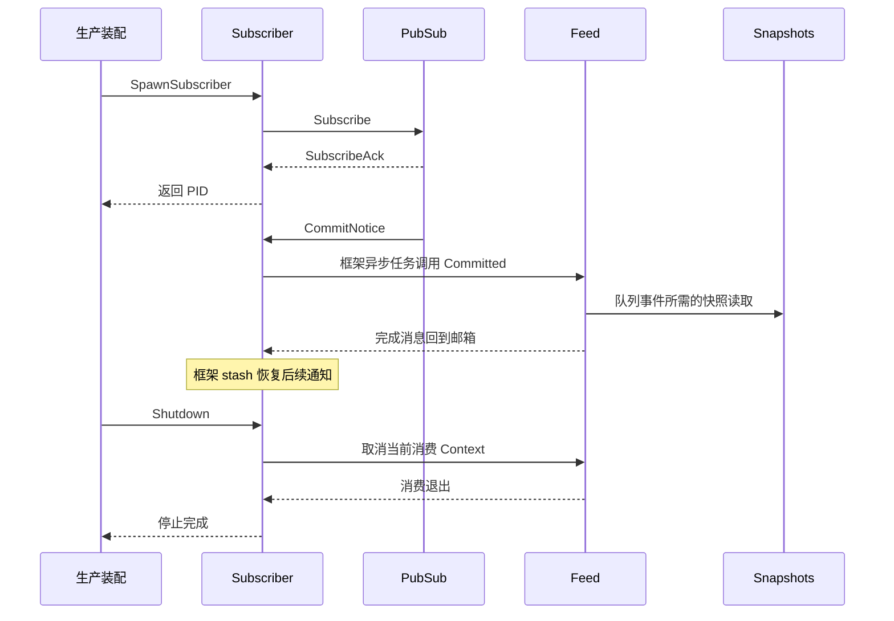

# Session 下行 Actor 适配

Snapshots 通过现有 Session Registry 和 Session Grain 读取指定创建的独立快照；Subscriber 订阅 Session 提交通知，串行交给 Feed。两者不持有 Session 日志、不决定持久化，也不修改 wire schema。

设计见 [API Proxy 模块](../../../../zh-CN/actor-design/38-api-proxy-module.md)，验证与问题见 [集成记录](../../../../zh-CN/actor-design/40-integration-findings.md)，项目证据入口见 [实施进度](../../../../zh-CN/08-implementation-progress.md)。

`snapshots.go` 负责请求及回复映射；`subscriber.go` 负责订阅和任务调度。消费者接口 Commits 只暴露已提交事件，Feed 保留转换和队列投影职责。消费失败记录错误；订阅不是持久化确认，也不承诺自动重投递。

生产装配必须等待订阅确认后开放准入，并在关闭 Feed／Broker 前停止 Subscriber。SpawnSubscriber 在订阅等待取消后可能同时返回 PID 和错误，已取得的 PID 仍需清理。GoAkt 外部停止与 Receive 可能并发，关闭边界用锁协调取消及任务退出；业务执行不持锁。

本包尚未承担 Session 创建／移除和 Agent 状态等通知，不能将提交事件测试作为全部下行行为已接通的证据。
