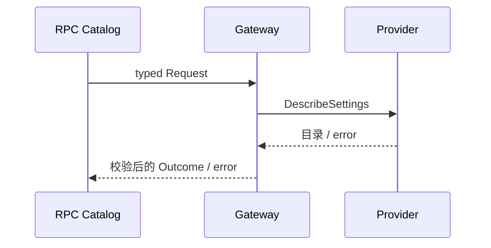

# Settings API

Gateway 消费 Describer 的脱敏目录，校验 namespace 唯一性、revision、applies 和 JSON，返回独立副本。API 不拥有配置文件、凭据或设置修改。

设计与迁移状态见 [API Proxy 设计](../../zh-CN/actor-design/38-api-proxy-module.md)，历史服务器验证入口见 [实施进度](../../zh-CN/08-implementation-progress.md)。

`api.go` 拥有方法契约和注册，`gateway.go` 拥有消费接口与视图映射，`gateway_test.go` 随业务迁移。根 API Proxy 组装并注入 Provider，模块依赖 rpc，不依赖根包或 GoAkt。没有独立后台任务，不增加 Actor。

未配置 Describer 时返回既有 internal RPC failure；技术错误使用 error，Context 原样传给 Provider。 Gateway 不释放共享 Provider；请求结束不改变部署配置。现有模块 race 测试与 vet 通过，生产 Host 组装仍待迁移。
