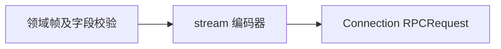

# API 流传输

当前实现帧编码、RPCID 生成和 Broker 订阅分发，设计见 [API Proxy](../../zh-CN/actor-design/38-api-proxy-module.md)，问题与验收见 [集成记录](../../zh-CN/actor-design/40-integration-findings.md)，整体进度见 [实施计划](../../zh-CN/actor-design/12-implementation-plan.md)。测试已覆盖真实 Broker 的待答重放、慢订阅隔离、批次原子发布与关闭；生产 WebSocket 接入仍待完成。

Frame 定义 Type/Validate；MuxFrame 与 HostFrame 标记所属下行通道，领域模块实现具体帧。Request 关联 RPCID 与具名帧，不保存业务对象。EncodeMuxFrame/EncodeHostFrame 校验并加入规范 type 字段，拒绝 nil、带 nil 指针的接口和非 JSON 对象；ErrorFrame 表达两条通道共享的错误协议。

编码器无状态，不管理业务取消、Session 日志、审批或提问终态。帧校验或编码失败返回 error，由调用方决定结束订阅及错误投影。

Broker 保存已编码帧和未解决交互，不保存业务对象。Subscription 读取每次连接的重放基线与实时批次；Release 仅释放连接，Close 关闭所有订阅。慢订阅缓冲区按批次计数，满载后只关闭该订阅。

Session 的日志基线衔接由 `session/events.Feed` 负责。Broker 不解析 Session 日志，也不决定审批或提问结果。
