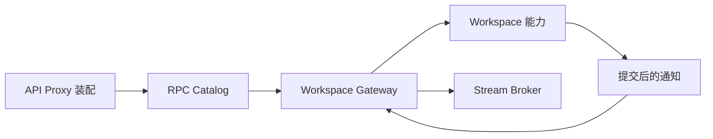

# Workspace API

本模块负责 `workspace.*` 请求解码、接口注册、响应映射和 Workspace 通知到 Host 下行帧的转换。
业务目录注册、命名冲突、排序、Session 归属及归档属于根 `workspace` 能力；存储不由 API 访问。

| 文件 | 职责 |
| --- | --- |
| `api.go` | 请求和响应契约、方法注册、协议错误 |
| `decode.go` | 请求字段校验 |
| `gateway.go` | 能力调用和协议映射 |
| `directory.go` | 消费方操作接口与一致快照 |
| `actor/directory.go` | Workspace Actor 客户端适配 |
| `view.go` | 浏览器工作区视图 |
| `notifications.go` | Workspace 的 Host 通知契约 |

图中通知为数据流，不代表业务对象反向持有 Gateway。
Gateway 不拥有 Workspace 生命周期；API Proxy 连接通知来源和 Broker，Workspace 生命周期由组合入口负责。
请求取消传到能力；失败映射为既有协议错误，持久化失败不能发布成功事实。

详细边界和迁移方案见 [API Proxy 设计](../../zh-CN/actor-design/38-api-proxy-module.md)。
集成验证见 [问题记录](../../zh-CN/actor-design/40-integration-findings.md)。

Gateway 不持有可变 Workspace 对象，不自行加锁检查名称。修改响应取自同一次 Actor 操作结果。
`actor/directory_test.go` 验证 Catalog、Gateway、真实 Workspace Actor 和 SQLite 下的并发重命名冲突；生产入口连接仍属于 API Proxy 总体迁移的待完成部分。
