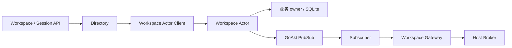

# Workspace API Actor 适配器

本包实现 API 消费者的领域接口，并接收 Workspace 提交后的通知。业务 owner 是 `workspace.DurableRegistry`；Actor 只负责消息调度。设计见 [API Proxy Actor 方案](../../../zh-CN/actor-design/38-api-proxy-module.md)，实现证据见 [集成记录](../../../zh-CN/actor-design/40-integration-findings.md) 与 [实施进度](../../../zh-CN/08-implementation-progress.md)。

| 对象 | 职责与依赖 |
| --- | --- |
| Directory | 持有 Workspace Actor Client，实现工作区操作与 Session 成员端口；不保留可变 Workspace 对象 |
| Subscriber | 订阅 workspace/notices，按邮箱顺序投递给 Notices；不决定通知内容 |
| Notices | 窄消费接口，由 API Gateway 实现，转换为 Host 帧并发布到有界内存 Broker |

`SpawnSubscriber` 等待订阅确认；组合根必须在成功后开放 HTTP。订阅后取消启动等待时，返回的 PID 仍需由组合根关闭。通知消费只执行内存帧发布，不执行阻塞 I/O；因此不加异步任务或自行维护队列。停止 PID 后 GoAkt 清除订阅，再由组合根关闭 API Broker。投递错误写入框架日志，不回滚已经提交的变更。重连通过 workspace.list 读取基线，通知不作为持久化日志。

`subscriber_test.go` 使用真实 SQLite、Workspace Actor、PubSub、Gateway 和 Broker 验证提交到下行，以及订阅停止和启动拒绝。此测试不代表最终 HTTP 生产入口已完成。
