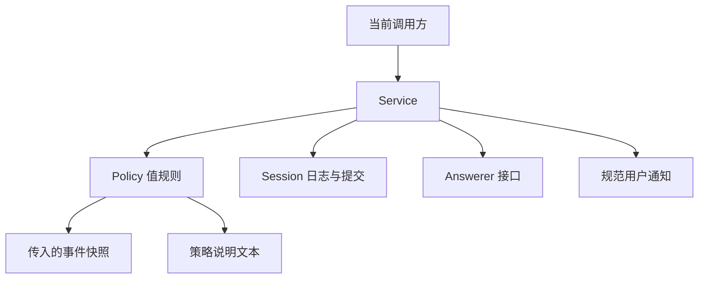
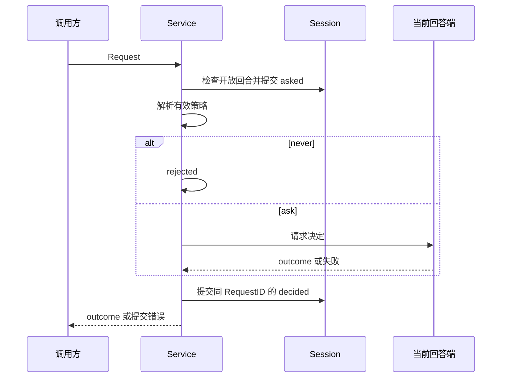

# Approval 审批策略与审计

`approval` 拥有审批策略、策略说明文本、策略变更及审批前后的审计语义。当前正在迁移到 Actor 架构，目标和未完成项见 [Approval 模块设计](../zh-CN/actor-design/20-approval-module.md)；[历史实施进度](../zh-CN/08-implementation-progress.md)不代表本次重构的完成度。

## 模块内职责划分

| 职责 | 文件 | 边界 |
| --- | --- | --- |
| 配置与业务契约 | [types.go](types.go) | 定义策略、结果、审计载荷和消费接口；严格解码、校验及按值继承配置 |
| 策略规则 | [policy.go](policy.go) | 从事件快照选择最后的策略覆盖，生成策略文本 |
| 策略变更用例 | [service_policy.go](service_policy.go) | 解析 Session 策略、提交用户或 delegation 策略变更、注入用户通知 |
| 审批用例 | [service.go](service.go) | 检查开放回合，先记录 asked，再调用回答端，最终记录配对 decided；通过 Answerer 请求回答 |

## 主要对象职责

| 对象 | 持有数据及职责 | 不负责什么 |
| --- | --- | --- |
| `Policy` | ask/never 值；`Resolve` 从事件快照取得有效值，`Text` 生成固定说明 | 不持有 Session、Prompt 或父 Service，不读取实时配置 |
| `ValidatedConfig` | 已验证的默认策略；`WithOverrides` 合并一次子配置 | 不保留调用方指针，不动态追踪父配置 |
| `Service` | 独立默认策略、Answerer 依赖及审批用例入口 | 不注册 Prompt 回调、不持有父策略 owner |
| `ApprovalTarget` | 当前审批用例所需的 Session 和用户消息注入接口 | 仍是旧进程内边界，不能冒充已实现的 Actor 消息契约 |
| `Question` / `Answerer` | 以审计 ID、SessionID 和工具信息请求回答 | 不传可变 Agent/Session，路由和等待资源属于适配端 |
| `Asked` / `Decided` | 同一个 RequestID 关联的持久化审计载荷 | 不拥有等待中的回答或消息传输 |
| `PolicyChanged` | Session 显式覆盖及可选 delegation 来源 | 不代表全局配置修改 |

## 依赖关系

生产代码不依赖 `systemprompt`。Session 提供日志和提交能力，agentmessage 提供规范用户通知；回答器通过 `Answerer.Answer(ctx, Question)` 访问。目标中 Interaction Actor 管理回答等待，框架负责任务和消息调度，Approval 保留策略与审计规则。

子 Agent 的创建方先取得父 Agent 有效配置值，再应用自定义覆盖。统一的 `New` 接收最终配置与 Answerer，创建后不再向父 Service 查询。Session 显式策略覆盖优先于默认值；最新策略事件损坏时返回错误，不能悄悄使用较早策略。

## 交互流程

没有开放回合时拒绝请求且不写审计；没有回答器或回答失败时按 unavailable 处理。Answerer 必须响应取消并清理等待资源后返回；Service 在回答返回后检查取消，晚到的允许不能覆盖取消。业务层不创建 goroutine 或等待队列。终态审计使用不继承调用取消的上下文提交，提交失败返回 error。

策略说明路径已拆为 `默认 Policy.Resolve(事件快照) → 有效 Policy.Text()`。Prompt 后续通过消息接收说明文本，不再回调 Approval。该 Actor 消息路径尚未接入，所以当前移除回调不等于生产 Prompt 的审批说明集成已完成。

## 验证与后续工作

`go test -race -count=1 ./approval/...` 和 `go vet ./approval/...` 通过。测试覆盖开放回合约束、审计关联、回答端错误与 panic、取消后晚到允许、策略通知幂等、delegation 来源及配置验证。Tools 生产构建仍通过，但旧调用方和其他模块测试还未迁移。

Approval 的 Plugin、Factory 和 Waterfall 类型已删除，不保留桥接。当前 Session 提交仍通过进程内接口执行；后续需接入 Interaction Actor 回答端、Session Actor 读取/提交和具名通知请求，验证完整取消与关闭协作。本包通过不代表整体 Agent Actor 重构完成。
